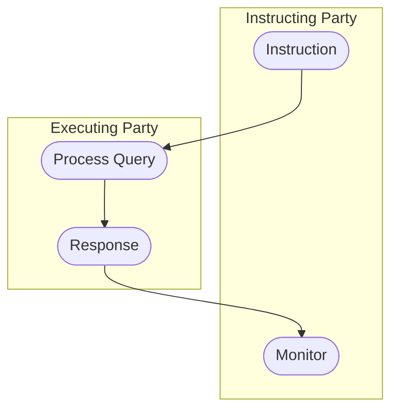

# Party query and response activity

[src-000368](../../../../../../../../evidence/omitted/e6546c5f64c53f963440988a.md) archive member `ISO20022_MDR_Target2Securities_August_2026_v1/Target2-Securities_PartyReferenceData_MessageSet/ISO20022_MDRPart1_Target2Securities_PartyReferenceData_2023_2024_v2.docx`; direct-body paragraph P145; Word-rendered file page 20. Standalone source artwork, additionally checked in Word-rendered file page 20.

[Complete original figure/context](../../../../../../../../evidence/omitted/46c5e5278923724be4fee90d.md) · [Business flow and conditional narrative](../../flows/flow-src-000368-p126-query.md)

## Source reconstruction

## Participants

- [Instructing Party](../../../../../../../../shared/reference/participants/participant-src-000368-instructing-party.md)
- [Executing / Servicing Party](../../../../../../../../shared/reference/participants/participant-src-000368-executing-servicing-party.md)

## Entities and relationships

| Source | Destination | Condition or exchange | Line notation |
| --- | --- | --- | --- |
| Instruction | Process Query | Unlabelled connector | --&gt; |
| Process Query | Response | Unlabelled connector | --&gt; |
| Response | Monitor | Unlabelled connector | --&gt; |

## Qualifications

- No start/final symbols or decision guards are drawn; none are added.

## Rendering and visual review

On 2026-11-09 this reconstruction parsed and rendered with Mermaid 12.3.0 / Mermaid browser API + Chromium 156.0.8078.81. The final rendering was directly compared with the complete source for labels, participants, connector endpoints/directions, decisions and line styles. All 47 Word pages were inspected for complete composition. **Visible-source fidelity: pass.** Source conflicts remain open where listed. Mermaid changes layout, actor glyphs, arrowhead styling and final-node centre fill; the original and textual relationship description preserve them.

[Rendered SVG](../../../../../../../../evidence/omitted/c003a0d59c93425928d54a81.md) · [Rendered PNG](../../../../../../../../evidence/omitted/12657f60012827c83e18a5dd.md) · [Hash-bound review evidence](../../../../../../../../tracking/reviews/t2s-party-reference-data.json)
