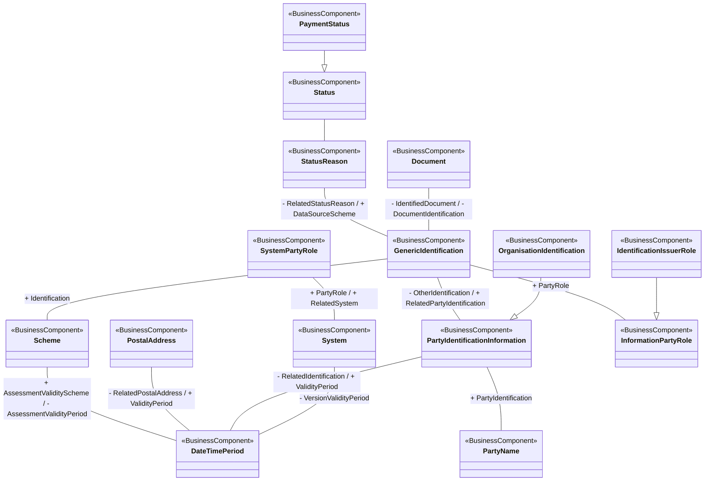

# T2S party reference-data conceptual model

[src-000370](../../../../../../../../../evidence/omitted/e6546c5f64c53f963440988a.md) archive member `ISO20022_MDR_Target2Securities_August_2026_v1/Target2-Securities_PartyReferenceData_MessageSet/ISO20022_MDRPart3_Target2Securities_PartyReferenceData_2023_2024_v1.xlsx`, PartyRefData!A1:AG34; xl/drawings/drawing2.xml; anchor 1. Original image SHA-256: 3eee08f0800ddc4798a2beaa625638fdfff2c8c0e44a1c15120e8bd36b47ebde.

[Original complete figure](../../../../../../../../../evidence/omitted/82297c4a335697d8cfbad052.md) · [Rendered Mermaid SVG](../../../../../../../../../evidence/omitted/af24c603fd0ee6f9598e8bac.md) · [Rendered Mermaid PNG](../../../../../../../../../evidence/omitted/c25a8282d3adb35480cc4260.md)

## Source reconstruction

## Entities and relationships

Generic identification relates document, status reason, scheme, party identification and information-party role. Scheme, postal address, party identification and system each have separate validity-period relationships. Organisation identification specializes party-identification information, and identification issuer specializes information-party role. PaymentStatus specializes Status. SystemPartyRole links the system; it is a contextual role rather than a fixed institution. The DataSourceScheme label belongs to StatusReason–GenericIdentification, as confirmed by rows 164 and 1525; the Scheme–GenericIdentification link carries Identification (row 159).

All 15 visible node occurrences and 15 relationship lines are retained. No numeric multiplicity is shown in this source view, so none is inferred. Printed package labels and absent labels are preserved in the entity register; the reconstruction adds no package boundaries absent from the source. Association labels retain literal +/− prefixes and combined end names. Their re-layout position is not additional navigability evidence. The native class inheritance marker is reserved for the source’s hollow-triangle generalizations. Source editor/navigation icons are omitted as interface decoration; no business entity or relationship is excluded.

## Complete relationship register

| From node | To node | Source relationship kind | Visible source label(s) | From-end multiplicity | To-end multiplicity |
| --- | --- | --- | --- | --- | --- |
| Status | StatusReason | association | (unlabelled in source) | not printed | not printed |
| PaymentStatus | Status | generalization: subtype to supertype | (unlabelled in source) | not printed | not printed |
| StatusReason | GenericIdentification | association | - RelatedStatusReason / + DataSourceScheme | not printed | not printed |
| GenericIdentification | Scheme | association | + Identification | not printed | not printed |
| Scheme | DateTimePeriod | association | + AssessmentValidityScheme / - AssessmentValidityPeriod | not printed | not printed |
| PostalAddress | DateTimePeriod | association | - RelatedPostalAddress / + ValidityPeriod | not printed | not printed |
| Document | GenericIdentification | association | - IdentifiedDocument / - DocumentIdentification | not printed | not printed |
| GenericIdentification | PartyIdentificationInformation | association | - OtherIdentification / + RelatedPartyIdentification | not printed | not printed |
| GenericIdentification | InformationPartyRole | association | + PartyRole | not printed | not printed |
| IdentificationIssuerRole | InformationPartyRole | generalization: subtype to supertype | (unlabelled in source) | not printed | not printed |
| OrganisationIdentification | PartyIdentificationInformation | generalization: subtype to supertype | (unlabelled in source) | not printed | not printed |
| PartyIdentificationInformation | PartyName | association | + PartyIdentification | not printed | not printed |
| PartyIdentificationInformation | DateTimePeriod | association | - RelatedIdentification / + ValidityPeriod | not printed | not printed |
| System | DateTimePeriod | association | - VersionValidityPeriod | not printed | not printed |
| SystemPartyRole | System | association | + PartyRole / + RelatedSystem | not printed | not printed |

## Entity definitions and precise workbook locators

| Visible label | Source package / stereotype | Definition evidence |
| --- | --- | --- |
| Status | DICO_BusinessComponents / BusinessComponent | [FullBusinessModel!A889:D889](../sheets/02-fullbusinessmodel/tbl-0006.md) — The status of an instruction, advice or request. |
| StatusReason | DICO_BusinessComponents / BusinessComponent | [FullBusinessModel!A1521:D1521](../sheets/02-fullbusinessmodel/tbl-0009.md) — Specifies the underlying reason for the status of an object. |
| PaymentStatus | DICO_BusinessComponents / BusinessComponent | [FullBusinessModel!A1845:D1845](../sheets/02-fullbusinessmodel/tbl-0011.md) — Specifies the status of a payment at a specified time. |
| Scheme | DICO_BusinessComponentsDataTypes / BusinessComponent | [FullBusinessModel!A678:D678](../sheets/02-fullbusinessmodel/tbl-0005.md) — Information regarding an enumerated code list and its owner. |
| PostalAddress | DICO_BusinessComponents / BusinessComponent | [FullBusinessModel!A441:D441](../sheets/02-fullbusinessmodel/tbl-0004.md) — Information that locates and identifies a specific address. |
| Document | DICO_BusinessComponents / BusinessComponent | [FullBusinessModel!A999:D999](../sheets/02-fullbusinessmodel/tbl-0006.md) — General information that unambiguously identifies a document, such as identification number and issue date time. |
| GenericIdentification | DICO_BusinessComponentsDataTypes / BusinessComponent | [FullBusinessModel!A152:D152](../sheets/02-fullbusinessmodel/tbl-0002.md) — Information related to a non-standardised identification, such as a proprietary party identification or account identification. |
| DateTimePeriod | DICO_BusinessComponentsDataTypes / BusinessComponent | [FullBusinessModel!A693:D693](../sheets/02-fullbusinessmodel/tbl-0005.md) — Time span defined by a start date and time, and an end date and time. |
| System | DICO_BusinessComponents / BusinessComponent | [FullBusinessModel!A1664:D1664](../sheets/02-fullbusinessmodel/tbl-0010.md) — Set of integrated applications that provides centralised services such as clearing, netting, reconciliation, trading and/or settlement. |
| SystemPartyRole | DICO_BusinessComponents / BusinessComponent | [FullBusinessModel!A1700:D1700](../sheets/02-fullbusinessmodel/tbl-0010.md) — Role played by a party in a system. |
| PartyIdentificationInformation | DICO_BusinessComponents / BusinessComponent | [FullBusinessModel!A476:D476](../sheets/02-fullbusinessmodel/tbl-0004.md) — Unique and unambiguous way to identify a party |
| PartyName | DICO_BusinessComponents / BusinessComponent | [FullBusinessModel!A420:D420](../sheets/02-fullbusinessmodel/tbl-0004.md) — Name by which a party is known and which is usually used to identify that party. |
| InformationPartyRole | DICO_BusinessComponents / BusinessComponent | [FullBusinessModel!A141:D141](../sheets/02-fullbusinessmodel/tbl-0002.md) — Role played by a party as source of information. |
| OrganisationIdentification | DICO_BusinessComponents / BusinessComponent | [FullBusinessModel!A490:D490](../sheets/02-fullbusinessmodel/tbl-0004.md) — Unique and unambiguous way to identify an organisation. |
| IdentificationIssuerRole | DICO_BusinessComponents / BusinessComponent | [FullBusinessModel!A148:D148](../sheets/02-fullbusinessmodel/tbl-0002.md) — Entity that assigns the identification. |

## Participant and flow navigation

This is a conceptual entity model, not a message exchange diagram. A business component or relationship label is not automatically a functional participant or institution. [Message-set participant references](../../../participants.md) and [Message-set business flows](../../../flows/index.md) provide the independently sourced actor/process context. These references are navigational; source figure associations do not establish message direction.

## Rendering and visual review

2026-11-09: Mermaid 12.3.0 parsed and rendered successfully with Mermaid browser API + Chromium 156.0.8078.81. Compared complete source artwork against the final rendered Mermaid PNG; all visible entities, relationship lines, literal labels, printed stereotypes and any package labels reconciled. Inheritance triangles, association arrows and composition diamonds preserve source endpoint direction. No absent numerical multiplicity is inferred. Magnified source and rows 159, 164 and 1525 resolve displaced DataSourceScheme label to status-reason association. [Renderer evidence](../../../../../../../../../work/t2s-workbook-models/render-report.json).

