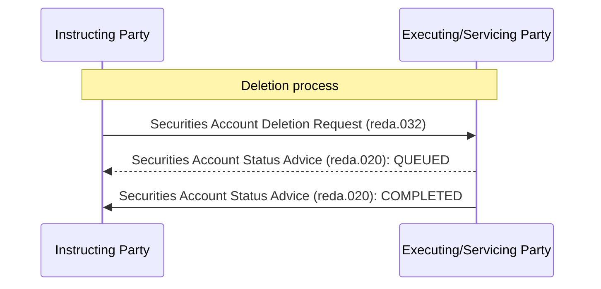

# Deletion confirmation sequence

[src-000371](../../../../../../../../evidence/omitted/e6546c5f64c53f963440988a.md) archive member `ISO20022_MDR_Target2Securities_August_2026_v1/Target2-Securities_SecuritiesAccountReferenceData_MessageSet/ISO20022_MDRPart1_Target2Securities_SecuritiesAccountReferenceData_v2.docx`; direct-body paragraph P262; Word-rendered file page27.

[Complete Word-composed source figure](../../../../../../../../evidence/omitted/f8434e3fddb0038b71c749c7.md) · [Business flow and conditional narrative](../../flows/flow-src-000371-p155-delete-securities-account.md)

## Source reconstruction

## Participants

- [Instructing Party](../../../../../../../../shared/reference/participants/participant-src-000371-instructing-party.md)
- [Executing/Servicing Party](../../../../../../../../shared/reference/participants/participant-src-000371-executing-servicing-party.md)

## Entities and relationships

| Source | Destination | Condition or exchange | Line notation |
| --- | --- | --- | --- |
| Instructing Party | Executing/Servicing Party | Securities Account Deletion Request (reda.032) | -&gt;&gt; |
| Executing/Servicing Party | Instructing Party | Securities Account Status Advice (reda.020): QUEUED | --&gt;&gt; |
| Executing/Servicing Party | Instructing Party | Securities Account Status Advice (reda.020): COMPLETED | -&gt;&gt; |

## Qualifications

- The source uses a dashed QUEUED return and solid final return, including rejection. Conditional queuing and initial-versus-post-queue rejection reasons remain in the narrative.
- Multiple rejection reasons may be reported. The picture does not make QUEUED mandatory for every final response.
- P264 describes an inactive party inside the securities-account deletion scenario. The literal source claim is retained under issue-000050, not generalized into a deletion precondition.

## Rendering and visual review

All labels, roles, endpoints, directions, line styles, decision guards and complete Word composition were directly compared with this final Mermaid12.3.0 rendering on 2026-11-09. All42 complete Word pages were inventoried. Native text supporting clipped labels is explicitly distinguished from visible artwork; source conflicts remain open where listed. Mermaid changes layout, actor pictograms and final-node centre fill; original artwork and textual descriptions retain those features.

[Rendered SVG](../../../../../../../../evidence/omitted/a266e01331a86fe2a1fcbdeb.md) · [Rendered PNG](../../../../../../../../evidence/omitted/98e9e3d0e0f14e68115fdc2c.md) · [Hash-bound review evidence](../../../../../../../../tracking/reviews/t2s-securities-account-reference-data.json)
