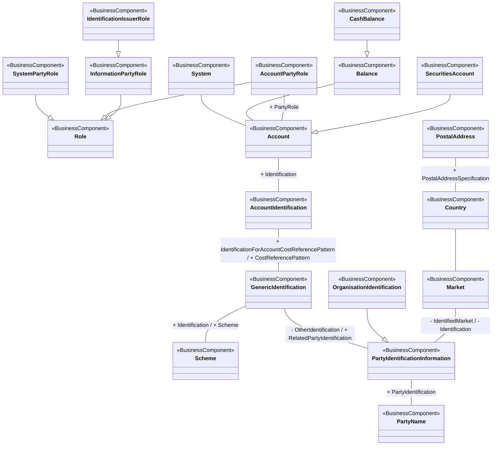

# T2S securities-account reference-data conceptual model

[src-000373](../../../../../../../../../evidence/omitted/e6546c5f64c53f963440988a.md) archive member `ISO20022_MDR_Target2Securities_August_2026_v1/Target2-Securities_SecuritiesAccountReferenceData_MessageSet/ISO20022_MDRPart3_Target2Securities_SecuritiesAccountReferenceData_v1.xlsx`, SecuritiesAccountRefData!A1:X41; xl/drawings/drawing2.xml; anchor 1. Original image SHA-256: efaf3ab35339ca981363e968c7021f2857f97edf28475fb9e39bdc553a7afb4a.

[Original complete figure](../../../../../../../../../evidence/omitted/7c0f6d5d53e376ff024990f7.md) · [Rendered Mermaid SVG](../../../../../../../../../evidence/omitted/c48520f79d7baf2ac4422d2f.md) · [Rendered Mermaid PNG](../../../../../../../../../evidence/omitted/29a925debd258986f938433e.md)

## Source reconstruction

## Entities and relationships

Account links system, balance, party role and account identification; SecuritiesAccount specializes Account and CashBalance specializes Balance. System, account and information party roles specialize Role; identification issuer specializes information-party role. Account identification uses a generic cost-reference pattern, and generic identification links scheme and party identification. Country links market and postal address. The source’s account role and account entity hierarchies remain separate.

All 19 visible node occurrences and 18 relationship lines are retained. No numeric multiplicity is shown in this source view, so none is inferred. Printed package labels and absent labels are preserved in the entity register; the reconstruction adds no package boundaries absent from the source. Association labels retain literal +/− prefixes and combined end names. Their re-layout position is not additional navigability evidence. The native class inheritance marker is reserved for the source’s hollow-triangle generalizations. Source editor/navigation icons are omitted as interface decoration; no business entity or relationship is excluded.

## Complete relationship register

| From node | To node | Source relationship kind | Visible source label(s) | From-end multiplicity | To-end multiplicity |
| --- | --- | --- | --- | --- | --- |
| System | Account | association | (unlabelled in source) | not printed | not printed |
| Balance | Account | association | (unlabelled in source) | not printed | not printed |
| CashBalance | Balance | generalization: subtype to supertype | (unlabelled in source) | not printed | not printed |
| SystemPartyRole | Role | generalization: subtype to supertype | (unlabelled in source) | not printed | not printed |
| AccountPartyRole | Role | generalization: subtype to supertype | (unlabelled in source) | not printed | not printed |
| InformationPartyRole | Role | generalization: subtype to supertype | (unlabelled in source) | not printed | not printed |
| IdentificationIssuerRole | InformationPartyRole | generalization: subtype to supertype | (unlabelled in source) | not printed | not printed |
| AccountPartyRole | Account | association | + PartyRole | not printed | not printed |
| SecuritiesAccount | Account | generalization: subtype to supertype | (unlabelled in source) | not printed | not printed |
| Account | AccountIdentification | association | + Identification | not printed | not printed |
| AccountIdentification | GenericIdentification | association | + IdentificationForAccountCostReferencePattern / + CostReferencePattern | not printed | not printed |
| GenericIdentification | Scheme | association | + Identification / + Scheme | not printed | not printed |
| GenericIdentification | PartyIdentificationInformation | association | - OtherIdentification / + RelatedPartyIdentification | not printed | not printed |
| PartyIdentificationInformation | PartyName | association | + PartyIdentification | not printed | not printed |
| OrganisationIdentification | PartyIdentificationInformation | generalization: subtype to supertype | (unlabelled in source) | not printed | not printed |
| Market | PartyIdentificationInformation | association | - IdentifiedMarket / - Identification | not printed | not printed |
| Country | Market | association | (unlabelled in source) | not printed | not printed |
| PostalAddress | Country | association | + PostalAddressSpecification | not printed | not printed |

## Entity definitions and precise workbook locators

| Visible label | Source package / stereotype | Definition evidence |
| --- | --- | --- |
| System | not printed in figure / BusinessComponent | [FullBusinessModel!A1664:D1664](../sheets/02-fullbusinessmodel/tbl-0010.md) — Set of integrated applications that provides centralised services such as clearing, netting, reconciliation, trading and/or settlement. |
| Balance | not printed in figure / BusinessComponent | [FullBusinessModel!A1780:D1780](../sheets/02-fullbusinessmodel/tbl-0010.md) — Numerical representation of the net increases and decreases in an account at a specific point in time. |
| CashBalance | not printed in figure / BusinessComponent | [FullBusinessModel!A1792:D1792](../sheets/02-fullbusinessmodel/tbl-0010.md) — Numerical representation of the net increases and decreases in an account at a specific point in time. A cash balance is calculated from a sum of cash credits minus a sum of cash debits. |
| Role | not printed in figure / BusinessComponent | [FullBusinessModel!A135:D135](../sheets/02-fullbusinessmodel/tbl-0002.md) — Role of a party in an activity. |
| SystemPartyRole | not printed in figure / BusinessComponent | [FullBusinessModel!A1700:D1700](../sheets/02-fullbusinessmodel/tbl-0010.md) — Role played by a party in a system. |
| AccountPartyRole | not printed in figure / BusinessComponent | [FullBusinessModel!A785:D785](../sheets/02-fullbusinessmodel/tbl-0005.md) — Role played by a party in the context of account operations. |
| InformationPartyRole | not printed in figure / BusinessComponent | [FullBusinessModel!A141:D141](../sheets/02-fullbusinessmodel/tbl-0002.md) — Role played by a party as source of information. |
| IdentificationIssuerRole | not printed in figure / BusinessComponent | [FullBusinessModel!A148:D148](../sheets/02-fullbusinessmodel/tbl-0002.md) — Entity that assigns the identification. |
| Account | not printed in figure / BusinessComponent | [FullBusinessModel!A521:D521](../sheets/02-fullbusinessmodel/tbl-0004.md) — Record of transactions in specific types of assets, maintained by a servicing party on behalf of one or more owning parties. Business relationship between an account servicer and one or more account owners. |
| SecuritiesAccount | not printed in figure / BusinessComponent | [FullBusinessModel!A764:D764](../sheets/02-fullbusinessmodel/tbl-0005.md) — Account to or from which a securities entry is made. |
| AccountIdentification | not printed in figure / BusinessComponent | [FullBusinessModel!A585:D585](../sheets/02-fullbusinessmodel/tbl-0004.md) — Unique identifier of an account, as assigned by the account servicer. |
| GenericIdentification | not printed in figure / BusinessComponent | [FullBusinessModel!A152:D152](../sheets/02-fullbusinessmodel/tbl-0002.md) — Information related to a non-standardised identification, such as a proprietary party identification or account identification. |
| Scheme | not printed in figure / BusinessComponent | [FullBusinessModel!A678:D678](../sheets/02-fullbusinessmodel/tbl-0005.md) — Information regarding an enumerated code list and its owner. |
| PostalAddress | not printed in figure / BusinessComponent | [FullBusinessModel!A441:D441](../sheets/02-fullbusinessmodel/tbl-0004.md) — Information that locates and identifies a specific address. |
| Country | not printed in figure / BusinessComponent | [FullBusinessModel!A203:D203](../sheets/02-fullbusinessmodel/tbl-0003.md) — Nation with its own government. |
| Market | not printed in figure / BusinessComponent | [FullBusinessModel!A5007:D5007](../sheets/02-fullbusinessmodel/tbl-0027.md) — Context or geographic environment in which trading parties execute trades. |
| PartyIdentificationInformation | not printed in figure / BusinessComponent | [FullBusinessModel!A476:D476](../sheets/02-fullbusinessmodel/tbl-0004.md) — Unique and unambiguous way to identify a party |
| PartyName | not printed in figure / BusinessComponent | [FullBusinessModel!A420:D420](../sheets/02-fullbusinessmodel/tbl-0004.md) — Name by which a party is known and which is usually used to identify that party. |
| OrganisationIdentification | not printed in figure / BusinessComponent | [FullBusinessModel!A490:D490](../sheets/02-fullbusinessmodel/tbl-0004.md) — Unique and unambiguous way to identify an organisation. |

## Participant and flow navigation

This is a conceptual entity model, not a message exchange diagram. A business component or relationship label is not automatically a functional participant or institution. [Message-set participant references](../../../participants.md) and [Message-set business flows](../../../flows/index.md) provide the independently sourced actor/process context. These references are navigational; source figure associations do not establish message direction.

## Rendering and visual review

2026-11-09: Mermaid 12.3.0 parsed and rendered successfully with Mermaid browser API + Chromium 156.0.8078.81. Compared complete source artwork against the final rendered Mermaid PNG; all visible entities, relationship lines, literal labels, printed stereotypes and any package labels reconciled. Inheritance triangles, association arrows and composition diamonds preserve source endpoint direction. No absent numerical multiplicity is inferred. [Renderer evidence](../../../../../../../../../work/t2s-workbook-models/render-report.json).

