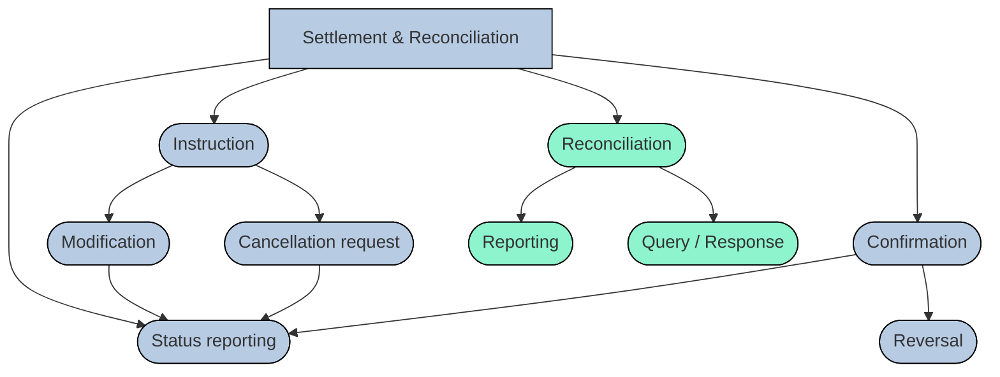

# Securities reporting business-process overview

## Source evidence

[src-000374](../../../../../../../../evidence/omitted/e6546c5f64c53f963440988a.md) archive member `ISO20022_MDR_Target2Securities_August_2026_v1/Target2-Securities_SecuritiesAndPenaltyReporting_MessageSet/ISO20022_MDRPart1_Target2Securities_SecuritiesAndPenaltyReporting_v2.docx`; BusinessProcess Description; direct-body paragraph P223; word/media/image7.png. [Unchanged original figure](../../../../../../../../evidence/omitted/8f1400e21c32768faf81e1a7.md).

[Complete source figure](../../../../../../../../evidence/omitted/8f1400e21c32768faf81e1a7.md)

## Mermaid reconstruction

## Roles, activities and alternatives

The source overview links Settlement & Reconciliation to Instruction, Status reporting, Confirmation and Reconciliation. Instruction branches to Modification and Cancellation request, both pointing to Status reporting. Confirmation points to Status reporting and Reversal. Reconciliation points to Reporting and Query/Response; these three nodes alone are green. Cancellation requests and reversals remain distinct contextual processes; the diagram does not assign their messages to the five reporting definitions.

| Source-scoped role | Canonical reference |
| --- | --- |
| instructing party | [instructing party](../../../../../../../../shared/reference/participants/participant-src-000374-instructing-party.md) |
| executing servicing party | [executing servicing party](../../../../../../../../shared/reference/participants/participant-src-000374-executing-servicing-party.md) |
| settlement infrastructure | [settlement infrastructure](../../../../../../../../shared/reference/participants/participant-src-000374-settlement-infrastructure.md) |
| central securities depositories csd | [central securities depositories csd](../../../../../../../../shared/reference/participants/participant-src-000374-central-securities-depositories-csd.md) |
| direct connected participant dcp | [direct connected participant dcp](../../../../../../../../shared/reference/participants/participant-src-000374-direct-connected-participant-dcp.md) |

Source responsibilities/conditions: [T8](../../documents/src-000374/tables/tbl-0008.md).

## Exact message evidence

| Source family | Exact supplied definition | Companion MDR Part2 locator |
| --- | --- | --- |
| semt.025 | [semt.025.001.01](../../../../../messages/semt.025.001.01/index.md) | src-000375; 2 semt.025.001.01 SecuritiesAccountPositionQueryV01; file pages5-12 |
| semt.026 | [semt.026.001.01](../../../../../messages/semt.026.001.01/index.md) | src-000375; 3 semt.026.001.01 SecuritiesSettlementTransactionQueryV01; file pages13-76 |
| semt.027 | [semt.027.001.01](../../../../../messages/semt.027.001.01/index.md) | src-000375; 4 semt.027.001.01 SecuritiesSettlementTransactionQueryResponseV01; file pages77-165 |
| semt.040 | [semt.040.001.01](../../../../../messages/semt.040.001.01/index.md) | src-000375; 5 semt.040.001.01 SecuritiesAccountPositionResponseV01; file pages166-178 |
| semt.044 | [semt.044.001.01](../../../../../messages/semt.044.001.01/index.md) | src-000375; 6 semt.044.001.01 SecuritiesTransactionPenaltiesReportV01; file pages179-245 |

Reusable flows: [Query Report Process](../../flows/flow-src-000374-p224-query-report-process.md).

## Review evidence

Compared complete source pages and rendered reconstruction for actor labels/stereotypes, lanes, message order/direction, all choice labels, optional/error outcomes, black join bar and green reporting context. No query request is invented for the scheduled penalty-report activity; exact missing error-family versions remain explicit. Rendering and visual comparison passed2026-11-09 Europe/Warsaw. [Compared Mermaid12.3.0 rendering](../../../../../../../../evidence/omitted/76b156458aeb86a8e3755131.md). Source: [Word17](../../../../../../../../evidence/omitted/aa2d4c35417484240a3c186f.md).
