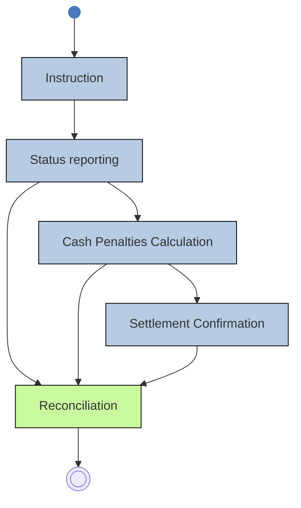

# Reconciliation across status, penalty and settlement information

## Source evidence

[src-000374](../../../../../../../../evidence/omitted/e6546c5f64c53f963440988a.md) archive member `ISO20022_MDR_Target2Securities_August_2026_v1/Target2-Securities_SecuritiesAndPenaltyReporting_MessageSet/ISO20022_MDRPart1_Target2Securities_SecuritiesAndPenaltyReporting_v2.docx`; BusinessTransactions; direct-body paragraph P253; word/media/image15.png. [Unchanged original figure](../../../../../../../../evidence/omitted/ae97abfa2da4f476516bb14c.md).

[Complete source figure](../../../../../../../../evidence/omitted/ae97abfa2da4f476516bb14c.md)

## Mermaid reconstruction

## Roles, activities and alternatives

The context diagram starts with Instruction then Status reporting, Cash Penalties Calculation and Settlement Confirmation. Each of the last three information stages feeds Reconciliation, the only green node, which leads to the final symbol. This is a high-level business context, not a claim that every instruction incurs a penalty or that each arrow is a separate XML message. P250 explicitly includes pending and posted transactions and computed penalties if any.

| Source-scoped role | Canonical reference |
| --- | --- |
| instructing party | [instructing party](../../../../../../../../shared/reference/participants/participant-src-000374-instructing-party.md) |
| executing servicing party | [executing servicing party](../../../../../../../../shared/reference/participants/participant-src-000374-executing-servicing-party.md) |
| account owner | [account owner](../../../../../../../../shared/reference/participants/participant-src-000374-account-owner.md) |
| account servicer | [account servicer](../../../../../../../../shared/reference/participants/participant-src-000374-account-servicer.md) |
| central securities depositories csd | [central securities depositories csd](../../../../../../../../shared/reference/participants/participant-src-000374-central-securities-depositories-csd.md) |
| csd participant | [csd participant](../../../../../../../../shared/reference/participants/participant-src-000374-csd-participant.md) |
| penalty debtor | [penalty debtor](../../../../../../../../shared/reference/participants/participant-src-000374-penalty-debtor.md) |
| penalty creditor | [penalty creditor](../../../../../../../../shared/reference/participants/participant-src-000374-penalty-creditor.md) |

Source responsibilities/conditions: [T8](../../documents/src-000374/tables/tbl-0008.md).

## Exact message evidence

| Source family | Exact supplied definition | Companion MDR Part2 locator |
| --- | --- | --- |
| semt.025 | [semt.025.001.01](../../../../../messages/semt.025.001.01/index.md) | src-000375; 2 semt.025.001.01 SecuritiesAccountPositionQueryV01; file pages5-12 |
| semt.026 | [semt.026.001.01](../../../../../messages/semt.026.001.01/index.md) | src-000375; 3 semt.026.001.01 SecuritiesSettlementTransactionQueryV01; file pages13-76 |
| semt.027 | [semt.027.001.01](../../../../../messages/semt.027.001.01/index.md) | src-000375; 4 semt.027.001.01 SecuritiesSettlementTransactionQueryResponseV01; file pages77-165 |
| semt.040 | [semt.040.001.01](../../../../../messages/semt.040.001.01/index.md) | src-000375; 5 semt.040.001.01 SecuritiesAccountPositionResponseV01; file pages166-178 |
| semt.044 | [semt.044.001.01](../../../../../messages/semt.044.001.01/index.md) | src-000375; 6 semt.044.001.01 SecuritiesTransactionPenaltiesReportV01; file pages179-245 |

Reusable flows: [Query Report Process](../../flows/flow-src-000374-p224-query-report-process.md).

## Review evidence

Compared complete source pages and rendered reconstruction for actor labels/stereotypes, lanes, message order/direction, all choice labels, optional/error outcomes, black join bar and green reporting context. No query request is invented for the scheduled penalty-report activity; exact missing error-family versions remain explicit. Rendering and visual comparison passed2026-11-09 Europe/Warsaw. [Compared Mermaid12.3.0 rendering](../../../../../../../../evidence/omitted/80d8e4871446b9bd964d96e5.md). Source: [Word24](../../../../../../../../evidence/omitted/291ef6eca3ae18d7b1e61c04.md).
