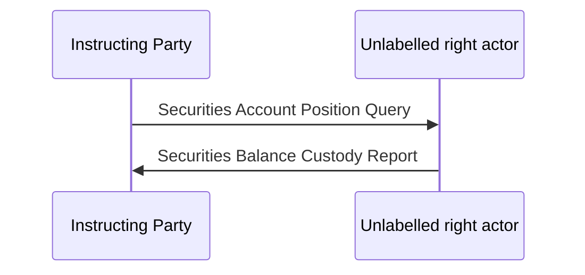

# Off-page legacy position-query canvas

[src-000374](../../../../../../../../evidence/omitted/e6546c5f64c53f963440988a.md) archive member `ISO20022_MDR_Target2Securities_August_2026_v1/Target2-Securities_SecuritiesAndPenaltyReporting_MessageSet/ISO20022_MDRPart1_Target2Securities_SecuritiesAndPenaltyReporting_v2.docx`; P55 contains two matching Word canvases in addition to current visible figure1. Each has DrawingML and fallback branches; those branches are alternate representations, not four separate figures. Both outer anchors lie5480050EMU below the line and are absent from complete Word6.

Original canvas contents were isolated in working DOCX copies and only outer page offsets moved to the margin. Shape contents, connectors, text, colors and original media stayed unchanged. [Exact derivation](../../../../../../../../work/documents/src-000374/native-canvases/derivation.json); [Original paragraph XML extraction](../../../../../../../../work/documents/src-000374/p55-drawings.xml).

[Complete recovered source canvas](../../../../../../../../evidence/omitted/a9476e33245e0668ed5e29ca.md)

[Second equivalent occurrence](../../../../../../../../evidence/omitted/c2a71dc62282e5a2f16b1cf9.md). The left actor is Instructing Party; the right actor is unlabelled. Green query points right; black custody report points left. No extra message identifier or right-party role is inferred.

The current in-page figure is [position query/response](fig-0001.md). The legacy label remains separate evidence and is not silently substituted for semt.040.

## Actual review evidence

Compared all source labels, endpoints, direction and shapes with [Mermaid12.3.0 reconstruction](../../../../../../../../evidence/omitted/8213adf0a2f855de4941dff0.md) on2026-11-09. Both complete isolated original canvas crops have identical SHA256 5dff66065793c381d85245ee5cb3f667fc4cdcf9a0432f2266a3b02cb897eeff. The right actor remains unlabelled and the legacy custody-response label remains unresolved; no exact message is assigned.
