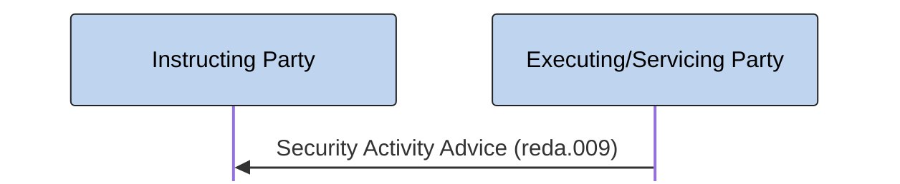

# Unsolicited security activity advice

[src-000377](../../../../../../../../evidence/omitted/e6546c5f64c53f963440988a.md) archive member `ISO20022_MDR_Target2Securities_August_2026_v1/Target2-Securities_SecuritiesReferenceData_MessageSet/ISO20022_MDRPart1_Target2Securities_SecuritiesReferenceData_v2.docx`; direct-body paragraph P313; BusinessTransactions / Statement Process; rendered Word file page 29.

[Complete source figure / composite](../../../../../../../../evidence/omitted/5adb40393c0c4f365f379372.md) · [Whole Word-page context](../../../../../../../../evidence/omitted/5adb40393c0c4f365f379372.md)

## Mermaid reconstruction

## Participants and responsibilities

- [Instructing Party](../../../../../../../../shared/reference/participants/participant-src-000377-instructing-party.md)
- [Executing/Servicing Party](../../../../../../../../shared/reference/participants/participant-src-000377-executing-servicing-party.md)
- [Recipient Party](../../../../../../../../shared/reference/participants/participant-src-000377-recipient-party.md)

| Step | Sender | Receiver | Literal source message | Line |
| --- | --- | --- | --- | --- |
| 1 | Executing/Servicing Party | Instructing Party | Security Activity Advice (reda.009) | solid |

[Reusable flow, conditions and source narrative](../../flows/flow-src-000377-p312-statement-process.md)

## Source tables and limitations

- [T12](../../documents/src-000377/tables/tbl-0012.md)
- [T18](../../documents/src-000377/tables/tbl-0018.md)

- The source statement covers securities-reference-data changes during the business day and is sent unilaterally in an unsolicited manner (P315–P316). T12 requires a standing instruction; T18 says an initiating instruction is outside the message scope.
- Source377 is June2021; companion source378 is March2024. Matching full identifiers do not erase the publication difference (issue-000010).
- The original figure is assembled from native Word connector/text objects and institutional pictograms. The retained full Word page is the complete composite; its pictograms alone are not counted as diagrams.
- Native Mermaid participant boxes replace the institutional drawings; sender and receiver roles, solid/dashed lines and visible arrow direction remain explicit. No institution is equated with a functional role.

[issue-000010 publication difference; issue-000051 copied role/restriction wording](../../../../../../../../tracking/issues.md)

<!-- SECURITIES-REFERENCE-DIAGRAM-REVIEW-START -->
## Completed rendering and visual review

Mermaid browser API + Chromium 156.0.8078.81; Mermaid 12.3.0; 2026-11-09: parse/render **pass**. [Rendered SVG](../../../../../../../../evidence/omitted/eee442eb22ff1483d97f8ac4.md) · [Rendered PNG](../../../../../../../../evidence/omitted/65f7ac6e6321a92904d46aee.md).

Each original figure and final Mermaid render was directly compared for all labels, endpoints, arrow direction, solid/dashed connectors, decision branches and lane/role boundaries. Native composites12–20 were inspected as full Word pages; figures1–2 received explicit high-priority role/process review. Extraction-fidelity comparison **pass with the page’s explicit notation limitations**. Whole Word page 29 was also inspected. This does not resolve source ambiguities or claim review of hidden native-application layers.

[Hash-bound review evidence](../../../../../../../../tracking/reviews/securities-reference-diagrams.json).

<!-- SECURITIES-REFERENCE-DIAGRAM-REVIEW-END -->
