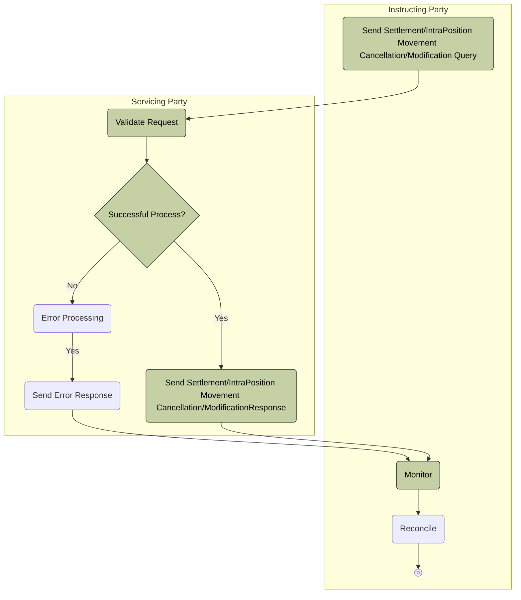

# Pull-mode cancellation or modification query processing

[src-000380](../../../../../../../../evidence/omitted/e6546c5f64c53f963440988a.md) archive member `ISO20022_MDR_Target2Securities_August_2026_v1/Target2-Securities_SettlementRestrictions_MessageSet/ISO20022_MDRPart1_Target2Securities_SettlementRestrictions_v2.docx`; direct-body paragraph P269; Description of BusinessActivities / Securities Transaction Cancellation/Modification Request Query/Report / Pull mode; rendered Word file page 20.

[Complete original figure / composite](../../../../../../../../evidence/omitted/a51fd4f65e16b3a880935158.md) · [Whole Word-page context](../../../../../../../../evidence/omitted/97a44811fd749747e3362a0f.md)

## Mermaid reconstruction

## Participants and source relationships

- [Instructing Party](../../../../../../../../shared/reference/participants/participant-src-000380-instructing-party.md)
- [Executing / Servicing Party](../../../../../../../../shared/reference/participants/participant-src-000380-executing-servicing-party.md)
- [Servicing Party](../../../../../../../../shared/reference/participants/participant-src-000380-servicing-party.md)

The transcription retains all source node labels, visible endpoints, arrow directions, process/lane boundaries and decision labels. Activity responsibilities are defined separately by the source tables; the scope diagrams do not establish a runtime message order.

[Reusable flow, triggers, conditions and alternatives](../../flows/flow-src-000380-p268-pull-mode.md)

## Source tables and limitations

- [T8](../../documents/src-000380/tables/tbl-0008.md)
- [T12](../../documents/src-000380/tables/tbl-0012.md)

- The source has no start glyph and places a literal Yes label between Error Processing and Send Error Response; this is preserved without inventing another decision. The successful source node says Response, while the activity table calls the output Report.
- T12 applies technical and business validation and operational-error processing to queries about earlier cancellation/modification requests. It does not itself cancel or modify the underlying instruction. Business-error message family sese.022 is cited in P291/P302 without an exact version.

[issue-000056: source wording remains visible](../../../../../../../../tracking/issues.md)

<!-- SETTLEMENT-RESTRICTIONS-DIAGRAM-REVIEW-START -->
## Completed rendering and visual review

Mermaid browser API + Chromium 156.0.8078.81; Mermaid 12.3.0; 2026-11-09: parse/render **pass**. [Rendered SVG](../../../../../../../../evidence/omitted/9039fd95aa1e45f5839a0a46.md) · [Rendered PNG](../../../../../../../../evidence/omitted/3b57d8fed26b533285601bda.md).

All ten original figures and final Mermaid renderings were directly compared for labels, endpoints, message direction, solid/dashed connectors, decision branches and scoped roles. Figures2–3 were checked as complete native Word composites on pages7–8. Role/process scope figure4 and native use-case figure5 received explicit label/edge review. Source colors, pictograms and bar geometry have the documented notation adaptations. Extraction-fidelity comparison **pass with the page’s explicit notation limitations**. Whole Word page 20 was also inspected. This does not resolve source ambiguities or claim review of hidden native-application layers.

[Hash-bound review evidence](../../../../../../../../tracking/reviews/settlement-restrictions-diagrams.json).

<!-- SETTLEMENT-RESTRICTIONS-DIAGRAM-REVIEW-END -->
