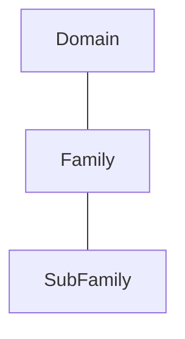

# Domain, family and sub-family hierarchy

Source: [src-000003](../../../../../../../../evidence/omitted/1dcbe16191b6c8898a146b17.md). T1 row 1 cell 2 composite; /w:document/w:body/w:tbl[1]; rendered file/printed page 6.

[Complete rendered source figure (300 dpi)](../../../../../../../../evidence/omitted/d90e5b832dbe8c05bbf2ce23.md) · [Full rendered source page](../../../../../../../../evidence/omitted/f78d21f6d5a9a078efa49ad3.md) · [Mermaid SVG](../../../../../../../../evidence/omitted/63ffe81efe2db2b5df31fc21.md) · [Mermaid preview](../../../../../../../../evidence/omitted/503b45a494ab10992e18ba6b.md)

## Entities and relationships

This is a code taxonomy or data-structure view. It has no business participants, process initiator, message sender/receiver or activity sequence. The publication reporting context is documented separately.

| Source label | Node |
| --- | --- |
| Domain | D |
| Family | F |
| SubFamily | S |

| Parent/container | Child/member | Source connector evidence |
| --- | --- | --- |
| Domain | Family | visually transcribed; T1 row 1 cell 2 composite; /w:document/w:body/w:tbl[1] |
| Family | SubFamily | visually transcribed; T1 row 1 cell 2 composite; /w:document/w:body/w:tbl[1] |

## Representation limits

- The original is a three-level pyramid assembled from fourteen EMF pieces and shape text. Word renders its front faces dark; the visible level labels agree with the adjacent T1 definitions. The diagram preserves the hierarchy in readable boxes and does not reproduce the three-dimensional shading. AlternateContent fallback also contains Product family/Product sub-family labels; the complete original parts remain retained.

## Review evidence

Compared complete composite pyramid on Word-PDF page 6, its shape-text source and adjacent T1 definitions with the Mermaid hierarchy; preserved all three visible level labels and retained original dark-shaded rendering. Completed 2026-11-09. Rendered with Mermaid 12.3.0 and Mermaid browser API + Chromium 156.0.8078.81. Source checksum was verified against the register.
