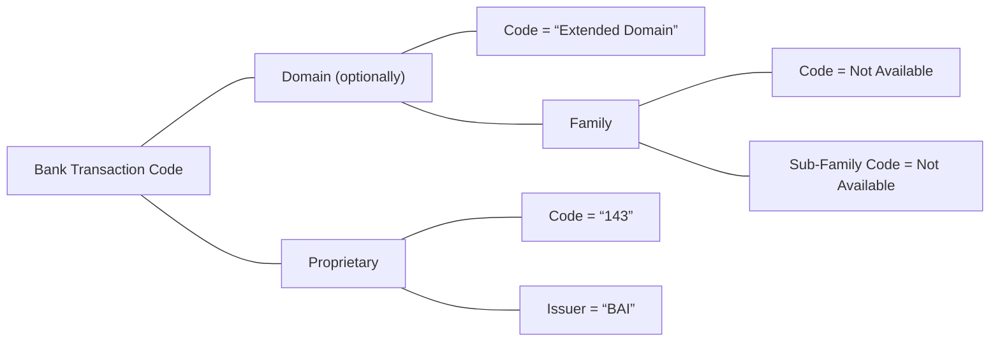

# Proprietary component example

Source: [src-000003](../../../../../../../../evidence/omitted/1dcbe16191b6c8898a146b17.md). direct-body paragraph P127; rendered file/printed page 9.

[Complete rendered source figure (300 dpi)](../../../../../../../../evidence/omitted/7b4eb41c0c0645f55d2cd5bf.md) · [Full rendered source page](../../../../../../../../evidence/omitted/f75bbda2e395dee27ea0e06c.md) · [Mermaid SVG](../../../../../../../../evidence/omitted/34426a01af2a78a290457317.md) · [Mermaid preview](../../../../../../../../evidence/omitted/11c851a19f47587d57b1385d.md)

Exact SmartArt evidence: [word/diagrams/data1.xml](../smartart/data1.md). All data, drawing, layout, style and color parts are retained.

## Entities and relationships

This is a code taxonomy or data-structure view. It has no business participants, process initiator, message sender/receiver or activity sequence. The publication reporting context is documented separately.

| Source label | Node |
| --- | --- |
| Bank Transaction Code | N1 |
| Domain (optionally) | N2 |
| Code = “Extended Domain” | N3 |
| Family | N4 |
| Code = Not Available | N5 |
| Sub-Family Code = Not Available | N6 |
| Proprietary | N7 |
| Code = “143” | N8 |
| Issuer = “BAI” | N9 |

| Parent/container | Child/member | Source connector evidence |
| --- | --- | --- |
| Bank Transaction Code | Domain (optionally) | /dgm:dataModel/dgm:cxnLst/dgm:cxn[34] |
| Bank Transaction Code | Proprietary | /dgm:dataModel/dgm:cxnLst/dgm:cxn[31] |
| Domain (optionally) | Code = “Extended Domain” | /dgm:dataModel/dgm:cxnLst/dgm:cxn[12] |
| Domain (optionally) | Family | /dgm:dataModel/dgm:cxnLst/dgm:cxn[9] |
| Family | Code = Not Available | /dgm:dataModel/dgm:cxnLst/dgm:cxn[21] |
| Family | Sub-Family Code = Not Available | /dgm:dataModel/dgm:cxnLst/dgm:cxn[35] |
| Proprietary | Code = “143” | /dgm:dataModel/dgm:cxnLst/dgm:cxn[36] |
| Proprietary | Issuer = “BAI” | /dgm:dataModel/dgm:cxnLst/dgm:cxn[26] |

## Representation limits

- The source uses connector lines without arrowheads. Mermaid lines represent the displayed taxonomy/structure, not message directions or a time sequence. Layout and box colors differ to keep labels readable; generic-family emphasis is preserved.
- The example retains the supplied proprietary code 143 and issuer BAI. It does not define that code or endorse a newer proprietary publication.

## Review evidence

Compared the complete Word-PDF source page and the rendered Mermaid image. Checked each label, parent-child connector, hierarchy boundary and generic-family emphasis. SmartArt source nodes/connections provide exact text and endpoint evidence; no hidden node text is inferred. Completed 2026-11-09. Rendered with Mermaid 12.3.0 and Mermaid browser API + Chromium 156.0.8078.81. Source checksum was verified against the register.
