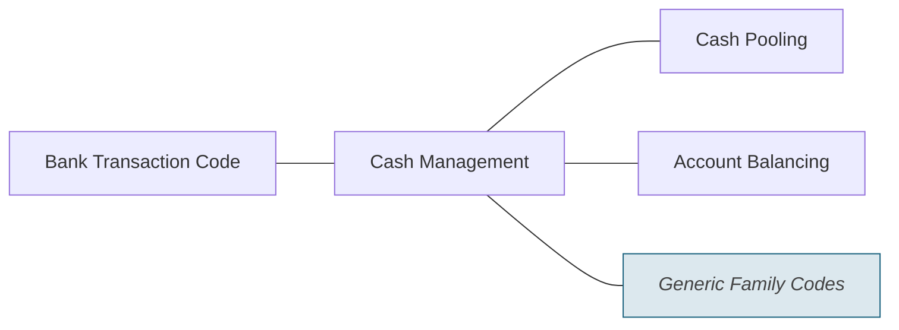

# Cash Management families

Source: [src-000003](../../../../../../../../evidence/omitted/1dcbe16191b6c8898a146b17.md). direct-body paragraph P226; rendered file/printed page 37.

[Complete rendered source figure (300 dpi)](../../../../../../../../evidence/omitted/9b4db0ef910ec52fedf67b77.md) · [Full rendered source page](../../../../../../../../evidence/omitted/16ba3cd7b44195fc49693f26.md) · [Mermaid SVG](../../../../../../../../evidence/omitted/4668e00bf585e3e74d0063f2.md) · [Mermaid preview](../../../../../../../../evidence/omitted/6c5045af6832f1a05032bd1e.md)

Exact SmartArt evidence: [word/diagrams/data4.xml](../smartart/data4.md). All data, drawing, layout, style and color parts are retained.

## Entities and relationships

This is a code taxonomy or data-structure view. It has no business participants, process initiator, message sender/receiver or activity sequence. The publication reporting context is documented separately.

| Source label | Node |
| --- | --- |
| Bank Transaction Code | N1 |
| Cash Management | N2 |
| Cash Pooling | N3 |
| Account Balancing | N4 |
| Generic Family Codes | N5 |

| Parent/container | Child/member | Source connector evidence |
| --- | --- | --- |
| Bank Transaction Code | Cash Management | /dgm:dataModel/dgm:cxnLst/dgm:cxn[7] |
| Cash Management | Cash Pooling | /dgm:dataModel/dgm:cxnLst/dgm:cxn[16] |
| Cash Management | Account Balancing | /dgm:dataModel/dgm:cxnLst/dgm:cxn[2] |
| Cash Management | Generic Family Codes | /dgm:dataModel/dgm:cxnLst/dgm:cxn[11] |

## Representation limits

- The source uses connector lines without arrowheads. Mermaid lines represent the displayed taxonomy/structure, not message directions or a time sequence. Layout and box colors differ to keep labels readable; generic-family emphasis is preserved.

## Review evidence

Compared the complete Word-PDF source page and the rendered Mermaid image. Checked each label, parent-child connector, hierarchy boundary and generic-family emphasis. SmartArt source nodes/connections provide exact text and endpoint evidence; no hidden node text is inferred. Completed 2026-11-09. Rendered with Mermaid 12.3.0 and Mermaid browser API + Chromium 156.0.8078.81. Source checksum was verified against the register.
