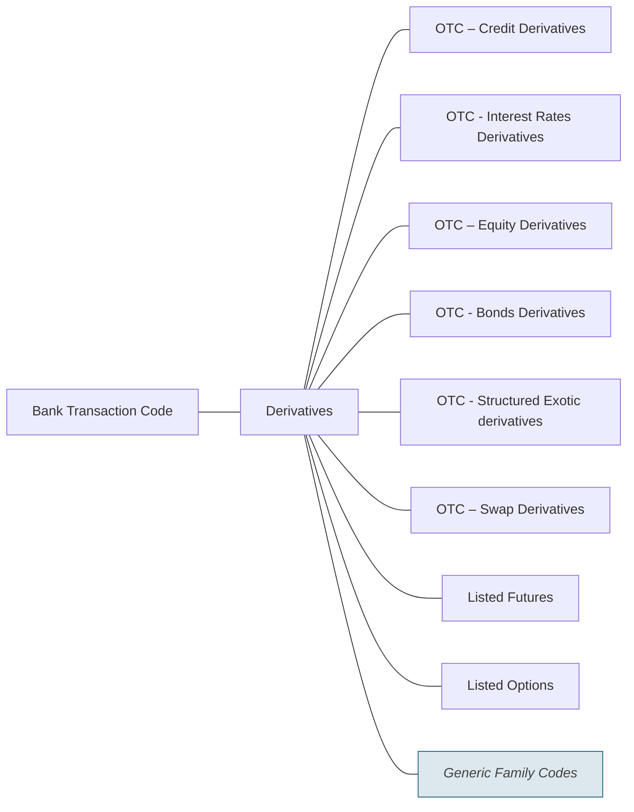

# Derivatives families

Source: [src-000003](../../../../../../../../evidence/omitted/1dcbe16191b6c8898a146b17.md). direct-body paragraph P240; rendered file/printed page 39.

[Complete rendered source figure (300 dpi)](../../../../../../../../evidence/omitted/c548346c9e99406aa3ddbf61.md) · [Full rendered source page](../../../../../../../../evidence/omitted/894cb43a22f4f72599dcd266.md) · [Mermaid SVG](../../../../../../../../evidence/omitted/2224e9541994319396d07f94.md) · [Mermaid preview](../../../../../../../../evidence/omitted/6fe39c5614af85d8c026ae65.md)

Exact SmartArt evidence: [word/diagrams/data5.xml](../smartart/data5.md). All data, drawing, layout, style and color parts are retained.

## Entities and relationships

This is a code taxonomy or data-structure view. It has no business participants, process initiator, message sender/receiver or activity sequence. The publication reporting context is documented separately.

| Source label | Node |
| --- | --- |
| Bank Transaction Code | N1 |
| Derivatives | N2 |
| OTC – Credit Derivatives | N3 |
| OTC - Interest Rates Derivatives | N4 |
| OTC – Equity Derivatives | N5 |
| OTC - Bonds Derivatives | N6 |
| OTC - Structured Exotic derivatives | N7 |
| OTC – Swap Derivatives | N8 |
| Listed Futures | N9 |
| Listed Options | N10 |
| Generic Family Codes | N11 |

| Parent/container | Child/member | Source connector evidence |
| --- | --- | --- |
| Bank Transaction Code | Derivatives | /dgm:dataModel/dgm:cxnLst/dgm:cxn[33] |
| Derivatives | OTC – Credit Derivatives | /dgm:dataModel/dgm:cxnLst/dgm:cxn[34] |
| Derivatives | OTC - Interest Rates Derivatives | /dgm:dataModel/dgm:cxnLst/dgm:cxn[19] |
| Derivatives | OTC – Equity Derivatives | /dgm:dataModel/dgm:cxnLst/dgm:cxn[9] |
| Derivatives | OTC - Bonds Derivatives | /dgm:dataModel/dgm:cxnLst/dgm:cxn[3] |
| Derivatives | OTC - Structured Exotic derivatives | /dgm:dataModel/dgm:cxnLst/dgm:cxn[5] |
| Derivatives | OTC – Swap Derivatives | /dgm:dataModel/dgm:cxnLst/dgm:cxn[29] |
| Derivatives | Listed Futures | /dgm:dataModel/dgm:cxnLst/dgm:cxn[1] |
| Derivatives | Listed Options | /dgm:dataModel/dgm:cxnLst/dgm:cxn[21] |
| Derivatives | Generic Family Codes | /dgm:dataModel/dgm:cxnLst/dgm:cxn[43] |

## Representation limits

- The source uses connector lines without arrowheads. Mermaid lines represent the displayed taxonomy/structure, not message directions or a time sequence. Layout and box colors differ to keep labels readable; generic-family emphasis is preserved.
- Some labels extend beyond the small source boxes in Word rendering. All source SmartArt text is preserved, and the original full page is retained.

## Review evidence

Compared the complete Word-PDF source page and the rendered Mermaid image. Checked each label, parent-child connector, hierarchy boundary and generic-family emphasis. SmartArt source nodes/connections provide exact text and endpoint evidence; no hidden node text is inferred. Completed 2026-11-09. Rendered with Mermaid 12.3.0 and Mermaid browser API + Chromium 156.0.8078.81. Source checksum was verified against the register.
