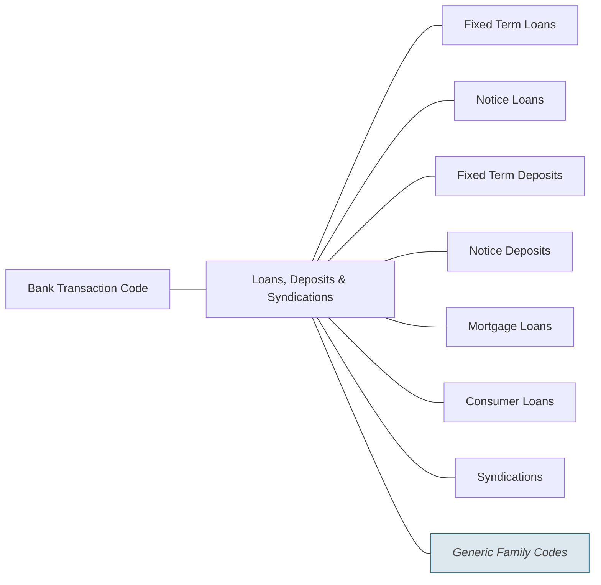

# Loans, Deposits and Syndications families

Source: [src-000003](../../../../../../../../evidence/omitted/1dcbe16191b6c8898a146b17.md). direct-body paragraph P253; rendered file/printed page 41.

[Complete rendered source figure (300 dpi)](../../../../../../../../evidence/omitted/e2ffd3ffa76ae1e1491c69c7.md) · [Full rendered source page](../../../../../../../../evidence/omitted/2b897c7d12265bc5ce2055b9.md) · [Mermaid SVG](../../../../../../../../evidence/omitted/6effd2a650cf2bff3e1f2358.md) · [Mermaid preview](../../../../../../../../evidence/omitted/43dfc9a8a182d81f5846f95b.md)

Exact SmartArt evidence: [word/diagrams/data6.xml](../smartart/data6.md). All data, drawing, layout, style and color parts are retained.

## Entities and relationships

This is a code taxonomy or data-structure view. It has no business participants, process initiator, message sender/receiver or activity sequence. The publication reporting context is documented separately.

| Source label | Node |
| --- | --- |
| Bank Transaction Code | N1 |
| Loans, Deposits &amp; Syndications | N2 |
| Fixed Term Loans | N3 |
| Notice Loans | N4 |
| Fixed Term Deposits | N5 |
| Notice Deposits | N6 |
| Mortgage Loans | N7 |
| Consumer Loans | N8 |
| Syndications | N9 |
| Generic Family Codes | N10 |

| Parent/container | Child/member | Source connector evidence |
| --- | --- | --- |
| Bank Transaction Code | Loans, Deposits &amp; Syndications | /dgm:dataModel/dgm:cxnLst/dgm:cxn[40] |
| Loans, Deposits &amp; Syndications | Fixed Term Loans | /dgm:dataModel/dgm:cxnLst/dgm:cxn[35] |
| Loans, Deposits &amp; Syndications | Notice Loans | /dgm:dataModel/dgm:cxnLst/dgm:cxn[16] |
| Loans, Deposits &amp; Syndications | Fixed Term Deposits | /dgm:dataModel/dgm:cxnLst/dgm:cxn[5] |
| Loans, Deposits &amp; Syndications | Notice Deposits | /dgm:dataModel/dgm:cxnLst/dgm:cxn[20] |
| Loans, Deposits &amp; Syndications | Mortgage Loans | /dgm:dataModel/dgm:cxnLst/dgm:cxn[12] |
| Loans, Deposits &amp; Syndications | Consumer Loans | /dgm:dataModel/dgm:cxnLst/dgm:cxn[1] |
| Loans, Deposits &amp; Syndications | Syndications | /dgm:dataModel/dgm:cxnLst/dgm:cxn[9] |
| Loans, Deposits &amp; Syndications | Generic Family Codes | /dgm:dataModel/dgm:cxnLst/dgm:cxn[30] |

## Representation limits

- The source uses connector lines without arrowheads. Mermaid lines represent the displayed taxonomy/structure, not message directions or a time sequence. Layout and box colors differ to keep labels readable; generic-family emphasis is preserved.

## Review evidence

Compared the complete Word-PDF source page and the rendered Mermaid image. Checked each label, parent-child connector, hierarchy boundary and generic-family emphasis. SmartArt source nodes/connections provide exact text and endpoint evidence; no hidden node text is inferred. Completed 2026-11-09. Rendered with Mermaid 12.3.0 and Mermaid browser API + Chromium 156.0.8078.81. Source checksum was verified against the register.
