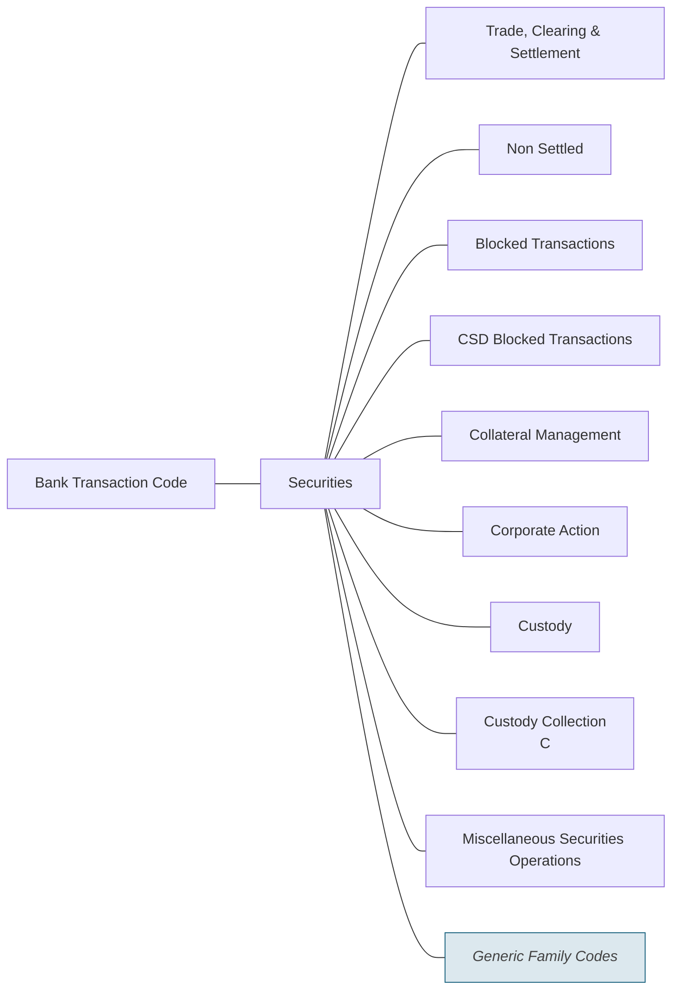

# Securities families

Source: [src-000003](../../../../../../../../evidence/omitted/1dcbe16191b6c8898a146b17.md). direct-body paragraph P287; rendered file/printed page 45.

[Complete rendered source figure (300 dpi)](../../../../../../../../evidence/omitted/cee85b9f43bdeb24be0d7353.md) · [Full rendered source page](../../../../../../../../evidence/omitted/c7fdabd8feedf96f10247ea7.md) · [Mermaid SVG](../../../../../../../../evidence/omitted/1615d1140e8ab5f3c3403df5.md) · [Mermaid preview](../../../../../../../../evidence/omitted/e417eb452e3c863fd81ac892.md)

Exact SmartArt evidence: [word/diagrams/data8.xml](../smartart/data8.md). All data, drawing, layout, style and color parts are retained.

## Entities and relationships

This is a code taxonomy or data-structure view. It has no business participants, process initiator, message sender/receiver or activity sequence. The publication reporting context is documented separately.

| Source label | Node |
| --- | --- |
| Bank Transaction Code | N1 |
| Securities | N2 |
| Trade, Clearing &amp; Settlement | N3 |
| Non Settled | N4 |
| Blocked Transactions | N5 |
| CSD Blocked Transactions | N6 |
| Collateral Management | N7 |
| Corporate Action | N8 |
| Custody | N9 |
| Custody Collection  C | N10 |
| Miscellaneous Securities Operations | N11 |
| Generic Family Codes | N12 |

| Parent/container | Child/member | Source connector evidence |
| --- | --- | --- |
| Bank Transaction Code | Securities | /dgm:dataModel/dgm:cxnLst/dgm:cxn[39] |
| Securities | Trade, Clearing &amp; Settlement | /dgm:dataModel/dgm:cxnLst/dgm:cxn[12] |
| Securities | Non Settled | /dgm:dataModel/dgm:cxnLst/dgm:cxn[2] |
| Securities | Blocked Transactions | /dgm:dataModel/dgm:cxnLst/dgm:cxn[41] |
| Securities | CSD Blocked Transactions | /dgm:dataModel/dgm:cxnLst/dgm:cxn[13] |
| Securities | Collateral Management | /dgm:dataModel/dgm:cxnLst/dgm:cxn[42] |
| Securities | Corporate Action | /dgm:dataModel/dgm:cxnLst/dgm:cxn[30] |
| Securities | Custody | /dgm:dataModel/dgm:cxnLst/dgm:cxn[25] |
| Securities | Custody Collection  C | /dgm:dataModel/dgm:cxnLst/dgm:cxn[19] |
| Securities | Miscellaneous Securities Operations | /dgm:dataModel/dgm:cxnLst/dgm:cxn[37] |
| Securities | Generic Family Codes | /dgm:dataModel/dgm:cxnLst/dgm:cxn[36] |

## Representation limits

- The source uses connector lines without arrowheads. Mermaid lines represent the displayed taxonomy/structure, not message directions or a time sequence. Layout and box colors differ to keep labels readable; generic-family emphasis is preserved.
- The source SmartArt node includes a separate trailing C under Custody Collection. It is retained verbatim; the source supplies no explanation of this character.
- This source overview omits the separately tabulated LACK family (T13 and T45). The reconstruction preserves the supplied view; use the detailed tables for full coverage.

## Review evidence

Compared the complete Word-PDF source page and the rendered Mermaid image. Checked each label, parent-child connector, hierarchy boundary and generic-family emphasis. SmartArt source nodes/connections provide exact text and endpoint evidence; no hidden node text is inferred. Completed 2026-11-09. Rendered with Mermaid 12.3.0 and Mermaid browser API + Chromium 156.0.8078.81. Source checksum was verified against the register.
