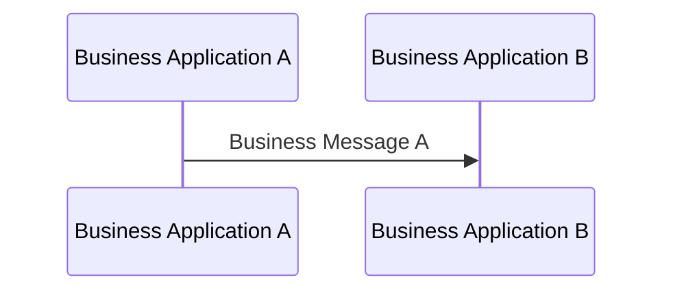

# Direct Business Message exchange

[src-000012](../../../../../../../../evidence/omitted/2bef0f7d99f68f11e72a140f.md), file/printed page 4, §1.3 Sending and Receiving MessagingEndpoint.

[Original extracted artwork](../../../../../../../../evidence/omitted/475331fa9590e3d42a741b51.md) · [Complete rendered source page](../../../../../../../../evidence/omitted/733037d5cc88b012a0f9239c.md) · [Rendered Mermaid SVG](../../../../../../../../evidence/omitted/ac64c109ae75e090e11bbdce.md) · [Rendered Mermaid PNG](../../../../../../../../evidence/omitted/233181635df7083875871e2e.md)

## Reconstruction

## Entities, actors and relationships

The source has one directed Business Message A from Business Application A to B. Icon artwork is replaced with labelled participant lifelines; no institution class is inferred.

## Participant and flow links

- [bah-sending-messaging-endpoint](../../../../../../participants/bah-sending-messaging-endpoint.md).
- [bah-receiving-messaging-endpoint](../../../../../../participants/bah-receiving-messaging-endpoint.md).

- [bah-business-message-exchange](../../../flows/business-message-exchange.md).

## Rendering and visual review

Mermaid 12.3.0 parsed and rendered this reconstruction with Chromium 156.0.8078.81 on 2026-11-09. The source artwork and rendered PNG were visually compared for labels, endpoints, direction, boundaries, choices and visible multiplicity. Raster icons become labelled lifelines or nodes; raster layout is not normative. [Render evidence](../../../../../../../../work/mug-render-report.json).

