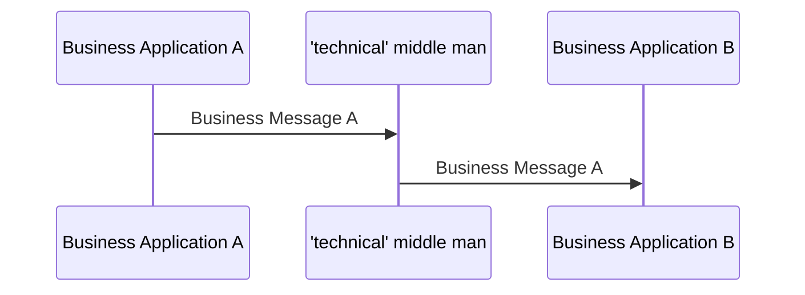

# Forwarding without a new business message

[src-000012](../../../../../../../../evidence/omitted/2bef0f7d99f68f11e72a140f.md), file/printed page 9, §2.2 Technical forwarding.

[Original extracted artwork](../../../../../../../../evidence/omitted/a59fd6a7dd871b6306dea2da.md) · [Complete rendered source page](../../../../../../../../evidence/omitted/e76eaf707076cfcc63b14f85.md) · [Rendered Mermaid SVG](../../../../../../../../evidence/omitted/24a7a403bc74624f42eab78e.md) · [Rendered Mermaid PNG](../../../../../../../../evidence/omitted/ce78c3ed2abcfbd9fe9a9b4e.md)

## Reconstruction

## Entities, actors and relationships

Both source arrows carry Business Message A. The technical middle man forwards without processing or changing the business content. It is not promoted to a business sender/receiver by transport alone.

## Participant and flow links

- [bah-sending-messaging-endpoint](../../../../../../participants/bah-sending-messaging-endpoint.md).
- [bah-receiving-messaging-endpoint](../../../../../../participants/bah-receiving-messaging-endpoint.md).
- [bah-technical-forwarder](../../../../../../participants/bah-technical-forwarder.md).

- [bah-business-message-exchange](../../../flows/business-message-exchange.md).

## Rendering and visual review

Mermaid 12.3.0 parsed and rendered this reconstruction with Chromium 156.0.8078.81 on 2026-11-09. The source artwork and rendered PNG were visually compared for labels, endpoints, direction, boundaries, choices and visible multiplicity. Raster icons become labelled lifelines or nodes; raster layout is not normative. [Render evidence](../../../../../../../../work/mug-render-report.json).

