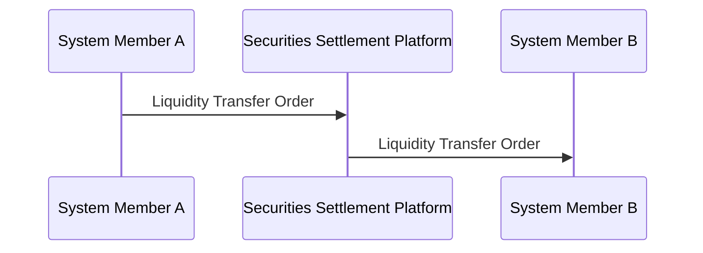

# Liquidity Transfer Order forwarded through a settlement platform

[src-000012](../../../../../../../../evidence/omitted/2bef0f7d99f68f11e72a140f.md), file/printed page 10, §2.2 Liquidity-transfer example.

[Original extracted artwork](../../../../../../../../evidence/omitted/90a41dcfa3dc9ac3c9a85c25.md) · [Complete rendered source page](../../../../../../../../evidence/omitted/9bd50bd4faeaf3373b3c2abe.md) · [Rendered Mermaid SVG](../../../../../../../../evidence/omitted/b6e2382ea23392c8b739d790.md) · [Rendered Mermaid PNG](../../../../../../../../evidence/omitted/7ac0270305405eff87738bf2.md)

## Reconstruction

## Entities, actors and relationships

The source example uses the Securities Settlement Platform as a technical middle man. Both arrows remain Liquidity Transfer Order; this illustration does not declare a particular exact liquidity-transfer schema version or require every settlement platform to be purely technical.

## Participant and flow links

- [bah-sending-messaging-endpoint](../../../../../../participants/bah-sending-messaging-endpoint.md).
- [bah-receiving-messaging-endpoint](../../../../../../participants/bah-receiving-messaging-endpoint.md).
- [bah-technical-forwarder](../../../../../../participants/bah-technical-forwarder.md).

- [bah-business-message-exchange](../../../flows/business-message-exchange.md).

## Rendering and visual review

Mermaid 12.3.0 parsed and rendered this reconstruction with Chromium 156.0.8078.81 on 2026-11-09. The source artwork and rendered PNG were visually compared for labels, endpoints, direction, boundaries, choices and visible multiplicity. Raster icons become labelled lifelines or nodes; raster layout is not normative. [Render evidence](../../../../../../../../work/mug-render-report.json).

