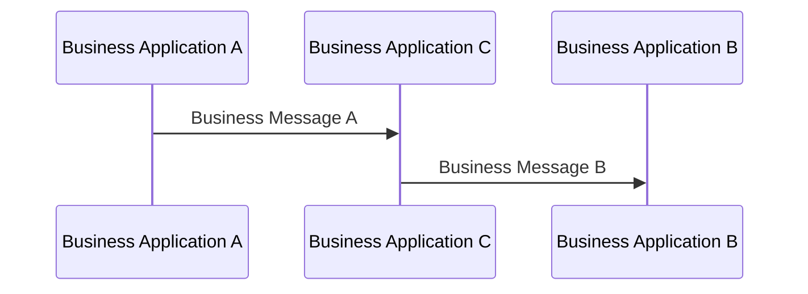

# Business Application C processes and creates a new message

[src-000012](../../../../../../../../evidence/omitted/2bef0f7d99f68f11e72a140f.md), file/printed page 10, §2.2 Business intermediary example.

[Original extracted artwork](../../../../../../../../evidence/omitted/ede75db676b2b66457b4972c.md) · [Complete rendered source page](../../../../../../../../evidence/omitted/9bd50bd4faeaf3373b3c2abe.md) · [Rendered Mermaid SVG](../../../../../../../../evidence/omitted/a73da400419e1a375cea596f.md) · [Rendered Mermaid PNG](../../../../../../../../evidence/omitted/7dfc1d5d3fb676a7becc03e0.md)

## Reconstruction

## Entities, actors and relationships

Business Application C is recipient of Message A and sender of a different Message B. This role differs from the technical-forwarder example on the same page.

## Participant and flow links

- [bah-sending-messaging-endpoint](../../../../../../participants/bah-sending-messaging-endpoint.md).
- [bah-receiving-messaging-endpoint](../../../../../../participants/bah-receiving-messaging-endpoint.md).
- [bah-business-intermediary](../../../../../../participants/bah-business-intermediary.md).

- [bah-business-message-exchange](../../../flows/business-message-exchange.md).

## Rendering and visual review

Mermaid 12.3.0 parsed and rendered this reconstruction with Chromium 156.0.8078.81 on 2026-11-09. The source artwork and rendered PNG were visually compared for labels, endpoints, direction, boundaries, choices and visible multiplicity. Raster icons become labelled lifelines or nodes; raster layout is not normative. [Render evidence](../../../../../../../../work/mug-render-report.json).

