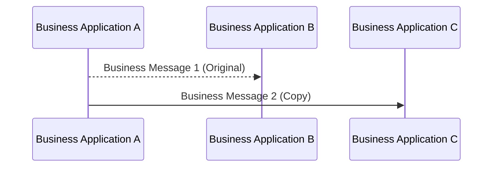

# Original message and a copy to another recipient

[src-000012](../../../../../../../../evidence/omitted/2bef0f7d99f68f11e72a140f.md), file/printed page 16, §2.7 Copy.

[Original extracted artwork](../../../../../../../../evidence/omitted/b44b60f787264c909e760c9c.md) · [Complete rendered source page](../../../../../../../../evidence/omitted/0346a4f81ae61df376b03e4c.md) · [Rendered Mermaid SVG](../../../../../../../../evidence/omitted/b384dc00046edec4fc10faef.md) · [Rendered Mermaid PNG](../../../../../../../../evidence/omitted/99b72b78dd9b97ec9231a59a.md)

## Reconstruction

## Entities, actors and relationships

The original goes from A to B; the copy goes from A to C. The dashed original and solid copy arrows are preserved. The p16 usage table nevertheless prints To=B; the diagram and table claims are retained separately.

## Participant and flow links

- [bah-sending-messaging-endpoint](../../../../../../participants/bah-sending-messaging-endpoint.md).
- [bah-receiving-messaging-endpoint](../../../../../../participants/bah-receiving-messaging-endpoint.md).

- [bah-copy](../../../flows/copy.md).

## Rendering and visual review

Mermaid 12.3.0 parsed and rendered this reconstruction with Chromium 156.0.8078.81 on 2026-11-09. The source artwork and rendered PNG were visually compared for labels, endpoints, direction, boundaries, choices and visible multiplicity. Raster icons become labelled lifelines or nodes; raster layout is not normative. [Render evidence](../../../../../../../../work/mug-render-report.json).

Limitations: Source diagram/table receiver discrepancy: issue-000003. [Issue register](../../../../../../../../tracking/issues.md). A successful faithful reconstruction does not resolve a conflict inside the source.
