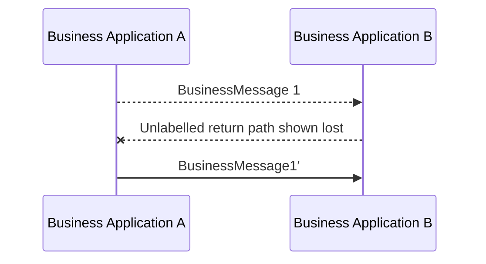

# Possible duplicate after a lost return path

[src-000012](../../../../../../../../evidence/omitted/2bef0f7d99f68f11e72a140f.md), file/printed page 19, §2.10 Possible duplicate.

[Original extracted artwork](../../../../../../../../evidence/omitted/1e3810dbf003232c11734507.md) · [Complete rendered source page](../../../../../../../../evidence/omitted/00171ae8d640cb037d781e0f.md) · [Rendered Mermaid SVG](../../../../../../../../evidence/omitted/cef2b3689265d3991c1230e9.md) · [Rendered Mermaid PNG](../../../../../../../../evidence/omitted/a16677e9bbffffd9290e69eb.md)

## Reconstruction

## Entities, actors and relationships

The source has a dashed original A→B, a dashed B→A return path marked by a red cross, and solid resend A→B. The source does not label the return path; the Mermaid label explicitly describes that absence. §2.10 supplies the receiver decision: ignore if original was received, otherwise process as original.

## Participant and flow links

- [bah-sending-messaging-endpoint](../../../../../../participants/bah-sending-messaging-endpoint.md).
- [bah-receiving-messaging-endpoint](../../../../../../participants/bah-receiving-messaging-endpoint.md).

- [bah-possible-duplicate](../../../flows/possible-duplicate.md).

## Rendering and visual review

Mermaid 12.3.0 parsed and rendered this reconstruction with Chromium 156.0.8078.81 on 2026-11-09. The source artwork and rendered PNG were visually compared for labels, endpoints, direction, boundaries, choices and visible multiplicity. Raster icons become labelled lifelines or nodes; raster layout is not normative. [Render evidence](../../../../../../../../work/mug-render-report.json).

