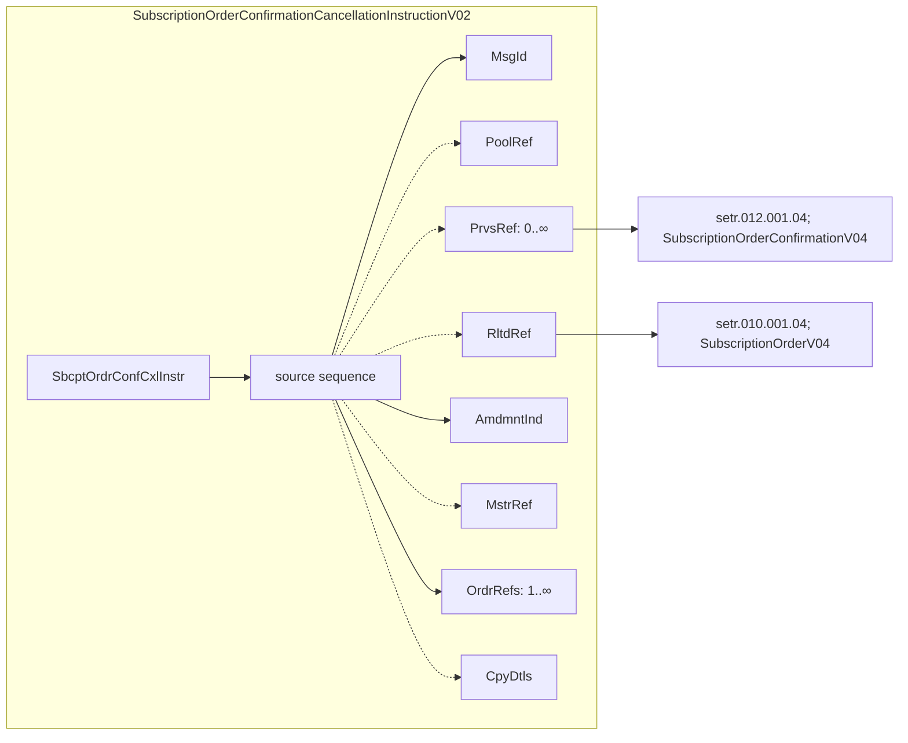

# Subscription confirmation cancellation links to earlier messages

[src-000012](../../../../../../../../evidence/omitted/2bef0f7d99f68f11e72a140f.md), file/printed page 23, §2.13 Embedded business-message references.

[Original extracted artwork](../../../../../../../../evidence/omitted/f2022a0786f26e9f7fc45057.md) · [Complete rendered source page](../../../../../../../../evidence/omitted/6f982fa1fe5ba659726b2427.md) · [Rendered Mermaid SVG](../../../../../../../../evidence/omitted/d53255b07d3c0aafcf4f013c.md) · [Rendered Mermaid PNG](../../../../../../../../evidence/omitted/77057194fc12ebd3a9f3be48.md)

## Reconstruction

## Entities, actors and relationships

The source XML-tree illustration lists MsgId, PoolRef, PrvsRef, RltdRef, AmdmntInd, MstrRef, OrdrRefs and CpyDtls in that order. Its visible cardinalities are PrvsRef 0..∞ and OrdrRefs 1..∞. Green arrows map PrvsRef to setr.012.001.04 and RltdRef to setr.010.001.04. Dashed/solid source outlines are retained using dashed/solid branch lines; missing multiplicities are not filled with guessed schema defaults. This is a source illustration of earlier definitions, not a supplied XSD or the complete current message structure.

Source sequence order is MsgId, PoolRef, PrvsRef, RltdRef, AmdmntInd, MstrRef, OrdrRefs, CpyDtls. The graph preserves all eight members; layout order is not XML order. Dotted source boxes/links are preserved as dotted edges without inventing unprinted multiplicities. This is a historical source excerpt, not a complete XSD-derived declaration.

## Participant and flow links

- [bah-sending-messaging-endpoint](../../../../../../participants/bah-sending-messaging-endpoint.md).
- [bah-receiving-messaging-endpoint](../../../../../../participants/bah-receiving-messaging-endpoint.md).

- [bah-related-message](../../../flows/related-message.md).

## Rendering and visual review

Mermaid 12.3.0 parsed and rendered this reconstruction with Chromium 156.0.8078.81 on 2026-11-09. The source artwork and rendered PNG were visually compared for labels, endpoints, direction, boundaries, choices and visible multiplicity. Raster icons become labelled lifelines or nodes; raster layout is not normative. [Render evidence](../../../../../../../../work/mug-render-report.json).

Limitations: Diagram is a source XML-tree excerpt; no complete schema coverage is asserted. [Issue register](../../../../../../../../tracking/issues.md). A successful faithful reconstruction does not resolve a conflict inside the source.
