# A2A communication, inbound and outbound processing — Communication Module - A2A

[src-000343](../../../../../../../evidence/omitted/e6546c5f64c53f963440988a.md) archive member `ISO20022_MDR_Target2Securities_August_2026_v1/Target2-Securities_Administration_MessageSet/ISO20022_MDRPart1_Target2Securities_Administration_2023_2024_v2.docx`; direct-body paragraph P142; Word file page 19.

[Original complete figure](../../../../../../../evidence/omitted/04d37afaf9312983dbf60ec3.md) · [Readable original](../../../../../../../evidence/omitted/d43e388a634fde46993f54c7.md) · [Business flow and participant responsibilities](../../flows/flow-src-000343-p142-technical-processing.md)

## Linked module views

- [Complete source graph](fig-0006.md)
- [Inbound Processing Module – A2A](fig-0006-inbound.md)
- [Outbound Processing Module – A2A](fig-0006-outbound.md)

## Source reconstruction

```mermaid
flowchart TB
subgraph group0["T2S System User"]
uSend(["A2A"])
uAckReceive(["A2A"])
uAckSend(["A2A"])
uReceive(["A2A"])
end
subgraph group1["Communication Module - A2A"]
encIn["Encrypted inbound communication A2A"]
recv(["1 - Receive/Log Communication A2A"])
recvFork@{ shape: fork }
techAckOut["Technical Acknowledgement"]
auth(["2 - Check Sender Authentication and Decryption A2A"])
authD{"#160;"}
store(["3 - Store Communication Content A2A"])
storeD{"#160;"}
storedMessage["Stored inbound communication - A2A individual message"]
storedFile["Stored inbound communication - A2A file"]
formatted["Formatted outbound communication A2A"]
queueMerge{"#160;"}
outCheck(["4 - Check for A2A Outbound Queuing"])
outQueueD{"#160;"}
outQueue(["5 - Queue A2A Outbound Communication"])
restart(["6 - Restart Queued A2A Outbound Communication"])
extBar@{ shape: fork }
extMerge{"#160;"}
sendMerge{"#160;"}
cert(["7 - Assign Certificate and Encryption A2A"])
techAckIn["Technical Acknowledgement"]
transmitMerge{"#160;"}
transmit(["8 - Transmit Communication A2A"])
encOut["Encrypted outbound communication A2A"]
end
subgraph group2["Inbound Processing Module – A2A"]
file(["1 - A2A File Validation and Splitting"])
msgMerge{"#160;"}
end
subgraph group3["Outbound Processing Module – A2A"]
create(["7 - Create A2A Outbound Communication"])
end
subgraph group4["Adjacent modules and system events"]
available["External system available event"]
unavailable["External system unavailable event"]
end
uSend --> encIn
encIn --> recv
recv --> recvFork
recvFork --> auth
auth --> authD
recvFork --> techAckOut
techAckOut --> uAckReceive
authD -->|"Not authenticated"| sendMerge
authD -->|"Authenticated"| store
store --> storeD
storeD -->|"Message received"| storedMessage
storeD -->|"File received"| storedFile
storedFile --> file
storedMessage --> msgMerge
create --> formatted
formatted --> queueMerge
queueMerge --> outCheck
outCheck --> outQueueD
outQueueD -->|"Outbound Queuing"| outQueue
outQueueD -->|"No Outbound Queuing"| sendMerge
available --> extBar
unavailable --> extMerge
extBar --> extMerge
extBar --> restart
extMerge --> queueMerge
restart --> sendMerge
sendMerge --> cert
cert --> transmitMerge
transmitMerge --> transmit
transmit --> encOut
encOut --> uReceive
uAckSend --> techAckIn
techAckIn --> transmitMerge
style extBar fill:#222,stroke:#222
style recvFork fill:#222,stroke:#222
```

## Entities and connections

| Source node | Destination node | Source condition |
| --- | --- | --- |
| uSend — A2A | encIn — Encrypted inbound communication A2A | Unlabelled directed connector |
| encIn — Encrypted inbound communication A2A | recv — 1 - Receive/Log Communication A2A | Unlabelled directed connector |
| recv — 1 - Receive/Log Communication A2A | recvFork —  | Unlabelled directed connector |
| recvFork —  | auth — 2 - Check Sender Authentication and Decryption A2A | Unlabelled directed connector |
| auth — 2 - Check Sender Authentication and Decryption A2A | authD —  | Unlabelled directed connector |
| recvFork —  | techAckOut — Technical Acknowledgement | Unlabelled directed connector |
| techAckOut — Technical Acknowledgement | uAckReceive — A2A | Unlabelled directed connector |
| authD —  | sendMerge —  | Not authenticated |
| authD —  | store — 3 - Store Communication Content A2A | Authenticated |
| store — 3 - Store Communication Content A2A | storeD —  | Unlabelled directed connector |
| storeD —  | storedMessage — Stored inbound communication - A2A individual message | Message received |
| storeD —  | storedFile — Stored inbound communication - A2A file | File received |
| storedFile — Stored inbound communication - A2A file | file — 1 - A2A File Validation and Splitting | Unlabelled directed connector |
| storedMessage — Stored inbound communication - A2A individual message | msgMerge —  | Unlabelled directed connector |
| create — 7 - Create A2A Outbound Communication | formatted — Formatted outbound communication A2A | Unlabelled directed connector |
| formatted — Formatted outbound communication A2A | queueMerge —  | Unlabelled directed connector |
| queueMerge —  | outCheck — 4 - Check for A2A Outbound Queuing | Unlabelled directed connector |
| outCheck — 4 - Check for A2A Outbound Queuing | outQueueD —  | Unlabelled directed connector |
| outQueueD —  | outQueue — 5 - Queue A2A Outbound Communication | Outbound Queuing |
| outQueueD —  | sendMerge —  | No Outbound Queuing |
| available — External system available event | extBar —  | Unlabelled directed connector |
| unavailable — External system unavailable event | extMerge —  | Unlabelled directed connector |
| extBar —  | extMerge —  | Unlabelled directed connector |
| extBar —  | restart — 6 - Restart Queued A2A Outbound Communication | Unlabelled directed connector |
| extMerge —  | queueMerge —  | Unlabelled directed connector |
| restart — 6 - Restart Queued A2A Outbound Communication | sendMerge —  | Unlabelled directed connector |
| sendMerge —  | cert — 7 - Assign Certificate and Encryption A2A | Unlabelled directed connector |
| cert — 7 - Assign Certificate and Encryption A2A | transmitMerge —  | Unlabelled directed connector |
| transmitMerge —  | transmit — 8 - Transmit Communication A2A | Unlabelled directed connector |
| transmit — 8 - Transmit Communication A2A | encOut — Encrypted outbound communication A2A | Unlabelled directed connector |
| encOut — Encrypted outbound communication A2A | uReceive — A2A | Unlabelled directed connector |
| uAckSend — A2A | techAckIn — Technical Acknowledgement | Unlabelled directed connector |
| techAckIn — Technical Acknowledgement | transmitMerge —  | Unlabelled directed connector |

## Source qualifications

- The four A2A ovals in the T2S System User region are retained as separate occurrences: inbound communication, receiving technical acknowledgement, sending technical acknowledgement and receiving outbound communication.
- Technical acknowledgements, authentication failure and processing rejection paths are distinct. A technical acknowledgement is not a business-success claim.
- The source has no outgoing connector from Queue A2A Outbound Communication (step5) or Queue A2A Inbound Message (step6). Their restart activities are independently connected through system events; no missing queue-to-restart arrow is invented.
- Every rejection feeds the drawn right-hand merge chain before outbound processing. Query queuing has a fork: rejection output and queuing path are both retained.
- System-event diamonds/bars and the blank merge diamonds are transcribed as drawn. The underlined source labels denote state/data objects; no storage schema or ownership is inferred.
- Details split the single source artwork by module. Boundary nodes repeat only to keep every cross-module connector visible; matching node identifiers denote the same source occurrence.

## Rendering and visual review

Mermaid 12.3.0 with Mermaid browser API + Chromium 156.0.8078.81 parsed and rendered this view. On 2026-11-09, the original artwork and final reconstruction were directly compared for labels, modules, participants, every endpoint and direction, guards, forks/merges, alternative frames and the distinction between technical and business outcomes. **Visible-source fidelity: pass.** Source conflicts remain open where listed. Layout, arrowhead styling and underlined data-box typography differ; the original and explicit descriptions remain available. Hidden native content is a separate review scope.

[Rendered SVG](../../../../../../../evidence/omitted/6b8c000bc0746697a0140e3d.md) · [Rendered PNG](../../../../../../../evidence/omitted/5215420856ab3d277d257b97.md) · [Hash-bound review evidence](../../../../../../../tracking/reviews/t2s-administration-diagrams.json)
