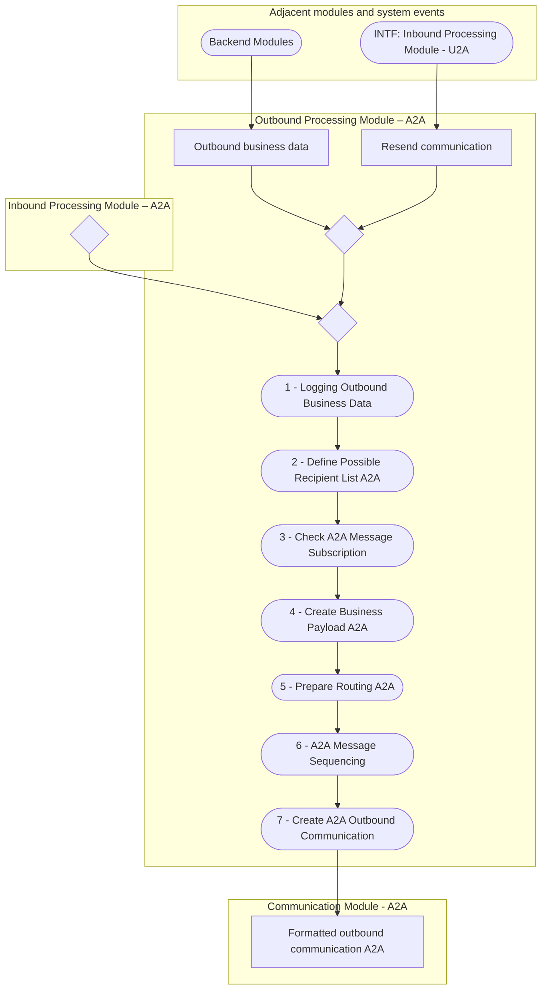

# A2A communication, inbound and outbound processing — Outbound Processing Module – A2A

[src-000343](../../../../../../../evidence/omitted/e6546c5f64c53f963440988a.md) archive member `ISO20022_MDR_Target2Securities_August_2026_v1/Target2-Securities_Administration_MessageSet/ISO20022_MDRPart1_Target2Securities_Administration_2023_2024_v2.docx`; direct-body paragraph P142; Word file page 19.

[Original complete figure](../../../../../../../evidence/omitted/04d37afaf9312983dbf60ec3.md) · [Readable original](../../../../../../../evidence/omitted/d43e388a634fde46993f54c7.md) · [Business flow and participant responsibilities](../../flows/flow-src-000343-p142-technical-processing.md)

## Linked module views

- [Complete source graph](fig-0006.md)
- [Communication Module - A2A](fig-0006-communication.md)
- [Inbound Processing Module – A2A](fig-0006-inbound.md)

## Source reconstruction

## Entities and connections

| Source node | Destination node | Source condition |
| --- | --- | --- |
| rejectMerge7 —  | statusMerge —  | Unlabelled directed connector |
| backOut — Backend Modules | businessOut — Outbound business data | Unlabelled directed connector |
| businessOut — Outbound business data | originMerge —  | Unlabelled directed connector |
| u2a — INTF: Inbound Processing Module - U2A | resendOther — Resend communication | Unlabelled directed connector |
| resendOther — Resend communication | originMerge —  | Unlabelled directed connector |
| originMerge —  | statusMerge —  | Unlabelled directed connector |
| statusMerge —  | log — 1 - Logging Outbound Business Data | Unlabelled directed connector |
| log — 1 - Logging Outbound Business Data | recipient — 2 - Define Possible Recipient List A2A | Unlabelled directed connector |
| recipient — 2 - Define Possible Recipient List A2A | subscription — 3 - Check A2A Message Subscription | Unlabelled directed connector |
| subscription — 3 - Check A2A Message Subscription | payload — 4 - Create Business Payload A2A | Unlabelled directed connector |
| payload — 4 - Create Business Payload A2A | routing — 5 - Prepare Routing A2A | Unlabelled directed connector |
| routing — 5 - Prepare Routing A2A | sequence — 6 - A2A Message Sequencing | Unlabelled directed connector |
| sequence — 6 - A2A Message Sequencing | create — 7 - Create A2A Outbound Communication | Unlabelled directed connector |
| create — 7 - Create A2A Outbound Communication | formatted — Formatted outbound communication A2A | Unlabelled directed connector |

## Source qualifications

- The four A2A ovals in the T2S System User region are retained as separate occurrences: inbound communication, receiving technical acknowledgement, sending technical acknowledgement and receiving outbound communication.
- Technical acknowledgements, authentication failure and processing rejection paths are distinct. A technical acknowledgement is not a business-success claim.
- The source has no outgoing connector from Queue A2A Outbound Communication (step5) or Queue A2A Inbound Message (step6). Their restart activities are independently connected through system events; no missing queue-to-restart arrow is invented.
- Every rejection feeds the drawn right-hand merge chain before outbound processing. Query queuing has a fork: rejection output and queuing path are both retained.
- System-event diamonds/bars and the blank merge diamonds are transcribed as drawn. The underlined source labels denote state/data objects; no storage schema or ownership is inferred.
- Details split the single source artwork by module. Boundary nodes repeat only to keep every cross-module connector visible; matching node identifiers denote the same source occurrence.

## Rendering and visual review

Mermaid 12.3.0 with Mermaid browser API + Chromium 156.0.8078.81 parsed and rendered this view. On 2026-11-09, the original artwork and final reconstruction were directly compared for labels, modules, participants, every endpoint and direction, guards, forks/merges, alternative frames and the distinction between technical and business outcomes. **Visible-source fidelity: pass.** Source conflicts remain open where listed. Layout, arrowhead styling and underlined data-box typography differ; the original and explicit descriptions remain available. Hidden native content is a separate review scope.

[Rendered SVG](../../../../../../../evidence/omitted/004eaf786cafc66d35eb4df6.md) · [Rendered PNG](../../../../../../../evidence/omitted/e93502a7694e9d275a2c445d.md) · [Hash-bound review evidence](../../../../../../../tracking/reviews/t2s-administration-diagrams.json)
