# Query families and access context

[src-000343](../../../../../../../evidence/omitted/e6546c5f64c53f963440988a.md) archive member `ISO20022_MDR_Target2Securities_August_2026_v1/Target2-Securities_Administration_MessageSet/ISO20022_MDRPart1_Target2Securities_Administration_2023_2024_v2.docx`; direct-body paragraph P123; BusinessProcess Description / Report Query Request; additional Word-rendered file page 14 (exact binary asset match).

[Original figure](../../../../../../../evidence/omitted/766e9cf2106428c5d867ec1b.md) · [Readable preview](../../../../../../../evidence/omitted/766e9cf2106428c5d867ec1b.md)

## Source reconstruction

```mermaid
flowchart TB
q["Queries"]
u["U2A"]
a["A2A"]
hub1(("#160;"))
hub2(("#160;"))
csd["CSDs"]
sb["Settlement Banks"]
pb["Payment Banks"]
ncb["NCBs"]
instructions["Instructions"]
instructions1["Settlement Instruction"]
instructions2["Settlement Instruction Current Status"]
instructions3["Settlement Instruction Status Audit Trail"]
instructions4["Settlement Instruction Audit Trail"]
instructions5["Settlement Transaction"]
security["Security account"]
security1["Security Account Position"]
security2["Security Account Position History"]
cash["Cash account"]
cash1["T2S Dedicated Cash Account Balance"]
cash2["T2S Dedicated Cash Account Posting Query"]
cash3["Outstanding Auto-Collateralisation Credit"]
cash4["Overall Liquidity"]
cash5["Cash Forecast"]
cash6["Limit"]
cash7["Immediate Liquidity Transfer Order List Query"]
cash8["Limit Utilisation Journal"]
cash9["Limit Utilisation"]
cash10["Total Collateral Value"]
cash11["Collateral Value per Cash Account"]
cash12["Collateral Value of a Security"]
cash13["Cash Account List"]
cash14["Immediate Liquidity Transfer Order Detail Query"]
day["Settlement day"]
day1["T2S Calendar"]
day2["T2S Diary"]
dynamic["Dynamic data queries"]
dynamic1["Report"]
static["Static data"]
static1["Several queries available (e.g. Liquidity Transfer Orders and Liquidity Transfer Order Link Set)"]
q --> u
q --> a
u --- hub1
a --- hub1
hub1 --> csd
csd --- hub2
hub1 --> sb
sb --- hub2
hub1 --> pb
pb --- hub2
hub1 --> ncb
ncb --- hub2
hub2 --> instructions
instructions --> instructions1
instructions --> instructions2
instructions --> instructions3
instructions --> instructions4
instructions --> instructions5
hub2 --> security
security --> security1
security --> security2
hub2 --> cash
cash --> cash1
cash --> cash2
cash --> cash3
cash --> cash4
cash --> cash5
cash --> cash6
cash --> cash7
cash --> cash8
cash --> cash9
cash --> cash10
cash --> cash11
cash --> cash12
cash --> cash13
cash --> cash14
hub2 --> day
day --> day1
day --> day2
hub2 --> dynamic
dynamic --> dynamic1
hub2 --> static
static --> static1
```

## Participants and context

- [Central Securities Depositories (CSD)](../../../../../participants/participant-src-000343-central-securities-depositories-csd.md)
- [Settlement Bank](../../../../../participants/participant-src-000343-settlement-bank.md)
- [Payment Bank](../../../../../participants/participant-src-000343-payment-bank.md)
- [National Central Bank (NCB)](../../../../../participants/participant-src-000343-national-central-bank-ncb.md)

## Relationships and directed exchanges

| Source / endpoint1 | Destination / endpoint2 | Condition, exchange or connector |
| --- | --- | --- |
| Queries | U2A | Unlabelled directed path |
| Queries | A2A | Unlabelled directed path |
| U2A | hub1 | Plain connector |
| A2A | hub1 | Plain connector |
| hub1 | CSDs | Unlabelled directed path |
| CSDs | hub2 | Plain connector |
| hub1 | Settlement Banks | Unlabelled directed path |
| Settlement Banks | hub2 | Plain connector |
| hub1 | Payment Banks | Unlabelled directed path |
| Payment Banks | hub2 | Plain connector |
| hub1 | NCBs | Unlabelled directed path |
| NCBs | hub2 | Plain connector |
| hub2 | Instructions | Unlabelled directed path |
| Instructions | Settlement Instruction | Unlabelled directed path |
| Instructions | Settlement Instruction Current Status | Unlabelled directed path |
| Instructions | Settlement Instruction Status Audit Trail | Unlabelled directed path |
| Instructions | Settlement Instruction Audit Trail | Unlabelled directed path |
| Instructions | Settlement Transaction | Unlabelled directed path |
| hub2 | Security account | Unlabelled directed path |
| Security account | Security Account Position | Unlabelled directed path |
| Security account | Security Account Position History | Unlabelled directed path |
| hub2 | Cash account | Unlabelled directed path |
| Cash account | T2S Dedicated Cash Account Balance | Unlabelled directed path |
| Cash account | T2S Dedicated Cash Account Posting Query | Unlabelled directed path |
| Cash account | Outstanding Auto-Collateralisation Credit | Unlabelled directed path |
| Cash account | Overall Liquidity | Unlabelled directed path |
| Cash account | Cash Forecast | Unlabelled directed path |
| Cash account | Limit | Unlabelled directed path |
| Cash account | Immediate Liquidity Transfer Order List Query | Unlabelled directed path |
| Cash account | Limit Utilisation Journal | Unlabelled directed path |
| Cash account | Limit Utilisation | Unlabelled directed path |
| Cash account | Total Collateral Value | Unlabelled directed path |
| Cash account | Collateral Value per Cash Account | Unlabelled directed path |
| Cash account | Collateral Value of a Security | Unlabelled directed path |
| Cash account | Cash Account List | Unlabelled directed path |
| Cash account | Immediate Liquidity Transfer Order Detail Query | Unlabelled directed path |
| hub2 | Settlement day | Unlabelled directed path |
| Settlement day | T2S Calendar | Unlabelled directed path |
| Settlement day | T2S Diary | Unlabelled directed path |
| hub2 | Dynamic data queries | Unlabelled directed path |
| Dynamic data queries | Report | Unlabelled directed path |
| hub2 | Static data | Unlabelled directed path |
| Static data | Several queries available (e.g. Liquidity Transfer Orders and Liquidity Transfer Order Link Set) | Unlabelled directed path |

## Qualifications

- The source uses common connector trunks across access modes and actor groups. Blank junctions preserve those shared routes without claiming a direct pairwise institutional relationship.
- Cash-query leaves appear in two columns connected to the same vertical trunk; they are separate query choices, not bidirectional messages between each pair.
- P113–P122 supplies access-right qualifications. This overview does not grant every actor every query; report query is only the dynamic-data Report branch.

## Rendering and visual review

Mermaid 12.3.0 with Mermaid browser API + Chromium 156.0.8078.81 parsed and rendered this view. On 2026-11-09, the original artwork and final reconstruction were directly compared for labels, modules, participants, every endpoint and direction, guards, forks/merges, alternative frames and the distinction between technical and business outcomes. **Visible-source fidelity: pass.** Source conflicts remain open where listed. Layout, arrowhead styling and underlined data-box typography differ; the original and explicit descriptions remain available. Hidden native content is a separate review scope.

[Rendered SVG](../../../../../../../evidence/omitted/dcdf7b053f8d75280f88e5eb.md) · [Rendered PNG](../../../../../../../evidence/omitted/25f0a86c585d4a79d528c7e2.md) · [Hash-bound review evidence](../../../../../../../tracking/reviews/t2s-administration-diagrams.json)
