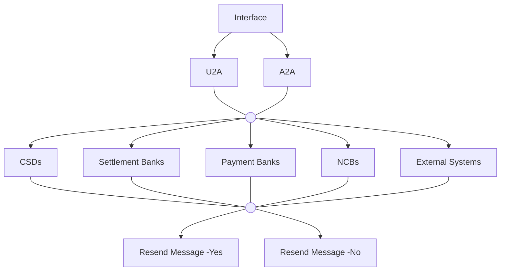

# Resend interface overview

[src-000343](../../../../../../../evidence/omitted/e6546c5f64c53f963440988a.md) archive member `ISO20022_MDR_Target2Securities_August_2026_v1/Target2-Securities_Administration_MessageSet/ISO20022_MDRPart1_Target2Securities_Administration_2023_2024_v2.docx`; direct-body paragraph P135; BusinessProcess Description / Resend Request; additional Word-rendered file page 17 (exact binary asset match).

[Original figure](../../../../../../../evidence/omitted/ac41467480656ee6edecb393.md) · [Readable preview](../../../../../../../evidence/omitted/796161ce2abe61f813543721.md)

## Source reconstruction

## Participants and context

- [Central Securities Depositories (CSD)](../../../../../participants/participant-src-000343-central-securities-depositories-csd.md)
- [Settlement Bank](../../../../../participants/participant-src-000343-settlement-bank.md)
- [Payment Bank](../../../../../participants/participant-src-000343-payment-bank.md)
- [National Central Bank (NCB)](../../../../../participants/participant-src-000343-national-central-bank-ncb.md)
- [External System](../../../../../participants/participant-src-000343-external-system.md)

## Relationships and directed exchanges

| Source / endpoint1 | Destination / endpoint2 | Condition, exchange or connector |
| --- | --- | --- |
| Interface | U2A | Unlabelled directed path |
| Interface | A2A | Unlabelled directed path |
| U2A | h1 | Plain connector |
| A2A | h1 | Plain connector |
| h1 | CSDs | Unlabelled directed path |
| CSDs | h2 | Plain connector |
| h1 | Settlement Banks | Unlabelled directed path |
| Settlement Banks | h2 | Plain connector |
| h1 | Payment Banks | Unlabelled directed path |
| Payment Banks | h2 | Plain connector |
| h1 | NCBs | Unlabelled directed path |
| NCBs | h2 | Plain connector |
| h1 | External Systems | Unlabelled directed path |
| External Systems | h2 | Plain connector |
| h2 | Resend Message -Yes | Unlabelled directed path |
| h2 | Resend Message -No | Unlabelled directed path |

## Qualifications

- Common connector trunks are retained as blank junctions. The picture supplies no actor-specific Yes/No guard; no access permission is inferred from this overview.

## Rendering and visual review

Mermaid 12.3.0 with Mermaid browser API + Chromium 156.0.8078.81 parsed and rendered this view. On 2026-11-09, the original artwork and final reconstruction were directly compared for labels, modules, participants, every endpoint and direction, guards, forks/merges, alternative frames and the distinction between technical and business outcomes. **Visible-source fidelity: pass.** Source conflicts remain open where listed. Layout, arrowhead styling and underlined data-box typography differ; the original and explicit descriptions remain available. Hidden native content is a separate review scope.

[Rendered SVG](../../../../../../../evidence/omitted/63ef5b8c953acff654ec6700.md) · [Rendered PNG](../../../../../../../evidence/omitted/95465bb33a0cc3773381ab84.md) · [Hash-bound review evidence](../../../../../../../tracking/reviews/t2s-administration-diagrams.json)
