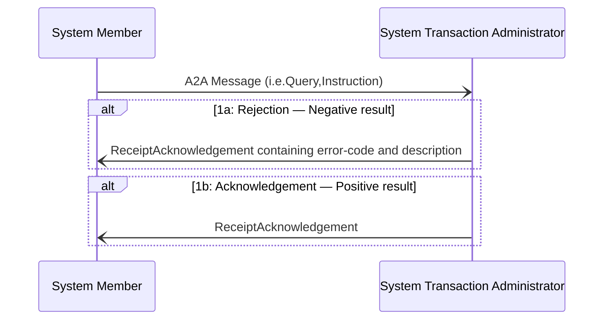

# Receipt acknowledgement sequence

[src-000343](../../../../../../../evidence/omitted/e6546c5f64c53f963440988a.md) archive member `ISO20022_MDR_Target2Securities_August_2026_v1/Target2-Securities_Administration_MessageSet/ISO20022_MDRPart1_Target2Securities_Administration_2023_2024_v2.docx`; direct-body paragraph P193; BusinessTransactions / Receipt Acknowledgement Business Transaction (admi.007); additional Word-rendered file page 32 (exact binary asset match).

[Original figure](../../../../../../../evidence/omitted/7205ddebc08d198fd1501120.md) · [Readable preview](../../../../../../../evidence/omitted/e8223c57ca2ec86308dde36f.md) · [Business flow](../../flows/flow-src-000343-p189-scenario-1-receipt-acknowledgement-sent-by-central-system-e-g-t2s-plat.md)

## Source reconstruction

## Participants and context

- [System Member](../../../../../participants/participant-src-000343-system-member.md)
- [System Transaction Administrator](../../../../../participants/participant-src-000343-system-transaction-administrator.md)

## Relationships and directed exchanges

| Source / endpoint1 | Destination / endpoint2 | Condition, exchange or connector |
| --- | --- | --- |
| System Member | System Transaction Administrator | A2A Message (i.e.Query,Instruction) |
| System Transaction Administrator | System Member | ReceiptAcknowledgement containing error-code and description |
| System Transaction Administrator | System Member | ReceiptAcknowledgement |

## Qualifications

- The source labels positive acknowledgement as alt1b, while the preceding activity section uses Scenario1b for negative business-processing response. The local picture labels and each section narrative are retained; identical labels are not assumed to identify the same scenario.

## Rendering and visual review

Mermaid 12.3.0 with Mermaid browser API + Chromium 156.0.8078.81 parsed and rendered this view. On 2026-11-09, the original artwork and final reconstruction were directly compared for labels, modules, participants, every endpoint and direction, guards, forks/merges, alternative frames and the distinction between technical and business outcomes. **Visible-source fidelity: pass.** Source conflicts remain open where listed. Layout, arrowhead styling and underlined data-box typography differ; the original and explicit descriptions remain available. Hidden native content is a separate review scope.

[Rendered SVG](../../../../../../../evidence/omitted/0a7cc2a6b3a47b29d4694dde.md) · [Rendered PNG](../../../../../../../evidence/omitted/ada4d18398fccf3adc084a36.md) · [Hash-bound review evidence](../../../../../../../tracking/reviews/t2s-administration-diagrams.json)
