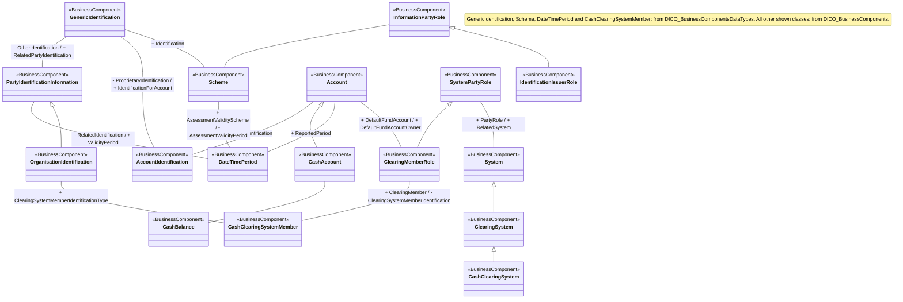

# T2S administration conceptual model

Source: [ISO20022_MDR_Target2Securities_August_2026_v1.zip](../../../../../../../../evidence/omitted/e6546c5f64c53f963440988a.md) → archive member `ISO20022_MDR_Target2Securities_August_2026_v1/Target2-Securities_Administration_MessageSet/ISO20022_MDRPart3_Target2Securities_Administration_2023_2024_v1.xlsx`; src-000345, AdminFunction; xl/drawings/drawing2.xml anchor 1; A1. Original picture bytes and drawing anchors are preserved.

[Original source model](../../../../../../../../evidence/omitted/4c110c2fc3a2fdca8024ce4b.md)

## Mermaid reconstruction

## Entities and source packages

| BusinessComponent | Source package label |
| --- | --- |
| GenericIdentification | from DICO_BusinessComponentsDataTypes |
| PartyIdentificationInformation | from DICO_BusinessComponents |
| Scheme | from DICO_BusinessComponentsDataTypes |
| InformationPartyRole | from DICO_BusinessComponents |
| IdentificationIssuerRole | from DICO_BusinessComponents |
| AccountIdentification | from DICO_BusinessComponents |
| DateTimePeriod | from DICO_BusinessComponentsDataTypes |
| OrganisationIdentification | from DICO_BusinessComponents |
| Account | from DICO_BusinessComponents |
| CashAccount | from DICO_BusinessComponents |
| CashBalance | from DICO_BusinessComponents |
| SystemPartyRole | from DICO_BusinessComponents |
| System | from DICO_BusinessComponents |
| ClearingSystem | from DICO_BusinessComponents |
| CashClearingSystem | from DICO_BusinessComponents |
| ClearingMemberRole | from DICO_BusinessComponents |
| CashClearingSystemMember | from DICO_BusinessComponentsDataTypes |

## Complete relationship transcription

Plain associations below are undirected source lines; a label is a source relationship-end label, not an invented message direction. Plus/minus prefixes are retained as printed. The artwork does not display cardinality values. Inheritance points from subtype to parent; it does not establish an institution hierarchy or database ownership.

| Endpoint / parent | Relationship | Endpoint / subtype | Printed relationship labels |
| --- | --- | --- | --- |
| GenericIdentification | association | PartyIdentificationInformation | OtherIdentification / + RelatedPartyIdentification |
| GenericIdentification | association | AccountIdentification | - ProprietaryIdentification / + IdentificationForAccount |
| GenericIdentification | association | Scheme | + Identification |
| InformationPartyRole | association | Scheme | no label visible |
| InformationPartyRole | generalization; hollow triangle at parent | IdentificationIssuerRole | no label visible |
| Account | association | AccountIdentification | + Identification |
| Account | generalization; hollow triangle at parent | CashAccount | no label visible |
| Account | association | DateTimePeriod | + ReportedPeriod |
| Scheme | association | DateTimePeriod | + AssessmentValidityScheme / - AssessmentValidityPeriod |
| PartyIdentificationInformation | association | DateTimePeriod | - RelatedIdentification / + ValidityPeriod |
| PartyIdentificationInformation | generalization; hollow triangle at parent | OrganisationIdentification | no label visible |
| OrganisationIdentification | association | CashClearingSystemMember | + ClearingSystemMemberIdentificationType |
| CashAccount | association | CashBalance | no label visible |
| SystemPartyRole | generalization; hollow triangle at parent | ClearingMemberRole | no label visible |
| SystemPartyRole | association | System | + PartyRole / + RelatedSystem |
| System | generalization; hollow triangle at parent | ClearingSystem | no label visible |
| ClearingSystem | generalization; hollow triangle at parent | CashClearingSystem | no label visible |
| Account | association | ClearingMemberRole | + DefaultFundAccount / + DefaultFundAccountOwner |
| ClearingMemberRole | association | CashClearingSystemMember | + ClearingMember / - ClearingSystemMemberIdentification |

The FullBusinessModel rows 141–167, 476–495, 521–560, 585–592, 678–739, 1288–1307, 1664–1714 and 1792–1793 corroborate the named concepts and associated relationship endpoints. This reconstruction includes only the relationships drawn in AdminFunction, not every relationship in the full dictionary. In particular, additional dictionary relations are not silently added to the source artwork.

## Scoped participants

- [InformationPartyRole](../../../../../../participants/t2s-administration-information-party-role.md).
- [IdentificationIssuerRole](../../../../../../participants/t2s-administration-identification-issuer-role.md).
- [SystemPartyRole](../../../../../../participants/t2s-administration-system-party-role.md).
- [ClearingMemberRole](../../../../../../participants/t2s-administration-clearing-member-role.md).

This is a conceptual model, not an activity or message-exchange flow. It does not identify initiators, message senders, receivers, or business-process outcomes. Diagram-tool navigation icons are interface ornaments and are not reconstructed as semantic edges.

## Rendering and visual review

Mermaid 12.3.0 parsed and rendered this class diagram using Chromium 156.0.8078.81 on 2026-11-08. The source PNG and final rendered PNG were opened and compared. All 17 entities, all six generalization directions, all 13 plain associations, visible source role labels and all package labels are accounted for. Layout and source label placement differ; the complete relationship table preserves the interpretation.

[Rendered PNG](../../../../../../../../evidence/omitted/0004d33663d7a91103261269.md), [SVG](../../../../../../../../evidence/omitted/10ebd24bc6000aaba841412b.md), [render report](../../../../../../../../work/workbook-admin-render-report.json). The review covers this figure; it does not mark the entire workbook reviewed.
