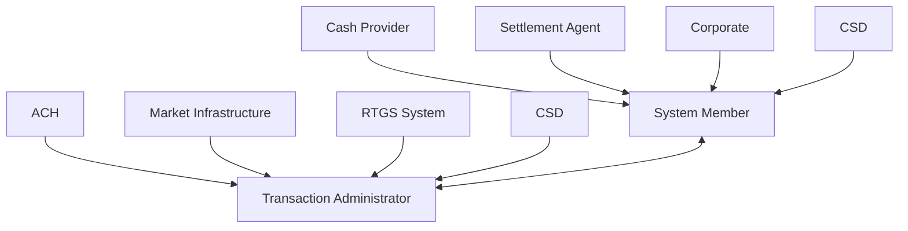

# Business roles and functional participants

[src-000014](../../../../../../../../evidence/omitted/335a400e27e5efca9fdafbb5.md); direct-body paragraph P100; Word file page10.

[Complete Word page](../../../../../../../../evidence/omitted/fc55a985bfdd0ad0ca28a867.md) · [Original artwork](../../../../../../../../evidence/omitted/b4cd3f6a5bc47a4326f9506f.md)

## Entities and relationships

| Source | Destination | Label or relationship |
| --- | --- | --- |
| Cash Provider | System Member | Directed source association |
| Settlement Agent | System Member | Directed source association |
| Corporate | System Member | Directed source association |
| CSD | System Member | Directed source association |
| ACH | Transaction Administrator | Directed source association |
| Market Infrastructure | Transaction Administrator | Directed source association |
| RTGS System | Transaction Administrator | Directed source association |
| CSD | Transaction Administrator | Directed source association |
| System Member | Transaction Administrator | Bidirectional source association |

## Participants

- [Cash Provider](../../../../../../../../shared/reference/participants/participant-src-000014-cash-provider.md)
- [Settlement Agent](../../../../../../../../shared/reference/participants/participant-src-000014-settlement-agent.md)
- [Corporate](../../../../../../../../shared/reference/participants/participant-src-000014-corporate.md)
- [Central Securities Depositories (CSD)](../../../../../../../../shared/reference/participants/participant-src-000014-central-securities-depositories-csd.md)
- [Automated Clearing House (ACH)](../../../../../../../../shared/reference/participants/participant-src-000014-automated-clearing-house-ach.md)
- [Market Infrastructure](../../../../../../../../shared/reference/participants/participant-src-000014-market-infrastructure.md)
- [Real Time Gross Settlement System (RTGS)](../../../../../../../../shared/reference/participants/participant-src-000014-real-time-gross-settlement-system-rtgs.md)
- [System Member](../../../../../../../../shared/reference/participants/participant-src-000014-system-member.md)
- [System / Transaction Administrator](../../../../../../../../shared/reference/participants/participant-src-000014-system-transaction-administrator.md)

## Qualifications

- Source stick-person icons are rendered as labelled boxes; arrows retain direction. Two CSD occurrences remain distinct drawing occurrences, linked to the same scoped definition. The bidirectional association is not an additional message exchange.
- Figure1 assigns CSD to System Member; T14 does not. T14 assigns Market Infrastructure and ACH to System Member; Figure1 shows them only as Transaction Administrator. P98 calls functional examples BusinessRoles. T12 definitions are limited to standing orders although the later flows cover additional functions.

## Rendering and visual review

The complete Word-composed source and final Mermaid12.3.0 reconstruction were directly compared on 2026-11-09. Actor labels, message labels, directions, order, associations, overview boundaries and execution-delay bars match. Source icons and layout are retained in the original image; the reconstruction uses text actors. Figures7/11 were corrected and re-rendered so the delay bar reaches the Return response. All38 Word pages were inventoried. Source discrepancies remain open where listed.

[Rendered PNG](../../../../../../../../evidence/omitted/072e40ae34e5637f4b3bf1e3.md) · [Rendered SVG](../../../../../../../../evidence/omitted/1402b29dc8b7a8537c3a63e9.md) · [Hash-bound review evidence](../../../../../../../../evidence/archived/fec8c4512c9430b9cb6ef03e.md)
