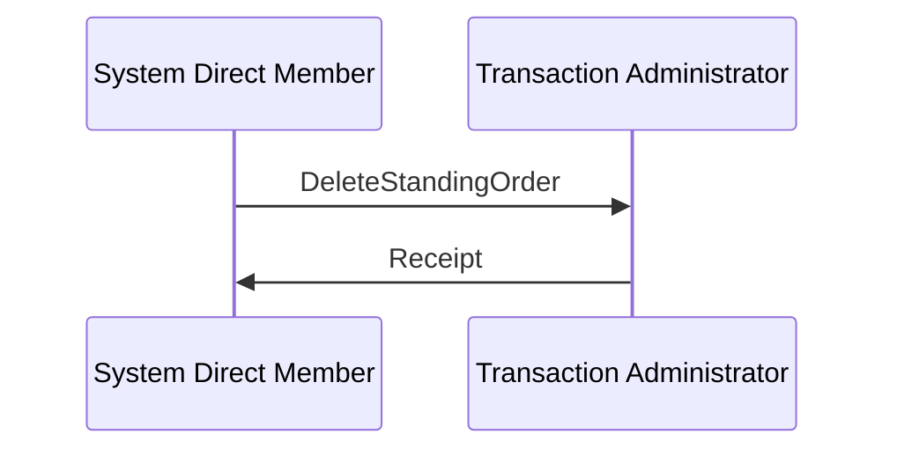

# Delete Standing Order Scenario

[src-000014](../../../../../../../../evidence/omitted/335a400e27e5efca9fdafbb5.md); direct-body paragraph P367; Word file page37.

[Complete Word page](../../../../../../../../evidence/omitted/faec7638dfbc2514b20ae9ca.md) · [Original artwork](../../../../../../../../evidence/omitted/839756295503fefc14988e7a.md)

## Entities and relationships

| Source | Destination | Label or relationship |
| --- | --- | --- |
| System Direct Member | Transaction Administrator | DeleteStandingOrder |
| Transaction Administrator | System Direct Member | Receipt |

## Participants

- [System Direct Member](../../../../../../../../shared/reference/participants/participant-src-000014-system-direct-member.md)
- [System / Transaction Administrator](../../../../../../../../shared/reference/participants/participant-src-000014-system-transaction-administrator.md)

## Qualifications

- The picture shows only the System Direct Member and Transaction Administrator. Account owner/servicing institution are narrative relationship roles (P75–78), not extra lifelines.
- Solid source exchange lines and ordering are retained. No timeout, condition, response code or mandatory Receipt is inferred solely from the picture.
- P364 says reservation facility inside Delete Standing Order Scenario; P365–366 and Figure36 describe standing-order deletion.

[Flow, alternatives and source narrative](../../flows/flow-src-000014-p363-delete-standing-order-scenario.md)

## Rendering and visual review

The complete Word-composed source and final Mermaid12.3.0 reconstruction were directly compared on 2026-11-09. Actor labels, message labels, directions, order, associations, overview boundaries and execution-delay bars match. Source icons and layout are retained in the original image; the reconstruction uses text actors. Figures7/11 were corrected and re-rendered so the delay bar reaches the Return response. All38 Word pages were inventoried. Source discrepancies remain open where listed.

[Rendered PNG](../../../../../../../../evidence/omitted/1994c97aca8ff87886c497b6.md) · [Rendered SVG](../../../../../../../../evidence/omitted/ad9d956c0e1e5fb56a446d96.md) · [Hash-bound review evidence](../../../../../../../../evidence/archived/fec8c4512c9430b9cb6ef03e.md)
