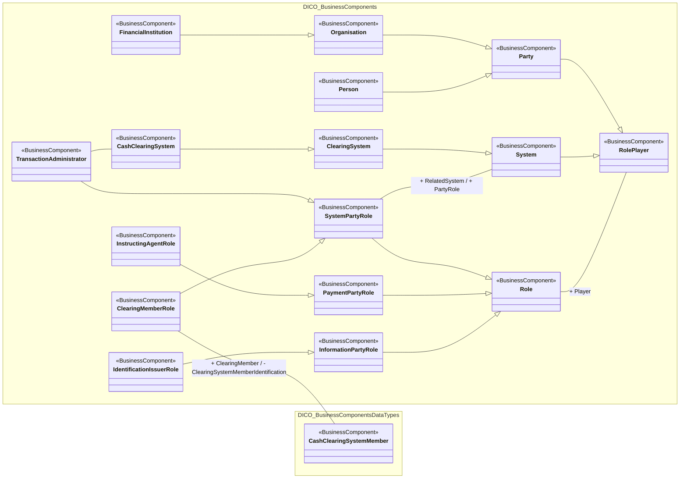

# Operational cash-management role players

[src-000016](../../../../../../../../../evidence/omitted/42cf3c4088baf4d4c6dc07c1.md), RolePlayers!A1; xl/drawings/drawing2.xml; anchor 1. Original image SHA-256: 710177933794856013ede2a5093526038c4e457f7e3dfbf7719e7d8bea4ea424.

[Original complete figure](../../../../../../../../../evidence/omitted/a5404bb7003a217065b5848c.md) · [Rendered Mermaid SVG](../../../../../../../../../evidence/omitted/59bb58cbb60bea9ad0bf0035.md) · [Rendered Mermaid PNG](../../../../../../../../../evidence/omitted/b62a218bb68ffa38593d1482.md)

## Source reconstruction

## Entities and relationships

Role associates with its RolePlayer. Information, payment and system-party roles specialize Role, while Party and System specialize RolePlayer. System roles and clearing-member identification remain distinct from the party or institution playing them. TransactionAdministrator specializes SystemPartyRole and associates with CashClearingSystem.

All 17 visible node occurrences and 18 relationship lines are retained. No numeric multiplicities are printed in this source view; none are inferred. Namespaces group only printed from-package labels for readability; the source does not draw those enclosing boxes. Nodes with no printed package remain outside these groups. No package membership is inferred from the component name. Association labels retain literal +/− prefixes and combined end names. Their re-layout position is not additional navigability evidence. The native class inheritance marker is reserved for the source’s hollow-triangle generalizations. Source editor/navigation icons are omitted as interface decoration; no business entity or relationship is excluded.

## Complete relationship register

| From node | To node | Source relationship kind | Visible source label(s) | From-end multiplicity | To-end multiplicity |
| --- | --- | --- | --- | --- | --- |
| Role | RolePlayer | association | + Player | not printed | not printed |
| InformationPartyRole | Role | generalization: subtype to supertype | (unlabelled in source) | not printed | not printed |
| PaymentPartyRole | Role | generalization: subtype to supertype | (unlabelled in source) | not printed | not printed |
| SystemPartyRole | Role | generalization: subtype to supertype | (unlabelled in source) | not printed | not printed |
| IdentificationIssuerRole | InformationPartyRole | generalization: subtype to supertype | (unlabelled in source) | not printed | not printed |
| InstructingAgentRole | PaymentPartyRole | generalization: subtype to supertype | (unlabelled in source) | not printed | not printed |
| ClearingMemberRole | SystemPartyRole | generalization: subtype to supertype | (unlabelled in source) | not printed | not printed |
| TransactionAdministrator | SystemPartyRole | generalization: subtype to supertype | (unlabelled in source) | not printed | not printed |
| SystemPartyRole | System | association | + RelatedSystem / + PartyRole | not printed | not printed |
| System | RolePlayer | generalization: subtype to supertype | (unlabelled in source) | not printed | not printed |
| Party | RolePlayer | generalization: subtype to supertype | (unlabelled in source) | not printed | not printed |
| ClearingSystem | System | generalization: subtype to supertype | (unlabelled in source) | not printed | not printed |
| CashClearingSystem | ClearingSystem | generalization: subtype to supertype | (unlabelled in source) | not printed | not printed |
| Person | Party | generalization: subtype to supertype | (unlabelled in source) | not printed | not printed |
| Organisation | Party | generalization: subtype to supertype | (unlabelled in source) | not printed | not printed |
| FinancialInstitution | Organisation | generalization: subtype to supertype | (unlabelled in source) | not printed | not printed |
| ClearingMemberRole | CashClearingSystemMember | association | + ClearingMember / - ClearingSystemMemberIdentification | not printed | not printed |
| TransactionAdministrator | CashClearingSystem | association | (unlabelled in source) | not printed | not printed |

## Entity definitions and precise workbook locators

| Visible label | Source package / stereotype | Definition evidence |
| --- | --- | --- |
| Role | DICO_BusinessComponents / BusinessComponent | [FullBusinessModel!A3769:D3769](../sheets/02-fullbusinessmodel/tbl-0020.md) — Role of a party in an activity. |
| RolePlayer | DICO_BusinessComponents / BusinessComponent | [FullBusinessModel!A3775:D3775](../sheets/02-fullbusinessmodel/tbl-0020.md) — Type of entity that plays a specific role in a specific context. |
| InformationPartyRole | DICO_BusinessComponents / BusinessComponent | [FullBusinessModel!A2046:D2046](../sheets/02-fullbusinessmodel/tbl-0012.md) — Role played by a party as source of information. |
| PaymentPartyRole | DICO_BusinessComponents / BusinessComponent | [FullBusinessModel!A3157:D3157](../sheets/02-fullbusinessmodel/tbl-0017.md) — Role played by a party in the context of a payment. |
| SystemPartyRole | DICO_BusinessComponents / BusinessComponent | [FullBusinessModel!A4888:D4888](../sheets/02-fullbusinessmodel/tbl-0026.md) — Role played by a party in a system. |
| System | DICO_BusinessComponents / BusinessComponent | [FullBusinessModel!A4832:D4832](../sheets/02-fullbusinessmodel/tbl-0026.md) — Set of integrated applications that provides centralised services such as clearing, netting, reconciliation, trading and/or settlement. |
| Party | DICO_BusinessComponents / BusinessComponent | [FullBusinessModel!A2983:D2983](../sheets/02-fullbusinessmodel/tbl-0016.md) — Entity involved in an activity. |
| IdentificationIssuerRole | DICO_BusinessComponents / BusinessComponent | [FullBusinessModel!A2004:D2004](../sheets/02-fullbusinessmodel/tbl-0012.md) — Entity that assigns the identification. |
| InstructingAgentRole | DICO_BusinessComponents / BusinessComponent | [FullBusinessModel!A2070:D2070](../sheets/02-fullbusinessmodel/tbl-0012.md) — Agent that instructs the next party in the chain to carry out the (set of) instruction(s). |
| CashClearingSystemMember | DICO_BusinessComponentsDataTypes / BusinessComponent | [FullBusinessModel!A619:D619](../sheets/02-fullbusinessmodel/tbl-0005.md) — Unique and unambiguous identifier for a clearing system member, as assigned by the clearing system. In some clearing systems, the accounts of the clearing system members are also assigned an identifier. The identifier can be used when transmitting, reconciling and confirming payment orders or security transfer instructions prior to settlement, and may include the netting of instructions and the establishment of final positions for settlement. |
| ClearingMemberRole | DICO_BusinessComponents / BusinessComponent | [FullBusinessModel!A802:D802](../sheets/02-fullbusinessmodel/tbl-0006.md) — Member of an exchange's clearing corporation, responsible for executing client trades and involved in the clearing of trades. |
| ClearingSystem | DICO_BusinessComponents / BusinessComponent | [FullBusinessModel!A812:D812](../sheets/02-fullbusinessmodel/tbl-0006.md) — Specifies the system which plays a role in the clearing process. |
| Person | DICO_BusinessComponents / BusinessComponent | [FullBusinessModel!A3230:D3230](../sheets/02-fullbusinessmodel/tbl-0018.md) — Human entity, as distinguished from a corporate entity (which is sometimes referred to as an 'artificial person'). |
| Organisation | DICO_BusinessComponents / BusinessComponent | [FullBusinessModel!A2920:D2920](../sheets/02-fullbusinessmodel/tbl-0016.md) — Organised structure that is set up for a particular purpose. For example, a business, government body, department, charity, or financial institution. |
| TransactionAdministrator | DICO_BusinessComponents / BusinessComponent | [FullBusinessModel!A5111:D5111](../sheets/02-fullbusinessmodel/tbl-0027.md) — Set of integrated applications that provides centralised services such as clearing and settlement. |
| CashClearingSystem | DICO_BusinessComponents / BusinessComponent | [FullBusinessModel!A613:D613](../sheets/02-fullbusinessmodel/tbl-0005.md) — Clearing system that processes only cash transfers. |
| FinancialInstitution | DICO_BusinessComponents / BusinessComponent | [FullBusinessModel!A1861:D1861](../sheets/02-fullbusinessmodel/tbl-0011.md) — Organisation established primarily to provide financial services. |

## Participant and flow navigation

This is a conceptual entity model, not a message exchange diagram. A business component or relationship label is not automatically a functional participant or institution. [Message-set participant references](../../../participants.md) and [Message-set business flows](../../../flows/index.md) provide the independently sourced actor/process context. These references are navigational; source figure associations do not establish message direction.

## Rendering and visual review

2026-11-09: Mermaid 12.3.0 parsed and rendered successfully with Mermaid browser API + Chromium 156.0.8078.81. Direct comparison of each complete source image and rendered PNG; checked all 17 visible node occurrences, 18 relationship lines, literal endpoint labels, inheritance direction, package labels and printed/omitted stereotypes. No multiplicities are printed or inferred. The src-000164 displaced label is resolved from FullBusinessModel A2990:F2990 and A635:F635; original source retained. [Renderer evidence](../../../../../../../../../evidence/archived/4fe16645bb9c8f36c022fa26.md).

## Exact-image occurrence in src-000364 fig-0003

[T2S LimitUtilisationJournal — RolePlayers](../../../../../../../../securities/reference/message-sets/t2s-limit-utilisation-journal/february-2025/workbooks/src-000364/diagrams/fig-0003.md) retains its archive-member provenance and message-set context. Full source-figure SHA-256 and all visible component parent/definition claims match; see its declaration-row comparison.
