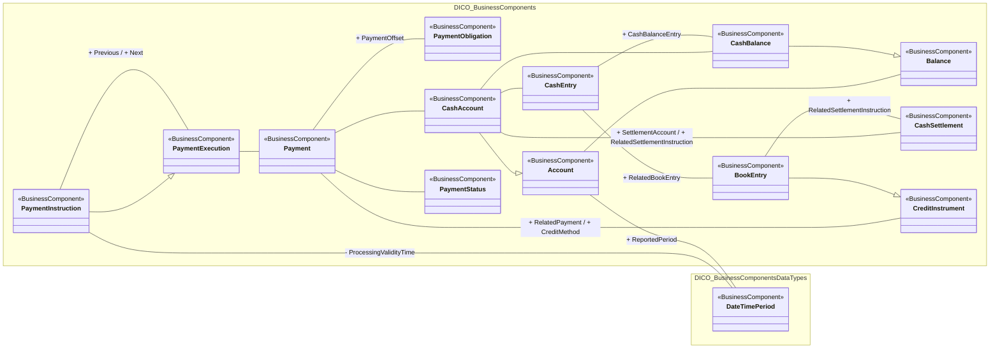

# Operational cash-management payment-related components

[src-000016](../../../../../../../../../evidence/omitted/42cf3c4088baf4d4c6dc07c1.md), PaymentsRelatedBCs!A1; xl/drawings/drawing3.xml; anchor 1. Original image SHA-256: 59d4a58a0bc28dae93762c2d8cd4a8eb99982bc61bd5bbcf088e61cb56d49ba5.

[Original complete figure](../../../../../../../../../evidence/omitted/d2a6100899f37465599df131.md) · [Rendered Mermaid SVG](../../../../../../../../../evidence/omitted/ac670ecbfb89843d46029126.md) · [Rendered Mermaid PNG](../../../../../../../../../evidence/omitted/8eca5abbb88fb3192a169b3a.md)

## Source reconstruction

## Entities and relationships

Payment instruction has both a generalization to PaymentExecution and a separate Previous/Next association. Payment relates to its obligation, status, cash account and credit method. BookEntry specializes CreditInstrument and connects CashEntry and CashSettlement. Cash-account, balance and date-period relationships are preserved without deriving payment directions.

All 14 visible node occurrences and 19 relationship lines are retained. No numeric multiplicities are printed in this source view; none are inferred. Namespaces group only printed from-package labels for readability; the source does not draw those enclosing boxes. Nodes with no printed package remain outside these groups. No package membership is inferred from the component name. Association labels retain literal +/− prefixes and combined end names. Their re-layout position is not additional navigability evidence. The native class inheritance marker is reserved for the source’s hollow-triangle generalizations. Source editor/navigation icons are omitted as interface decoration; no business entity or relationship is excluded.

## Complete relationship register

| From node | To node | Source relationship kind | Visible source label(s) | From-end multiplicity | To-end multiplicity |
| --- | --- | --- | --- | --- | --- |
| PaymentInstruction | PaymentExecution | generalization: subtype to supertype | (unlabelled in source) | not printed | not printed |
| PaymentInstruction | PaymentExecution | association | + Previous / + Next | not printed | not printed |
| PaymentInstruction | DateTimePeriod | association | - ProcessingValidityTime | not printed | not printed |
| Account | DateTimePeriod | association | + ReportedPeriod | not printed | not printed |
| Account | Balance | association | (unlabelled in source) | not printed | not printed |
| CashAccount | Account | generalization: subtype to supertype | (unlabelled in source) | not printed | not printed |
| CashBalance | Balance | generalization: subtype to supertype | (unlabelled in source) | not printed | not printed |
| PaymentExecution | Payment | association | (unlabelled in source) | not printed | not printed |
| Payment | PaymentObligation | association | + PaymentOffset | not printed | not printed |
| Payment | CashAccount | association | (unlabelled in source) | not printed | not printed |
| CashAccount | CashBalance | association | (unlabelled in source) | not printed | not printed |
| Payment | PaymentStatus | association | (unlabelled in source) | not printed | not printed |
| Payment | CreditInstrument | association | + RelatedPayment / + CreditMethod | not printed | not printed |
| CashAccount | CashSettlement | association | + SettlementAccount / + RelatedSettlementInstruction | not printed | not printed |
| CashAccount | CashEntry | association | (unlabelled in source) | not printed | not printed |
| CashEntry | CashBalance | association | + CashBalanceEntry | not printed | not printed |
| CashEntry | BookEntry | association | + RelatedBookEntry | not printed | not printed |
| BookEntry | CreditInstrument | generalization: subtype to supertype | (unlabelled in source) | not printed | not printed |
| BookEntry | CashSettlement | association | + RelatedSettlementInstruction | not printed | not printed |

## Entity definitions and precise workbook locators

| Visible label | Source package / stereotype | Definition evidence |
| --- | --- | --- |
| PaymentExecution | DICO_BusinessComponents / BusinessComponent | [FullBusinessModel!A3070:D3070](../sheets/02-fullbusinessmodel/tbl-0017.md) — Process required for executing an end to end payment. It consists of a payment initiation which may be followed by a series of instructions. |
| DateTimePeriod | DICO_BusinessComponentsDataTypes / BusinessComponent | [FullBusinessModel!A1346:D1346](../sheets/02-fullbusinessmodel/tbl-0008.md) — Time span defined by a start date and time, and an end date and time. |
| PaymentInstruction | DICO_BusinessComponents / BusinessComponent | [FullBusinessModel!A3092:D3092](../sheets/02-fullbusinessmodel/tbl-0017.md) — Instruction to pay an amount of money to an ultimate beneficiary, on behalf of an originator. This instruction may have to be forwarded several times to complete the settlement chain. |
| Account | DICO_BusinessComponents / BusinessComponent | [FullBusinessModel!A24:D24](../sheets/02-fullbusinessmodel/tbl-0002.md) — Record of transactions in specific types of assets, maintained by a servicing party on behalf of one or more owning parties. Business relationship between an account servicer and one or more account owners. |
| Balance | DICO_BusinessComponents / BusinessComponent | [FullBusinessModel!A344:D344](../sheets/02-fullbusinessmodel/tbl-0003.md) — Numerical representation of the net increases and decreases in an account at a specific point in time. |
| PaymentObligation | DICO_BusinessComponents / BusinessComponent | [FullBusinessModel!A3126:D3126](../sheets/02-fullbusinessmodel/tbl-0017.md) — Obligation for the debtor to pay the creditor an amount of cash. |
| Payment | DICO_BusinessComponents / BusinessComponent | [FullBusinessModel!A3016:D3016](../sheets/02-fullbusinessmodel/tbl-0017.md) — Payment information and processes required to transfer cash end to end from the debtor to the creditor. |
| CashAccount | DICO_BusinessComponents / BusinessComponent | [FullBusinessModel!A548:D548](../sheets/02-fullbusinessmodel/tbl-0004.md) — Account to or from which a cash entry is made. |
| CashBalance | DICO_BusinessComponents / BusinessComponent | [FullBusinessModel!A602:D602](../sheets/02-fullbusinessmodel/tbl-0005.md) — Numerical representation of the net increases and decreases in an account at a specific point in time. A cash balance is calculated from a sum of cash credits minus a sum of cash debits. |
| PaymentStatus | DICO_BusinessComponents / BusinessComponent | [FullBusinessModel!A3176:D3176](../sheets/02-fullbusinessmodel/tbl-0017.md) — Specifies the status of a payment at a specified time. |
| CashSettlement | DICO_BusinessComponents / BusinessComponent | [FullBusinessModel!A702:D702](../sheets/02-fullbusinessmodel/tbl-0005.md) — Instruction between two financial institutions stipulating the cash transfer characteristics between the two parties. |
| CashEntry | DICO_BusinessComponents / BusinessComponent | [FullBusinessModel!A665:D665](../sheets/02-fullbusinessmodel/tbl-0005.md) — Posting of an item to a cash account, in the context of a cash transaction, that results in an increase or decrease to the balance of the account. |
| CreditInstrument | DICO_BusinessComponents / BusinessComponent | [FullBusinessModel!A1267:D1267](../sheets/02-fullbusinessmodel/tbl-0008.md) — Specifies the instrument to be used for the credit of a payment. |
| BookEntry | DICO_BusinessComponents / BusinessComponent | [FullBusinessModel!A416:D416](../sheets/02-fullbusinessmodel/tbl-0004.md) — Movement of cash between two accounts. One account is debited and the other account is credited. |

## Participant and flow navigation

This is a conceptual entity model, not a message exchange diagram. A business component or relationship label is not automatically a functional participant or institution. [Message-set participant references](../../../participants.md) and [Message-set business flows](../../../flows/index.md) provide the independently sourced actor/process context. These references are navigational; source figure associations do not establish message direction.

## Rendering and visual review

2026-11-09: Mermaid 12.3.0 parsed and rendered successfully with Mermaid browser API + Chromium 156.0.8078.81. Direct comparison of each complete source image and rendered PNG; checked all 14 visible node occurrences, 19 relationship lines, literal endpoint labels, inheritance direction, package labels and printed/omitted stereotypes. No multiplicities are printed or inferred. The src-000164 displaced label is resolved from FullBusinessModel A2990:F2990 and A635:F635; original source retained. [Renderer evidence](../../../../../../../../../evidence/archived/4fe16645bb9c8f36c022fa26.md).

