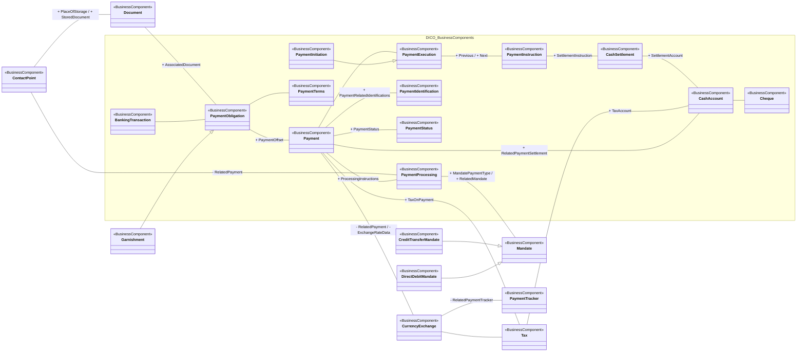

# Payments initiation conceptual model

[src-000175](../../../../../../../../../evidence/omitted/807236f9f4d5f25826f3ba17.md), PaymentsInitiation!A1; xl/drawings/drawing2.xml; anchor 1. Original image SHA-256: a5740b47f6f3cf50ca350c0c1f351db16630f0ee4522419c4cd897df562c9080.

[Original complete figure](../../../../../../../../../evidence/omitted/59f3b68e36b002850f558384.md) · [Rendered Mermaid SVG](../../../../../../../../../evidence/omitted/20d963031fae1c3924e3dfb4.md) · [Rendered Mermaid PNG](../../../../../../../../../evidence/omitted/fdd679c537164fc2a70f5c38.md)

## Source reconstruction

## Entities and relationships

Payment connects obligation, processing, identification, status, execution, tax, currency exchange and settlement account. Initiation specializes execution; credit-transfer and direct-debit mandates specialize Mandate; Garnishment specializes PaymentObligation. The long lower association connects Payment and CashAccount. Relationship-end labels are retained together without inferring message sender/receiver roles.

All 22 visible node occurrences and 25 relationship lines are retained. No numeric multiplicities are printed in this source view; none are inferred. Namespaces group only printed from-package labels for readability; the source does not draw those enclosing boxes. Nodes with no printed package remain outside these groups. No package membership is inferred from the component name. Association labels retain literal +/− prefixes and combined end names. Their re-layout position is not additional navigability evidence. The native class inheritance marker is reserved for the source’s hollow-triangle generalizations. Source editor/navigation icons are omitted as interface decoration; no business entity or relationship is excluded.

## Complete relationship register

| From node | To node | Source relationship kind | Visible source label(s) | From-end multiplicity | To-end multiplicity |
| --- | --- | --- | --- | --- | --- |
| ContactPoint | PaymentProcessing | association | - RelatedPayment | not printed | not printed |
| ContactPoint | Document | association | + PlaceOfStorage / + StoredDocument | not printed | not printed |
| Document | PaymentObligation | association | + AssociatedDocument | not printed | not printed |
| PaymentObligation | Payment | association | + PaymentOffset | not printed | not printed |
| PaymentObligation | PaymentTerms | association | (unlabelled in source) | not printed | not printed |
| BankingTransaction | PaymentObligation | association | (unlabelled in source) | not printed | not printed |
| Garnishment | PaymentObligation | generalization: subtype to supertype | (unlabelled in source) | not printed | not printed |
| Payment | PaymentIdentification | association | + PaymentRelatedIdentifications | not printed | not printed |
| Payment | PaymentStatus | association | + PaymentStatus | not printed | not printed |
| Payment | PaymentExecution | association | (unlabelled in source) | not printed | not printed |
| Payment | PaymentProcessing | association | + ProcessingInstructions | not printed | not printed |
| PaymentProcessing | Mandate | association | + MandatePaymentType / + RelatedMandate | not printed | not printed |
| CreditTransferMandate | Mandate | generalization: subtype to supertype | (unlabelled in source) | not printed | not printed |
| DirectDebitMandate | Mandate | generalization: subtype to supertype | (unlabelled in source) | not printed | not printed |
| PaymentInitiation | PaymentExecution | generalization: subtype to supertype | (unlabelled in source) | not printed | not printed |
| PaymentExecution | PaymentInstruction | association | + Previous / + Next | not printed | not printed |
| PaymentInstruction | CashSettlement | association | + SettlementInstruction | not printed | not printed |
| CashSettlement | CashAccount | association | + SettlementAccount | not printed | not printed |
| CashAccount | Cheque | association | (unlabelled in source) | not printed | not printed |
| Tax | CashAccount | association | + TaxAccount | not printed | not printed |
| Payment | Tax | association | + TaxOnPayment | not printed | not printed |
| Payment | CurrencyExchange | association | - RelatedPayment / - ExchangeRateData | not printed | not printed |
| CurrencyExchange | Tax | association | (unlabelled in source) | not printed | not printed |
| CurrencyExchange | PaymentTracker | association | - RelatedPaymentTracker | not printed | not printed |
| Payment | CashAccount | association | + RelatedPaymentSettlement | not printed | not printed |

## Entity definitions and precise workbook locators

| Visible label | Source package / stereotype | Definition evidence |
| --- | --- | --- |
| ContactPoint | (package not printed) / BusinessComponent | [FullBusinessModel!A994:D994](../sheets/02-fullbusinessmodel/tbl-0006.md) — Number, physical or virtual address, used for communication. |
| PaymentProcessing | DICO_BusinessComponents / BusinessComponent | [FullBusinessModel!A3200:D3200](../sheets/02-fullbusinessmodel/tbl-0017.md) — Specifies how a payment must be processed, for instance through which specific clearing channel. |
| Mandate | (package not printed) / BusinessComponent | [FullBusinessModel!A2679:D2679](../sheets/02-fullbusinessmodel/tbl-0015.md) — Authorisation given by an issuing party to a holder party to act on the issuer's behalf. |
| CreditTransferMandate | (package not printed) / BusinessComponent | [FullBusinessModel!A1295:D1295](../sheets/02-fullbusinessmodel/tbl-0008.md) — Authorisation in favour of the creditor agent given by the creditor to initiate a credit transfer from its own account. |
| DirectDebitMandate | (package not printed) / BusinessComponent | [FullBusinessModel!A1582:D1582](../sheets/02-fullbusinessmodel/tbl-0009.md) — Authorisation in favour of the creditor given by the debtor to debit its own account. |
| Document | (package not printed) / BusinessComponent | [FullBusinessModel!A1675:D1675](../sheets/02-fullbusinessmodel/tbl-0010.md) — General information that unambiguously identifies a document, such as identification number and issue date time. |
| PaymentIdentification | DICO_BusinessComponents / BusinessComponent | [FullBusinessModel!A3122:D3122](../sheets/02-fullbusinessmodel/tbl-0017.md) — Specifies the different identifications associated with a payment transaction. |
| PaymentStatus | DICO_BusinessComponents / BusinessComponent | [FullBusinessModel!A3216:D3216](../sheets/02-fullbusinessmodel/tbl-0018.md) — Specifies the status of a payment at a specified time. |
| PaymentObligation | DICO_BusinessComponents / BusinessComponent | [FullBusinessModel!A3166:D3166](../sheets/02-fullbusinessmodel/tbl-0017.md) — Obligation for the debtor to pay the creditor an amount of cash. |
| Payment | DICO_BusinessComponents / BusinessComponent | [FullBusinessModel!A3055:D3055](../sheets/02-fullbusinessmodel/tbl-0017.md) — Payment information and processes required to transfer cash end to end from the debtor to the creditor. |
| PaymentExecution | DICO_BusinessComponents / BusinessComponent | [FullBusinessModel!A3109:D3109](../sheets/02-fullbusinessmodel/tbl-0017.md) — Process required for executing an end to end payment. It consists of a payment initiation which may be followed by a series of instructions. |
| PaymentInstruction | DICO_BusinessComponents / BusinessComponent | [FullBusinessModel!A3132:D3132](../sheets/02-fullbusinessmodel/tbl-0017.md) — Instruction to pay an amount of money to an ultimate beneficiary, on behalf of an originator. This instruction may have to be forwarded several times to complete the settlement chain. |
| CashSettlement | DICO_BusinessComponents / BusinessComponent | [FullBusinessModel!A717:D717](../sheets/02-fullbusinessmodel/tbl-0005.md) — Instruction between two financial institutions stipulating the cash transfer characteristics between the two parties. |
| PaymentTerms | DICO_BusinessComponents / BusinessComponent | [FullBusinessModel!A3232:D3232](../sheets/02-fullbusinessmodel/tbl-0018.md) — Specifies the payment terms of the obligation. |
| BankingTransaction | DICO_BusinessComponents / BusinessComponent | [FullBusinessModel!A380:D380](../sheets/02-fullbusinessmodel/tbl-0003.md) — Transaction executed by the client of a financial institution from/to the account serviced by the financial institution, such as mortgage payment. |
| PaymentInitiation | DICO_BusinessComponents / BusinessComponent | [FullBusinessModel!A3131:D3131](../sheets/02-fullbusinessmodel/tbl-0017.md) — Instruction to pay an amount of money to an ultimate beneficiary, on behalf of an originator. This instruction is the first of the series of instructions which may be used to execute a payment. It is normally sent by the initiating party to the forwarding agent or to the debtor's agent. |
| CurrencyExchange | (package not printed) / BusinessComponent | [FullBusinessModel!A1310:D1310](../sheets/02-fullbusinessmodel/tbl-0008.md) — Information needed to process a currency exchange or conversion. |
| Tax | (package not printed) / BusinessComponent | [FullBusinessModel!A4968:D4968](../sheets/02-fullbusinessmodel/tbl-0026.md) — Amount of money due to the government or tax authority, according to various pre-defined parameters such as thresholds or income. |
| CashAccount | DICO_BusinessComponents / BusinessComponent | [FullBusinessModel!A562:D562](../sheets/02-fullbusinessmodel/tbl-0004.md) — Account to or from which a cash entry is made. |
| Cheque | DICO_BusinessComponents / BusinessComponent | [FullBusinessModel!A774:D774](../sheets/02-fullbusinessmodel/tbl-0005.md) — Negotiable instrument instructing a financial institution to pay a specific amount of a specific currency from the account of the drawer with that institution. |
| Garnishment | (package not printed) / BusinessComponent | [FullBusinessModel!A1975:D1975](../sheets/02-fullbusinessmodel/tbl-0011.md) — Legal process whereby the debtor pays another party than the creditor to settle a debt due by the creditor to that other party. |
| PaymentTracker | (package not printed) / BusinessComponent | [FullBusinessModel!A3240:D3240](../sheets/02-fullbusinessmodel/tbl-0018.md) — Specifies the agent specific tracking system information of a payment transaction. |

## Participant and flow navigation

This is a conceptual entity model, not a message exchange diagram. A business component or relationship label is not automatically a functional participant or institution. [Message-set participant references](../../../participants.md) and [Message-set business flows](../../../flows/index.md) provide the independently sourced actor/process context. These references are navigational; source figure associations do not establish message direction.

## Rendering and visual review

2026-11-09: Mermaid 12.3.0 parsed and rendered successfully with Mermaid browser API + Chromium 156.0.8078.81. Direct comparison of each complete source image and rendered PNG; checked all 22 visible node occurrences, 25 relationship lines, literal endpoint labels, inheritance direction, package labels and printed/omitted stereotypes. No multiplicities are printed or inferred. The src-000164 displaced label is resolved from FullBusinessModel A2990:F2990 and A635:F635; original source retained. [Renderer evidence](../../../../../../../../../evidence/archived/4fe16645bb9c8f36c022fa26.md).

