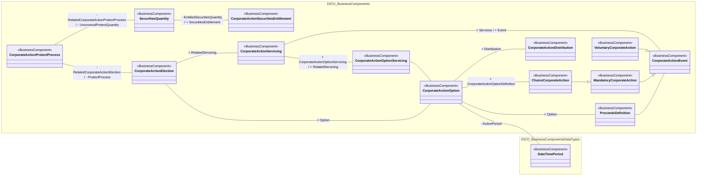

# Option-related corporate-action event, election and servicing

[src-000081](../../../../../../../../../evidence/omitted/5d05ada13720516836bc5043.md), OptionRelatedEvent!A1:AO46; xl/drawings/drawing5.xml; anchor 1. Original image SHA-256: 5550469d8a8d36ff791558f9813e56d0ff28db86cfca8c46b09f8ed2fe0da557.

[Original complete figure](../../../../../../../../../evidence/omitted/b3136df983ace86ac82d6e55.md) · [Rendered Mermaid SVG](../../../../../../../../../evidence/omitted/d94906d15f6e2e5c0ec9f7a5.md) · [Rendered Mermaid PNG](../../../../../../../../../evidence/omitted/77bf2240c1ab38b20a80afa2.md)

## Source reconstruction

## Entities and relationships

The option connects election, the valid action period, proceeds definition, servicing and distribution. Election connects protect processing and servicing. Protect processing and securities entitlement each have a separately named association with SecuritiesQuantity. The right-hand long association links CorporateActionEvent and CorporateActionServicing; its Event/Services endpoint labels are preserved. Mandatory/voluntary actions specialize Event; choice actions specialize MandatoryCorporateAction.

All 14 visible node occurrences and 16 relationship lines are retained. No numeric multiplicity is shown in this source view, so none is inferred. Namespaces group the source’s printed “from” package labels for readability; the source did not draw those enclosing package boxes. Association labels retain literal +/− prefixes and combined end names. Their re-layout position is not additional navigability evidence. The native class inheritance marker is reserved for the source’s hollow-triangle generalizations. Source editor/navigation icons are omitted as interface decoration; no business entity or relationship is excluded.

## Complete relationship register

| From node | To node | Source relationship kind | Visible source label(s) | From-end multiplicity | To-end multiplicity |
| --- | --- | --- | --- | --- | --- |
| CorporateActionProtectProcess | CorporateActionElection | association | - RelatedCorporateActionElection / - ProtectProcess | not printed | not printed |
| CorporateActionProtectProcess | SecuritiesQuantity | association | - RelatedCorporateActionProtectProcess / - UncoveredProtectQuantity | not printed | not printed |
| SecuritiesQuantity | CorporateActionSecuritiesEntitlement | association | - EntitledSecuritiesQuantity / + SecuritiesEntitlement | not printed | not printed |
| CorporateActionElection | CorporateActionOption | association | + Option | not printed | not printed |
| CorporateActionElection | CorporateActionServicing | association | + RelatedServicing | not printed | not printed |
| CorporateActionServicing | CorporateActionOptionServicing | association | + CorporateActionOptionServicing / + RelatedServicing | not printed | not printed |
| CorporateActionOptionServicing | CorporateActionOption | association | (unlabelled in source) | not printed | not printed |
| CorporateActionOption | DateTimePeriod | association | - ActionPeriod | not printed | not printed |
| CorporateActionOption | ProceedsDefinition | association | + Option | not printed | not printed |
| ProceedsDefinition | CorporateActionEvent | association | (unlabelled in source) | not printed | not printed |
| CorporateActionOption | ChoiceCorporateAction | association | + CorporateActionOptionDefinition | not printed | not printed |
| CorporateActionOption | CorporateActionDistribution | association | + Distribution | not printed | not printed |
| ChoiceCorporateAction | MandatoryCorporateAction | generalization: subtype to supertype | (unlabelled in source) | not printed | not printed |
| MandatoryCorporateAction | CorporateActionEvent | generalization: subtype to supertype | (unlabelled in source) | not printed | not printed |
| VoluntaryCorporateAction | CorporateActionEvent | generalization: subtype to supertype | (unlabelled in source) | not printed | not printed |
| CorporateActionServicing | CorporateActionEvent | association | + Services / + Event | not printed | not printed |

## Entity definitions and precise workbook locators

| Visible label | Source package / stereotype | Definition evidence |
| --- | --- | --- |
| CorporateActionProtectProcess | DICO_BusinessComponents / BusinessComponent | [FullBusinessModel!A1194:D1194](../sheets/02-fullbusinessmodel/tbl-0007.md) — Provides detailed information on protect and cover protect instructions. |
| SecuritiesQuantity | DICO_BusinessComponents / BusinessComponent | [FullBusinessModel!A4350:D4350](../sheets/02-fullbusinessmodel/tbl-0023.md) — Quantity of a security. |
| CorporateActionSecuritiesEntitlement | DICO_BusinessComponents / BusinessComponent | [FullBusinessModel!A1202:D1202](../sheets/02-fullbusinessmodel/tbl-0008.md) — Rights for securities entitled to the account owner based on the terms of the corporate action event and the balance of underlying securities. |
| CorporateActionElection | DICO_BusinessComponents / BusinessComponent | [FullBusinessModel!A1066:D1066](../sheets/02-fullbusinessmodel/tbl-0007.md) — Decision taken by the account holder regarding the corporate action event. |
| CorporateActionServicing | DICO_BusinessComponents / BusinessComponent | [FullBusinessModel!A1205:D1205](../sheets/02-fullbusinessmodel/tbl-0008.md) — Services which consists in notifying the investor or its agent of a corporate event and calculating its proceeds based on its holdings. |
| CorporateActionOptionServicing | DICO_BusinessComponents / BusinessComponent | [FullBusinessModel!A1170:D1170](../sheets/02-fullbusinessmodel/tbl-0007.md) — Option servicing process which calculates the entitlement based on a corporate action option. |
| CorporateActionOption | DICO_BusinessComponents / BusinessComponent | [FullBusinessModel!A1152:D1152](../sheets/02-fullbusinessmodel/tbl-0007.md) — Provides information about the alternatives available to an account owner when participating to a corporate action event. This is defined at a general level without looking at the specificities of the securities balances. |
| CorporateActionDistribution | DICO_BusinessComponents / BusinessComponent | [FullBusinessModel!A1048:D1048](../sheets/02-fullbusinessmodel/tbl-0007.md) — Distribution of the proceeds of a CA event. |
| ChoiceCorporateAction | DICO_BusinessComponents / BusinessComponent | [FullBusinessModel!A794:D794](../sheets/02-fullbusinessmodel/tbl-0005.md) — Mandatory with choice corporate action event that involves a choice on behalf of the owner of the securities. The shareholders are given a chance to choose among several options. |
| MandatoryCorporateAction | DICO_BusinessComponents / BusinessComponent | [FullBusinessModel!A2702:D2702](../sheets/02-fullbusinessmodel/tbl-0015.md) — Corporate action that will result in only one possibility for account holders. The shareholder is just a passive beneficiary of these actions. |
| VoluntaryCorporateAction | DICO_BusinessComponents / BusinessComponent | [FullBusinessModel!A5384:D5384](../sheets/02-fullbusinessmodel/tbl-0028.md) — Participation in the corporate action is voluntary. To take part in the event, the account owner must provide its instructions. |
| CorporateActionEvent | DICO_BusinessComponents / BusinessComponent | [FullBusinessModel!A1083:D1083](../sheets/02-fullbusinessmodel/tbl-0007.md) — An event determined by a corporation's board of directors, that changes the existing corporate capital structure or financial condition. |
| ProceedsDefinition | DICO_BusinessComponents / BusinessComponent | [FullBusinessModel!A3516:D3516](../sheets/02-fullbusinessmodel/tbl-0019.md) — Definition of exchanges of cash and/or securities available in the processing of corporate actions. |
| DateTimePeriod | DICO_BusinessComponentsDataTypes / BusinessComponent | [FullBusinessModel!A1363:D1363](../sheets/02-fullbusinessmodel/tbl-0008.md) — Time span defined by a start date and time, and an end date and time. |

## Participant and flow navigation

This is a conceptual entity model, not a message exchange diagram. A business component or relationship label is not automatically a functional participant or institution. [Message-set participant references](../../../participants.md) and [Message-set business flows](../../../flows/index.md) provide the independently sourced actor/process context. These references are navigational; source figure associations do not establish message direction.

## Rendering and visual review

2026-11-09: Mermaid 12.3.0 parsed and rendered successfully with Mermaid browser API + Chromium 156.0.8078.81. Visually compared original complete source figure with final rendered PNG, checking every entity occurrence, package/stereotype, association endpoint, arrow type, inheritance direction and literal label. All23/26/14/16 lines respectively reconciled in explicit relationship registers. [Renderer evidence](../../../../../../../../../evidence/archived/0be16e587a9ebe48c2259883.md).

