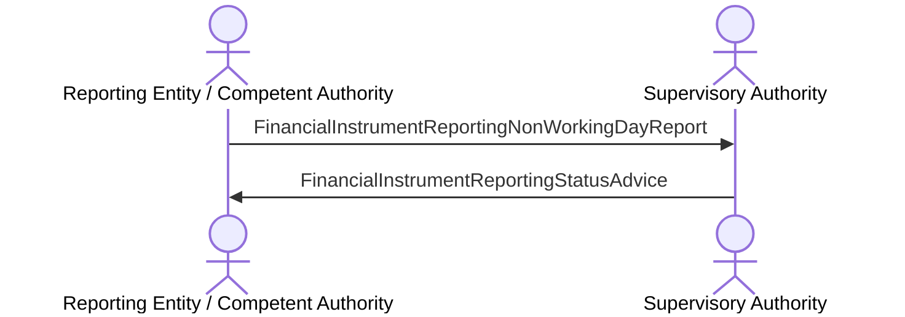

# Non-working days — direct reporting

[src-000320](../../../../../../../../evidence/omitted/b0e9dc6419046e4d0523e995.md); direct-body paragraph P190; BusinessTransactions / Non Working Day BusinessTransaction  / Direct Reporting.

[Original image](../../../../../../../../evidence/omitted/58008c5f6880628ed8cc2132.md) · [Readable original preview](../../../../../../../../evidence/omitted/3a2ad08d022d03eb89fba666.md) · [Flow, conditions and narrative responsibilities](../../flows/flow-src-000320-p188-direct-reporting.md)

## Source reconstruction

## Actors and relationships

- [Reporting Entity](../../../../../../../../shared/reference/participants/participant-src-000320-reporting-entity.md) / [Competent Authority](../../../../../../../../shared/reference/participants/participant-src-000320-competent-authority.md)
- [Supervisory Authority](../../../../../../../../shared/reference/participants/participant-src-000320-supervisory-authority.md)

| Order | Sender | Receiver | Literal source message / exchange | Source condition or fragment |
| --- | --- | --- | --- | --- |
| 1 | Reporting Entity / Competent Authority | Supervisory Authority | FinancialInstrumentReportingNonWorkingDayReport | Outside conditional frame |
| 2 | Supervisory Authority | Reporting Entity / Competent Authority | FinancialInstrumentReportingStatusAdvice | Outside conditional frame |

The source activation bars are execution markers without specified duration. Vertical message ordering is retained; synchronous versus asynchronous transport behavior is not inferred. OR-labelled message alternatives remain alternatives, not two required transmissions.

## Qualifications

No source discrepancy was identified in this picture transcription. Wider source and business review remains separate.

## Rendering and visual review

Mermaid 12.3.0 with Mermaid browser API + Chromium 156.0.8078.81 parsed and rendered this reconstruction. The original and rendered PNG were directly compared on 2026-11-09 (Europe/Warsaw), checking labels, endpoints, order, branches and repeated exchanges. Result: **pass**.

[Rendered SVG](../../../../../../../../evidence/omitted/dd067471e62e6286efe8d517.md) · [Rendered PNG](../../../../../../../../evidence/omitted/118ac59a3e192afa5e20ea0d.md) · [Hash-bound visual-review evidence](../../../../../../../../evidence/archived/23fb2a60ad772ea57058b145.md)

This review does not resolve conflicting source statements or native hidden-content coverage.
