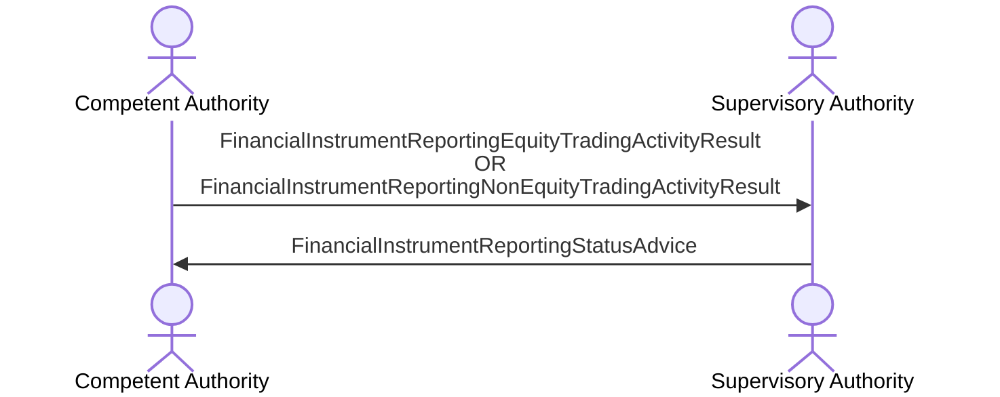

# Trading activity results — authority reporting

[src-000320](../../../../../../../../evidence/omitted/b0e9dc6419046e4d0523e995.md); direct-body paragraph P236; BusinessTransactions / Trading Activity Result BusinessTransaction / In-Direct Reporting.

[Original image](../../../../../../../../evidence/omitted/244adc8324cb1457c194a751.md) · [Readable original preview](../../../../../../../../evidence/omitted/ac25986633f6ac3afc2530fa.md) · [Flow, conditions and narrative responsibilities](../../flows/flow-src-000320-p234-in-direct-reporting.md)

## Source reconstruction

## Actors and relationships

- [Competent Authority](../../../../../../../../shared/reference/participants/participant-src-000320-competent-authority.md)
- [Supervisory Authority](../../../../../../../../shared/reference/participants/participant-src-000320-supervisory-authority.md)

| Order | Sender | Receiver | Literal source message / exchange | Source condition or fragment |
| --- | --- | --- | --- | --- |
| 1 | Competent Authority | Supervisory Authority | FinancialInstrumentReportingEquityTradingActivityResult OR FinancialInstrumentReportingNonEquityTradingActivityResult | Outside conditional frame |
| 2 | Supervisory Authority | Competent Authority | FinancialInstrumentReportingStatusAdvice | Outside conditional frame |

The source activation bars are execution markers without specified duration. Vertical message ordering is retained; synchronous versus asynchronous transport behavior is not inferred. OR-labelled message alternatives remain alternatives, not two required transmissions.

## Qualifications

- T18 names Supervisory Authority in its Role row, but the definition, P233–P235 and this figure assign submission of non-delegated calculation results to the Competent Authority. Both statements are retained; issue-000032.

## Rendering and visual review

Mermaid 12.3.0 with Mermaid browser API + Chromium 156.0.8078.81 parsed and rendered this reconstruction. The original and rendered PNG were directly compared on 2026-11-09 (Europe/Warsaw), checking labels, endpoints, order, branches and repeated exchanges. Result: **pass**.

[Rendered SVG](../../../../../../../../evidence/omitted/d63b30807bb727ca8f43982e.md) · [Rendered PNG](../../../../../../../../evidence/omitted/8c4138b7eebb4877e1fe4245.md) · [Hash-bound visual-review evidence](../../../../../../../../evidence/archived/23fb2a60ad772ea57058b145.md)

This review does not resolve conflicting source statements or native hidden-content coverage.
