# FITRR regulatory data identification and financial-asset context

[src-000322](../../../../../../../../../evidence/omitted/f39eee3c04bb287d206cc6a3.md), RegDataIdElements!A1:AQ69; xl/drawings/drawing3.xml; anchor 1. Original image SHA-256: 9553bf95e7bf923b3f7e092f44edf24db09914be13048191104b12d196ad95f3.

[Original complete figure](../../../../../../../../../evidence/omitted/2547430be8519d0fc17ecefb.md) · [Rendered Mermaid SVG](../../../../../../../../../evidence/omitted/6c011e1593f443c035406a63.md) · [Rendered Mermaid PNG](../../../../../../../../../evidence/omitted/fc0cefe11085a51478b250c5.md)

## Source reconstruction

```mermaid
classDiagram
direction TB
class SecuritiesIdentification {
<<BusinessComponent>>
}
class DateTimePeriod {
<<BusinessComponent>>
}
class Status {
<<BusinessComponent>>
}
class TradingMarket {
<<BusinessComponent>>
}
class Issuance {
<<BusinessComponent>>
}
class PlaceOfSettlement {
<<BusinessComponent>>
}
class Market {
<<BusinessComponent>>
}
class PartyIdentificationInformation {
<<BusinessComponent>>
}
class Party {
<<BusinessComponent>>
}
class OrganisationIdentification {
<<BusinessComponent>>
}
class Organisation {
<<BusinessComponent>>
}
class Person {
<<BusinessComponent>>
}
class FinancialInstitution {
<<BusinessComponent>>
}
class NonFinancialInstitution {
<<BusinessComponent>>
}
class PersonIdentification {
<<BusinessComponent>>
}
class Security {
<<BusinessComponent>>
}
class SecuritiesQuantity {
<<BusinessComponent>>
}
class Debt {
<<BusinessComponent>>
}
class MasterAgreement {
<<BusinessComponent>>
}
class Obligation {
<<BusinessComponent>>
}
class TradeIdentification {
<<BusinessComponent>>
}
class Trade {
<<BusinessComponent>>
}
class System {
<<BusinessComponent>>
}
class ClearingSystem {
<<BusinessComponent>>
}
class TradePartyRole {
<<BusinessComponent>>
}
class SecuritiesTradePartyRole {
<<BusinessComponent>>
}
class SecuritiesTrade {
<<BusinessComponent>>
}
class Asset {
<<BusinessComponent>>
}
class AssetClassification {
<<BusinessComponent>>
}
class Scheme {
<<BusinessComponent>>
}
class Derivative {
<<BusinessComponent>>
}
class Option {
<<BusinessComponent>>
}
class Swaps {
<<BusinessComponent>>
}
class SecuritiesPricing {
<<BusinessComponent>>
}
class Index {
<<BusinessComponent>>
}
class AssetHolding {
<<BusinessComponent>>
}
class Interest {
<<BusinessComponent>>
}
class InterestCalculation {
<<BusinessComponent>>
}
class Spread {
<<BusinessComponent>>
}
class Curve {
<<BusinessComponent>>
}
SecuritiesIdentification -- SecuritiesIdentification : + PrimeIdentification / + RelatedOtherIdentification
SecuritiesIdentification -- TradingMarket : + ListedSecurityTradingIdentification / + ApplicableTradingMarket
SecuritiesIdentification -- Security : + Identification / + IdentifiedSecurity
TradingMarket -- Issuance : - IssuePlace
TradingMarket -- PlaceOfSettlement : - SettlementMarket / - RelatedPlaceOfSettlement
DateTimePeriod -- Status : + ValidityTime
DateTimePeriod -- Issuance : + SubscriptionPeriod
DateTimePeriod -- System : - VersionValidityPeriod
Market -- Trade
Market -- PartyIdentificationInformation : - IdentifiedMarket / - Identification
PartyIdentificationInformation -- Party : + Identification / + IdentifiedParty
OrganisationIdentification --|> PartyIdentificationInformation
OrganisationIdentification -- Organisation
Organisation --|> Party
Person --|> Party
FinancialInstitution --|> Organisation
NonFinancialInstitution --|> Organisation
Person -- PersonIdentification
Party -- Security : - CloseLink / - CloseLinkSecurity
Issuance -- SecuritiesQuantity : + RelatedIssuance / + Minimum
Issuance -- SecuritiesQuantity : - IssueNominalAmount
MasterAgreement -- Trade : + GoverningDocument / + GovernedTrades
Obligation -- Trade
TradeIdentification -- Trade
System -- Trade
ClearingSystem --|> System
Trade -- Asset
Trade -- TradePartyRole
SecuritiesTrade --|> Trade
SecuritiesTradePartyRole --|> TradePartyRole
SecuritiesTradePartyRole -- SecuritiesTrade : + PartyRole
SecuritiesQuantity -- SecuritiesTrade : + TradeQuantity / + Trade
SecuritiesQuantity -- Security : + SecurityIdentification
Debt --|> Security
Debt -- SecuritiesQuantity : + MinimumDenominationDebt / - MinimumDenomination
Debt -- SecuritiesQuantity : + MinimumIncrementDebt / - MinimumIncrement
Debt -- InterestCalculation : + DebtInstrument / + NextInterest
InterestCalculation -- Interest
Interest -- AssetHolding : + RelatedAssetHolding
AssetHolding -- Asset : + AssetValue
Asset -- AssetClassification
AssetClassification -- Scheme : - AssetClassScheme
Derivative --|> Asset
Derivative -- Asset : + UnderlyingAsset
Option --|> Derivative
Swaps --|> Derivative
Derivative -- SecuritiesPricing : + RelatedFuture / + Tick
SecuritiesPricing -- Index
Index -- Spread
Spread -- Security : + BenchmarkSecurity
Spread -- InterestCalculation : - RelatedInterest
Spread -- Curve : + BenchmarkCurve
```

## Entities and relationships

The complete model connects securities identification, trading and settlement places, issuance and validity periods, party and organisation identities, trade identifiers and parties, governing agreement, system and clearing-system context, securities quantities, debt and interest calculations, asset classification, derivatives and price/benchmark relationships. Security identification has a self-association for prime and related identification. Issuance has two distinct quantity associations; debt also has separate denomination and increment associations. Derivative–Asset is displayed with a hollow-triangle generalization and UnderlyingAsset association sharing the same vertical route. FullBusinessModel!A1545:F1546 independently establishes both relationships, so the reconstruction separates the overlapping route into two lines rather than treating UnderlyingAsset as an inheritance label. Security–Asset inheritance exists in the workbook definition but is not drawn in this view and is not added to the source reconstruction. The figure is a conceptual reference model, not a database or business-message flow.

All 40 visible node occurrences and 52 relationship lines are retained. No numeric multiplicity is shown in this source view, so none is inferred. Printed package labels are preserved in the entity register. Nodes without a printed package remain explicitly unqualified in that register; no enclosing package boundaries are invented. Association labels retain literal +/− prefixes and combined end names. Their re-layout position is not additional navigability evidence. The native class inheritance marker is reserved for the source’s hollow-triangle generalizations. Source editor/navigation icons are omitted as interface decoration; no business entity or relationship is excluded.

## Complete relationship register

| From node | To node | Source relationship kind | Visible source label(s) | From-end multiplicity | To-end multiplicity |
| --- | --- | --- | --- | --- | --- |
| SecuritiesIdentification | SecuritiesIdentification | association | + PrimeIdentification / + RelatedOtherIdentification | not printed | not printed |
| SecuritiesIdentification | TradingMarket | association | + ListedSecurityTradingIdentification / + ApplicableTradingMarket | not printed | not printed |
| SecuritiesIdentification | Security | association | + Identification / + IdentifiedSecurity | not printed | not printed |
| TradingMarket | Issuance | association | - IssuePlace | not printed | not printed |
| TradingMarket | PlaceOfSettlement | association | - SettlementMarket / - RelatedPlaceOfSettlement | not printed | not printed |
| DateTimePeriod | Status | association | + ValidityTime | not printed | not printed |
| DateTimePeriod | Issuance | association | + SubscriptionPeriod | not printed | not printed |
| DateTimePeriod | System | association | - VersionValidityPeriod | not printed | not printed |
| Market | Trade | association | (unlabelled in source) | not printed | not printed |
| Market | PartyIdentificationInformation | association | - IdentifiedMarket / - Identification | not printed | not printed |
| PartyIdentificationInformation | Party | association | + Identification / + IdentifiedParty | not printed | not printed |
| OrganisationIdentification | PartyIdentificationInformation | generalization: subtype to supertype | (unlabelled in source) | not printed | not printed |
| OrganisationIdentification | Organisation | association | (unlabelled in source) | not printed | not printed |
| Organisation | Party | generalization: subtype to supertype | (unlabelled in source) | not printed | not printed |
| Person | Party | generalization: subtype to supertype | (unlabelled in source) | not printed | not printed |
| FinancialInstitution | Organisation | generalization: subtype to supertype | (unlabelled in source) | not printed | not printed |
| NonFinancialInstitution | Organisation | generalization: subtype to supertype | (unlabelled in source) | not printed | not printed |
| Person | PersonIdentification | association | (unlabelled in source) | not printed | not printed |
| Party | Security | association | - CloseLink / - CloseLinkSecurity | not printed | not printed |
| Issuance | SecuritiesQuantity | association | + RelatedIssuance / + Minimum | not printed | not printed |
| Issuance | SecuritiesQuantity | association | - IssueNominalAmount | not printed | not printed |
| MasterAgreement | Trade | association | + GoverningDocument / + GovernedTrades | not printed | not printed |
| Obligation | Trade | association | (unlabelled in source) | not printed | not printed |
| TradeIdentification | Trade | association | (unlabelled in source) | not printed | not printed |
| System | Trade | association | (unlabelled in source) | not printed | not printed |
| ClearingSystem | System | generalization: subtype to supertype | (unlabelled in source) | not printed | not printed |
| Trade | Asset | association | (unlabelled in source) | not printed | not printed |
| Trade | TradePartyRole | association | (unlabelled in source) | not printed | not printed |
| SecuritiesTrade | Trade | generalization: subtype to supertype | (unlabelled in source) | not printed | not printed |
| SecuritiesTradePartyRole | TradePartyRole | generalization: subtype to supertype | (unlabelled in source) | not printed | not printed |
| SecuritiesTradePartyRole | SecuritiesTrade | association | + PartyRole | not printed | not printed |
| SecuritiesQuantity | SecuritiesTrade | association | + TradeQuantity / + Trade | not printed | not printed |
| SecuritiesQuantity | Security | association | + SecurityIdentification | not printed | not printed |
| Debt | Security | generalization: subtype to supertype | (unlabelled in source) | not printed | not printed |
| Debt | SecuritiesQuantity | association | + MinimumDenominationDebt / - MinimumDenomination | not printed | not printed |
| Debt | SecuritiesQuantity | association | + MinimumIncrementDebt / - MinimumIncrement | not printed | not printed |
| Debt | InterestCalculation | association | + DebtInstrument / + NextInterest | not printed | not printed |
| InterestCalculation | Interest | association | (unlabelled in source) | not printed | not printed |
| Interest | AssetHolding | association | + RelatedAssetHolding | not printed | not printed |
| AssetHolding | Asset | association | + AssetValue | not printed | not printed |
| Asset | AssetClassification | association | (unlabelled in source) | not printed | not printed |
| AssetClassification | Scheme | association | - AssetClassScheme | not printed | not printed |
| Derivative | Asset | generalization: subtype to supertype | (unlabelled in source) | not printed | not printed |
| Derivative | Asset | association | + UnderlyingAsset | not printed | not printed |
| Option | Derivative | generalization: subtype to supertype | (unlabelled in source) | not printed | not printed |
| Swaps | Derivative | generalization: subtype to supertype | (unlabelled in source) | not printed | not printed |
| Derivative | SecuritiesPricing | association | + RelatedFuture / + Tick | not printed | not printed |
| SecuritiesPricing | Index | association | (unlabelled in source) | not printed | not printed |
| Index | Spread | association | (unlabelled in source) | not printed | not printed |
| Spread | Security | association | + BenchmarkSecurity | not printed | not printed |
| Spread | InterestCalculation | association | - RelatedInterest | not printed | not printed |
| Spread | Curve | association | + BenchmarkCurve | not printed | not printed |

## Entity definitions and precise workbook locators

| Visible label | Source package / stereotype | Definition evidence |
| --- | --- | --- |
| SecuritiesIdentification | not printed in figure / BusinessComponent | [FullBusinessModel!A4036:D4036](../sheets/02-fullbusinessmodel/tbl-0022.md) — Unique and unambiguous identifier of a security, assigned under a formal or proprietary identification scheme. |
| DateTimePeriod | not printed in figure / BusinessComponent | [FullBusinessModel!A1359:D1359](../sheets/02-fullbusinessmodel/tbl-0008.md) — Time span defined by a start date and time, and an end date and time. |
| Status | not printed in figure / BusinessComponent | [FullBusinessModel!A4795:D4795](../sheets/02-fullbusinessmodel/tbl-0025.md) — The status of an instruction, advice or request. |
| TradingMarket | not printed in figure / BusinessComponent | [FullBusinessModel!A5115:D5115](../sheets/02-fullbusinessmodel/tbl-0027.md) — Context or geographic environment in which trading parties may meet in order to negotiate and execute trades among themselves. It also identifies the primary market where an asset is issued. |
| Issuance | not printed in figure / BusinessComponent | [FullBusinessModel!A2474:D2474](../sheets/02-fullbusinessmodel/tbl-0014.md) — Preparation/bringing to market of a security (also known as primary market or Initial Public Offering (IPO) issuance). |
| PlaceOfSettlement | not printed in figure / BusinessComponent | [FullBusinessModel!A3315:D3315](../sheets/02-fullbusinessmodel/tbl-0018.md) — Place where settlement of securities occurs. |
| Market | not printed in figure / BusinessComponent | [FullBusinessModel!A2712:D2712](../sheets/02-fullbusinessmodel/tbl-0015.md) — Context or geographic environment in which trading parties execute trades. |
| PartyIdentificationInformation | DICO_BusinessComponents / BusinessComponent | [FullBusinessModel!A3011:D3011](../sheets/02-fullbusinessmodel/tbl-0017.md) — Unique and unambiguous way to identify a party |
| Party | DICO_BusinessComponents / BusinessComponent | [FullBusinessModel!A2998:D2998](../sheets/02-fullbusinessmodel/tbl-0016.md) — Entity involved in an activity. |
| OrganisationIdentification | DICO_BusinessComponents / BusinessComponent | [FullBusinessModel!A2962:D2962](../sheets/02-fullbusinessmodel/tbl-0016.md) — Unique and unambiguous way to identify an organisation. |
| Organisation | DICO_BusinessComponents / BusinessComponent | [FullBusinessModel!A2933:D2933](../sheets/02-fullbusinessmodel/tbl-0016.md) — Organised structure that is set up for a particular purpose. For example, a business, government body, department, charity, or financial institution. |
| Person | not printed in figure / BusinessComponent | [FullBusinessModel!A3252:D3252](../sheets/02-fullbusinessmodel/tbl-0018.md) — Human entity, as distinguished from a corporate entity (which is sometimes referred to as an 'artificial person'). |
| FinancialInstitution | not printed in figure / BusinessComponent | [FullBusinessModel!A1874:D1874](../sheets/02-fullbusinessmodel/tbl-0011.md) — Organisation established primarily to provide financial services. |
| NonFinancialInstitution | not printed in figure / BusinessComponent | [FullBusinessModel!A2874:D2874](../sheets/02-fullbusinessmodel/tbl-0016.md) — An organisation primarily established to offer and perform services other than financial services. |
| PersonIdentification | not printed in figure / BusinessComponent | [FullBusinessModel!A3274:D3274](../sheets/02-fullbusinessmodel/tbl-0018.md) — Unique and unambiguous way to identify a person. |
| Security | Securities / BusinessComponent | [FullBusinessModel!A4628:D4628](../sheets/02-fullbusinessmodel/tbl-0025.md) — Financial instruments representing a sum of rights of the investor vis-a-vis the issuer. |
| SecuritiesQuantity | DICO_BusinessComponents / BusinessComponent | [FullBusinessModel!A4319:D4319](../sheets/02-fullbusinessmodel/tbl-0023.md) — Quantity of a security. |
| Debt | not printed in figure / BusinessComponent | [FullBusinessModel!A1448:D1448](../sheets/02-fullbusinessmodel/tbl-0009.md) — Financial instruments evidencing moneys owed by the issuer to the holder on terms as specified. |
| MasterAgreement | DICO_BusinessComponents / BusinessComponent | [FullBusinessModel!A2725:D2725](../sheets/02-fullbusinessmodel/tbl-0015.md) — Agreement which defines the framework of a contract between two trading parties in different domains such as collateral, derivatives, trade.. |
| Obligation | DICO_BusinessComponents / BusinessComponent | [FullBusinessModel!A2880:D2880](../sheets/02-fullbusinessmodel/tbl-0016.md) — Specifies the assets (quantity of securities, goods, services, and cash amounts) that have to be delivered. |
| TradeIdentification | DICO_BusinessComponents / BusinessComponent | [FullBusinessModel!A5096:D5096](../sheets/02-fullbusinessmodel/tbl-0027.md) — Specifies the different identifications associated with a trade. |
| Trade | DICO_BusinessComponents / BusinessComponent | [FullBusinessModel!A5065:D5065](../sheets/02-fullbusinessmodel/tbl-0027.md) — Result of an order between at least two parties. A trade relates to the delivery of goods and services, cash or securities. |
| System | DICO_BusinessComponents / BusinessComponent | [FullBusinessModel!A4871:D4871](../sheets/02-fullbusinessmodel/tbl-0026.md) — Set of integrated applications that provides centralised services such as clearing, netting, reconciliation, trading and/or settlement. |
| ClearingSystem | DICO_BusinessComponents / BusinessComponent | [FullBusinessModel!A825:D825](../sheets/02-fullbusinessmodel/tbl-0006.md) — Specifies the system which plays a role in the clearing process. |
| TradePartyRole | DICO_BusinessComponents / BusinessComponent | [FullBusinessModel!A5108:D5108](../sheets/02-fullbusinessmodel/tbl-0027.md) — Trading party in a commercial, securities, treasury trade. This role may also represent parties which play different intermediary roles in a trade. |
| SecuritiesTradePartyRole | DICO_BusinessComponents / BusinessComponent | [FullBusinessModel!A4577:D4577](../sheets/02-fullbusinessmodel/tbl-0024.md) — Role played by a party in the context of a securities trade. |
| SecuritiesTrade | DICO_BusinessComponents / BusinessComponent | [FullBusinessModel!A4526:D4526](../sheets/02-fullbusinessmodel/tbl-0024.md) — Specifies trades linked to securities operations such as the exchange of securities, the lending of securities and the transactions related to investment funds. |
| Asset | DICO_BusinessComponents / BusinessComponent | [FullBusinessModel!A258:D258](../sheets/02-fullbusinessmodel/tbl-0003.md) — Tangible items of value to a business. |
| AssetClassification | Securities / BusinessComponent | [FullBusinessModel!A281:D281](../sheets/02-fullbusinessmodel/tbl-0003.md) — Other classification type of the security, ie, other than ISO 10962. |
| Scheme | DICO_BusinessComponentsDataTypes / BusinessComponent | [FullBusinessModel!A3833:D3833](../sheets/02-fullbusinessmodel/tbl-0021.md) — Information regarding an enumerated code list and its owner. |
| Derivative | DICO_BusinessComponents / BusinessComponent | [FullBusinessModel!A1545:D1545](../sheets/02-fullbusinessmodel/tbl-0009.md) — Specifies the parameters of a derivative instrument based on a specific asset. |
| Option | Securities / BusinessComponent | [FullBusinessModel!A2901:D2901](../sheets/02-fullbusinessmodel/tbl-0016.md) — Contracts which grant to the holder either the privilege to purchase or the privilege to sell the assets specified at a predetermined price or formula at or within a time in the future. |
| Swaps | not printed in figure / BusinessComponent | [FullBusinessModel!A4846:D4846](../sheets/02-fullbusinessmodel/tbl-0026.md) — Derivative contract through which two parties exchange financial instruments. |
| SecuritiesPricing | DICO_BusinessComponents / BusinessComponent | [FullBusinessModel!A4229:D4229](../sheets/02-fullbusinessmodel/tbl-0023.md) — Characteristics related to the price of the security. |
| Index | DICO_BusinessComponents / BusinessComponent | [FullBusinessModel!A2041:D2041](../sheets/02-fullbusinessmodel/tbl-0012.md) — Identifies the index. |
| AssetHolding | not printed in figure / BusinessComponent | [FullBusinessModel!A289:D289](../sheets/02-fullbusinessmodel/tbl-0003.md) — Specifies in terms of value and quantity the assets. |
| Interest | not printed in figure / BusinessComponent | [FullBusinessModel!A2111:D2111](../sheets/02-fullbusinessmodel/tbl-0012.md) — Consideration, such as amount of money,  paid or received in exchange for an asset that has been invested, loaned or borrowed for a certain period. The interest is expressed as a fixed amount or percentage of the amount upon which the interest is applied. |
| InterestCalculation | not printed in figure / BusinessComponent | [FullBusinessModel!A2134:D2134](../sheets/02-fullbusinessmodel/tbl-0012.md) — Set of parameters used to calculate an interest amount. |
| Spread | not printed in figure / BusinessComponent | [FullBusinessModel!A4755:D4755](../sheets/02-fullbusinessmodel/tbl-0025.md) — Margin over or under an index which determines a rate. |
| Curve | not printed in figure / BusinessComponent | [FullBusinessModel!A1349:D1349](../sheets/02-fullbusinessmodel/tbl-0008.md) — Describes a benchmark curve. |

## Participant and flow navigation

This is a conceptual entity model, not a message exchange diagram. A business component or relationship label is not automatically a functional participant or institution. [Message-set participant references](../../../participants.md) and [Message-set business flows](../../../flows/index.md) provide the independently sourced actor/process context. These references are navigational; source figure associations do not establish message direction.

## Rendering and visual review

2026-11-09: Mermaid 12.3.0 parsed and rendered successfully with Mermaid browser API + Chromium 156.0.8078.81. Compared every entity, printed package/stereotype and relationship in the complete source and four readable source crops against final Mermaid render. Checked role generalizations, self-association, parallel issuance/debt quantity associations and benchmark/interest links. The overlapping Derivative–Asset inheritance/UnderlyingAsset route was reconciled against FullBusinessModel!A1545:F1546, which separately establishes both. No numeric multiplicity is printed; none added. [Renderer evidence](../../../../../../../../../evidence/archived/f940a6c0b609204577ff9a0a.md).

