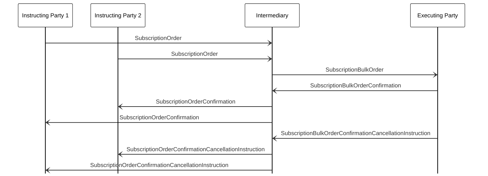

# Subscription confirmation cancellation — bulk

[src-000095](../../../../../../../../evidence/omitted/ffbc05daa043e55c6bd0cc1a.md); direct-body paragraph P694; BusinessTransactions / Order Confirmation Cancellation  / Subscription  / Bulk; `/w:document/w:body/w:p[694]`.

[Unchanged original figure](../../../../../../../../evidence/omitted/9063554be1ca86a878c0f8e7.md)

## Mermaid source reconstruction

## Actors and message directions

| Step | Sender | Receiver | Literal picture label |
| --- | --- | --- | --- |
| 1 | Instructing Party 1 | Intermediary | SubscriptionOrder |
| 2 | Instructing Party 2 | Intermediary | SubscriptionOrder |
| 3 | Intermediary | Executing Party | SubscriptionBulkOrder |
| 4 | Executing Party | Intermediary | SubscriptionBulkOrderConfirmation |
| 5 | Intermediary | Instructing Party 2 | SubscriptionOrderConfirmation |
| 6 | Intermediary | Instructing Party 1 | SubscriptionOrderConfirmation |
| 7 | Executing Party | Intermediary | SubscriptionBulkOrderConfirmationCancellationInstruction |
| 8 | Intermediary | Instructing Party 2 | SubscriptionOrderConfirmationCancellationInstruction |
| 9 | Intermediary | Instructing Party 1 | SubscriptionOrderConfirmationCancellationInstruction |

- [Instructing Party 1](../../../../../../../../shared/reference/participants/participant-src-000095-instructing-party.md)
- [Instructing Party 2](../../../../../../../../shared/reference/participants/participant-src-000095-instructing-party.md)
- [Intermediary](../../../../../../../../shared/reference/participants/participant-src-000095-intermediary.md)
- [Executing Party](../../../../../../../../shared/reference/participants/participant-src-000095-executing-party.md)

[Reusable flow, conditions, outcomes and source narrative](../../flows/flow-src-000095-p687-bulk.md)

## Source distinctions and limitations

- The two instructing-party lifelines are separate instances of one functional role. Orders for the same financial instrument are grouped into a bulk order, and confirmation information is split according to the originating chain. The picture sends the individual confirmations to party 2 before party 1; that visible order is preserved.
- The cancellation narrative uses the phrase “confirmation amendment message” at P693, while its message names and picture are confirmation cancellation instructions. The wording is retained, not treated as a separate amendment message.
- The source uses institutional pictograms for functional participants; native Mermaid lifeline boxes retain the labels without equating a functional role with one institution.
- Open source arrowheads are reproduced with native Mermaid open arrows. This visual notation choice does not establish additional transport or acknowledgement rules.
- The picture itself names messages without version numbers. Exact message references are matched separately through the supplied Part 2 headings; the mapping evidence and publication remain explicit.

[issue-000034 — Investment Funds source wording/order distinctions](../../../../../../../../tracking/issues.md)

## Rendering and visual review

Mermaid 12.3.0 parsed and rendered successfully using Mermaid browser API + Chromium 156.0.8078.81. [Rendered SVG](../../../../../../../../evidence/omitted/dd690eec424cf11a50ca58b6.md) · [Rendered PNG](../../../../../../../../evidence/omitted/4f91c72b213e7f3ba93521a2.md).

The unchanged source image and final reconstruction were directly compared on 2026-11-09 (Europe/Warsaw): participant instances, message labels, sender/receiver endpoints, vertical ordering and open arrowheads. Result: **visual relationship fidelity pass**. Recorded source wording/order differences remain unresolved as described above. The renderer’s UTC date is 2026-11-09.

[Hash-bound review evidence](../../../../../../../../evidence/archived/3498e067c897be279f868c47.md)

<!-- FUNDS-WORD-LOCATOR-START -->
## Word-rendered source page and composite review

[Word-rendered file page 86](../../../../../../../../evidence/omitted/60f19418a6a46f7562c8e7d8.md) was inspected in complete-page context on 2026-11-09. The asset identity also matches by SHA-256. The original image contains the displayed substantive figure; no additional external labels or omitted drawing objects were observed in its page surroundings. The two-panel message5 overview intentionally spans pages314–315 (figures146–147), linked separately.

This whole-page check complements the prior detailed original-image versus reconstruction review. Known local Word header-field errors are excluded from business evidence. [Hash-bound page-context review evidence](../../../../../../../../evidence/archived/4563608f960c3f070e6318d8.md).
<!-- FUNDS-WORD-LOCATOR-END -->
