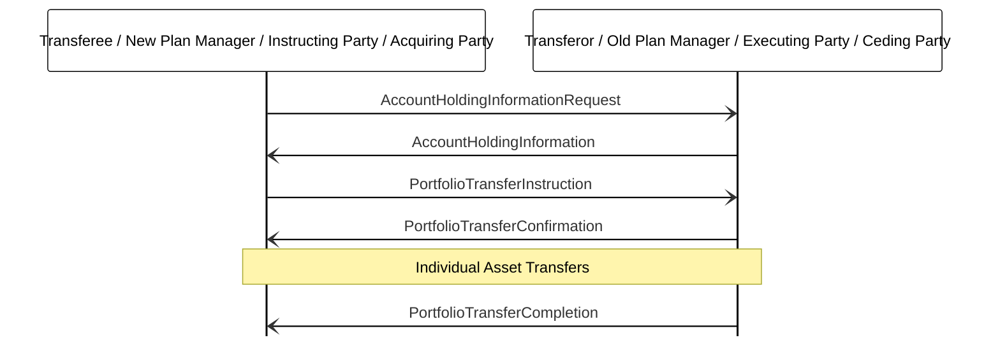

# Portfolio transfer instruction and completion

[src-000095](../../../../../../../../evidence/omitted/ffbc05daa043e55c6bd0cc1a.md); direct-body paragraph P777; BusinessTransactions / Portfolio Transfer Management / Portfolio Transfer Instruction; `/w:document/w:body/w:p[777]`.

[Unchanged original figure](../../../../../../../../evidence/omitted/90139eed518e24c1fe11f8f7.md)

## Mermaid source reconstruction

## Actors and message directions

| Step | Sender | Receiver | Literal picture label |
| --- | --- | --- | --- |
| 1 | Transferee / New Plan Manager / Instructing Party / Acquiring Party | Transferor / Old Plan Manager / Executing Party / Ceding Party | AccountHoldingInformationRequest |
| 2 | Transferor / Old Plan Manager / Executing Party / Ceding Party | Transferee / New Plan Manager / Instructing Party / Acquiring Party | AccountHoldingInformation |
| 3 | Transferee / New Plan Manager / Instructing Party / Acquiring Party | Transferor / Old Plan Manager / Executing Party / Ceding Party | PortfolioTransferInstruction |
| 4 | Transferor / Old Plan Manager / Executing Party / Ceding Party | Transferee / New Plan Manager / Instructing Party / Acquiring Party | PortfolioTransferConfirmation |
| 5 | Transferor / Old Plan Manager / Executing Party / Ceding Party | Transferee / New Plan Manager / Instructing Party / Acquiring Party | PortfolioTransferCompletion |

- [Transferee / New Plan Manager / Instructing Party / Acquiring Party](../../../../../../../../shared/reference/participants/participant-src-000095-transferee.md)
- [Transferor / Old Plan Manager / Executing Party / Ceding Party](../../../../../../../../shared/reference/participants/participant-src-000095-transferor.md)

[Reusable flow, conditions, outcomes and source narrative](../../flows/flow-src-000095-p768-portfolio-transfer-instruction.md)

## Source distinctions and limitations

- The source shaded “Individual Asset Transfers” band occurs after PortfolioTransferConfirmation and before PortfolioTransferCompletion. It is retained as a spanning note, not invented as an exchanged message. Fund units use transfer-out instruction/confirmation; cash uses a payment flow; liquidation requires redemption and payment flows (P775).
- The source uses institutional pictograms for functional participants; native Mermaid lifeline boxes retain the labels without equating a functional role with one institution.
- Open source arrowheads are reproduced with native Mermaid open arrows. This visual notation choice does not establish additional transport or acknowledgement rules.
- The picture itself names messages without version numbers. Exact message references are matched separately through the supplied Part 2 headings; the mapping evidence and publication remain explicit.

## Rendering and visual review

Mermaid 12.3.0 parsed and rendered successfully using Mermaid browser API + Chromium 156.0.8078.81. [Rendered SVG](../../../../../../../../evidence/omitted/4e23a3ad4a016a0513d95fd8.md) · [Rendered PNG](../../../../../../../../evidence/omitted/deb8f114598412ee3c893dfc.md).

The unchanged source image and final reconstruction were directly compared on 2026-11-09 (Europe/Warsaw): participant instances, message labels, sender/receiver endpoints, vertical ordering and open arrowheads. Result: **visual relationship fidelity pass**. Recorded source wording/order differences remain unresolved as described above. The renderer’s UTC date is 2026-11-09.

[Hash-bound review evidence](../../../../../../../../evidence/archived/3498e067c897be279f868c47.md)

<!-- FUNDS-WORD-LOCATOR-START -->
## Word-rendered source page and composite review

[Word-rendered file page 93](../../../../../../../../evidence/omitted/a24a3db2ad50dd80d05a9dd6.md) was inspected in complete-page context on 2026-11-09. The asset identity also matches by SHA-256. The original image contains the displayed substantive figure; no additional external labels or omitted drawing objects were observed in its page surroundings. The two-panel message5 overview intentionally spans pages314–315 (figures146–147), linked separately.

This whole-page check complements the prior detailed original-image versus reconstruction review. Known local Word header-field errors are excluded from business evidence. [Hash-bound page-context review evidence](../../../../../../../../evidence/archived/4563608f960c3f070e6318d8.md).
<!-- FUNDS-WORD-LOCATOR-END -->
