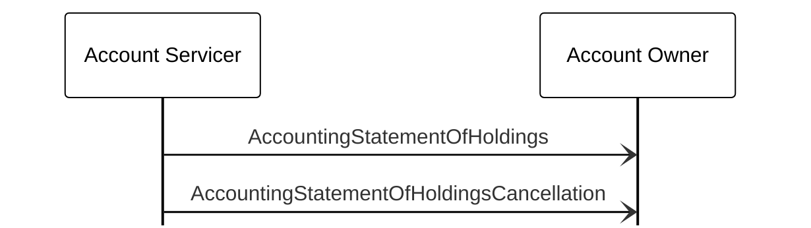

# Accounting holdings statement cancellation

[src-000095](../../../../../../../../evidence/omitted/ffbc05daa043e55c6bd0cc1a.md); direct-body paragraph P929; BusinessTransactions / Statements / Holdings Statements / Accounting Statement of Holdings - Cancellation; `/w:document/w:body/w:p[929]`.

[Unchanged original figure](../../../../../../../../evidence/omitted/6357946a64b445d3256c5a80.md)

## Mermaid source reconstruction

## Actors and message directions

| Step | Sender | Receiver | Literal picture label |
| --- | --- | --- | --- |
| 1 | Account Servicer | Account Owner | AccountingStatementOfHoldings |
| 2 | Account Servicer | Account Owner | AccountingStatementOfHoldingsCancellation |

- [Account Servicer](../../../../../../../../shared/reference/participants/participant-src-000095-account-servicer.md)
- [Account Owner](../../../../../../../../shared/reference/participants/participant-src-000095-account-owner.md)

[Reusable flow, conditions, outcomes and source narrative](../../flows/flow-src-000095-p926-accounting-statement-of-holdings-cancellation.md)

## Source distinctions and limitations

- The source uses institutional pictograms for functional participants; native Mermaid lifeline boxes retain the labels without equating a functional role with one institution.
- Open source arrowheads are reproduced with native Mermaid open arrows. This visual notation choice does not establish additional transport or acknowledgement rules.
- The picture itself names messages without version numbers. Exact message references are matched separately through the supplied Part 2 headings; the mapping evidence and publication remain explicit.

## Rendering and visual review

Mermaid 12.3.0 parsed and rendered successfully using Mermaid browser API + Chromium 156.0.8078.81. [Rendered SVG](../../../../../../../../evidence/omitted/aaa3869e904a6cbf79e47ae3.md) · [Rendered PNG](../../../../../../../../evidence/omitted/52c0ac2a88e3d65053baf232.md).

The unchanged source image and final reconstruction were directly compared on 2026-11-09 (Europe/Warsaw): participant instances, message labels, sender/receiver endpoints, vertical ordering and open arrowheads. Result: **visual relationship fidelity pass**. Recorded source wording/order differences remain unresolved as described above. The renderer’s UTC date is 2026-11-09.

[Hash-bound review evidence](../../../../../../../../evidence/archived/3498e067c897be279f868c47.md)

<!-- FUNDS-WORD-LOCATOR-START -->
## Word-rendered source page and composite review

[Word-rendered file page 107](../../../../../../../../evidence/omitted/91a009eb8e79d7f389a10861.md) was inspected in complete-page context on 2026-11-09. The asset identity also matches by SHA-256. The original image contains the displayed substantive figure; no additional external labels or omitted drawing objects were observed in its page surroundings. The two-panel message5 overview intentionally spans pages314–315 (figures146–147), linked separately.

This whole-page check complements the prior detailed original-image versus reconstruction review. Known local Word header-field errors are excluded from business evidence. [Hash-bound page-context review evidence](../../../../../../../../evidence/archived/4563608f960c3f070e6318d8.md).
<!-- FUNDS-WORD-LOCATOR-END -->
