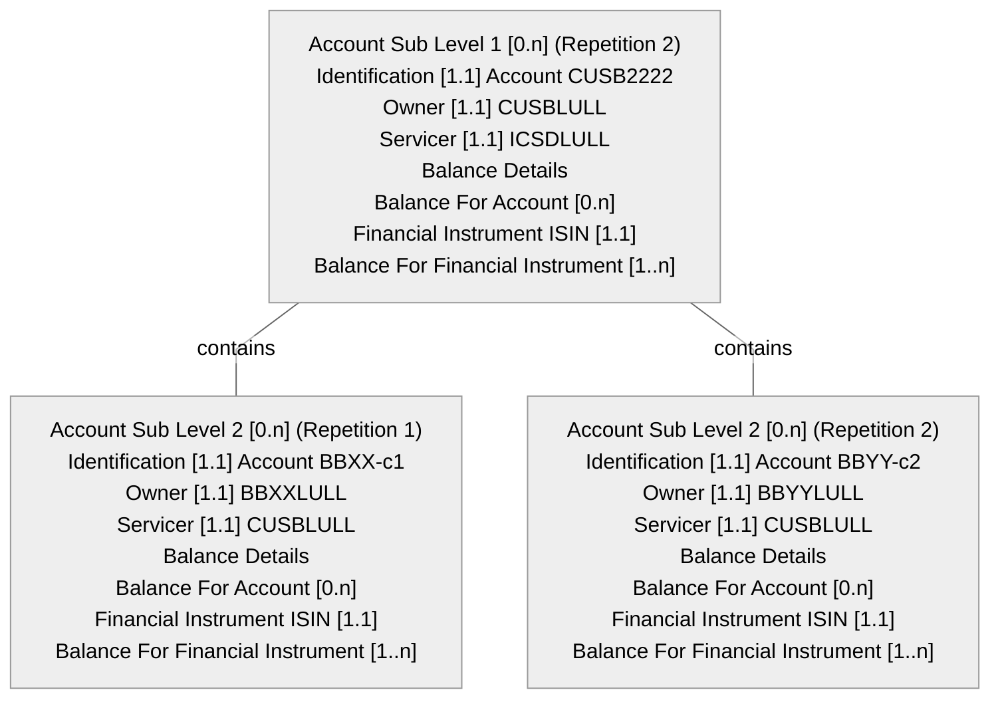

# Transparency example 1 — message 5 structure, CUSB branch

[src-000095](../../../../../../../../evidence/omitted/ffbc05daa043e55c6bd0cc1a.md); direct-body paragraph P5897; Business Examples / Transparency Of Holdings / SecuritiesBalanceTransparencyReport semt.041.001.02 Message 5.

[Unchanged original image](../../../../../../../../evidence/omitted/8ffa2ab714efb3a7d9bc7b59.md)

## Mermaid source reconstruction

## Complete label inventory

| Scoped diagram entity/block | Literal labels and values |
| --- | --- |
| L1 | Account Sub Level 1 [0.n] (Repetition 2) Identification [1.1] Account CUSB2222 Owner [1.1] CUSBLULL Servicer [1.1] ICSDLULL Balance Details Balance For Account [0.n] Financial Instrument ISIN [1.1] Balance For Financial Instrument [1..n] |
| C1 | Account Sub Level 2 [0.n] (Repetition 1) Identification [1.1] Account BBXX-c1 Owner [1.1] BBXXLULL Servicer [1.1] CUSBLULL Balance Details Balance For Account [0.n] Financial Instrument ISIN [1.1] Balance For Financial Instrument [1..n] |
| C2 | Account Sub Level 2 [0.n] (Repetition 2) Identification [1.1] Account BBYY-c2 Owner [1.1] BBYYLULL Servicer [1.1] CUSBLULL Balance Details Balance For Account [0.n] Financial Instrument ISIN [1.1] Balance For Financial Instrument [1..n] |

## Relationships and numbered messages

| From/container | To/contained entity | Source relation |
| --- | --- | --- |
| L1 | C1 | contains |
| L1 | C2 | contains |

| Sender | Receiver | Numbered source message |
| --- | --- | --- |

## Source callouts and distinctions

- This is the continuation of figure146’s message 5, not an independent message. The omitted top-level header/account belongs to that first panel.
- The omnibus account CUSB2222 is owned by CUSB on behalf of underlying clients BBXX and BBYY.
- Balance Details has no printed cardinality in this panel. The source’s omitted cardinalities are not filled from another diagram.

[issue-000040 — source example contradictions; issue-000042 — unavailable definition/schema](../../../../../../../../tracking/issues.md)

## Participants and reusable flow

[Source narrative, conditions, report directions, example values and table evidence](../../flows/flow-src-000095-transparency-example-1.md)

- [account-owner](../../../../../../../../shared/reference/participants/participant-src-000095-account-owner.md)
- [account-servicer](../../../../../../../../shared/reference/participants/participant-src-000095-account-servicer.md)
- [custodian](../../../../../../../../shared/reference/participants/participant-src-000095-custodian.md)
- [icsd](../../../../../../../../shared/reference/participants/participant-src-000095-icsd.md)
- [transfer-agent](../../../../../../../../shared/reference/participants/participant-src-000095-transfer-agent.md)

## Rendering and visual review

Mermaid 12.3.0 parsed and rendered using Mermaid browser API + Chromium 156.0.8078.81. The original image (enlarged where needed) and final render were directly compared on 2026-11-09 for all labels, literal values, cardinalities, containment, relation endpoints, numbered message directions and callouts. Visual reconstruction fidelity: pass, with explicit notation differences and unresolved source contradictions above. Full Word-page/composite checks are separate.

[Rendered SVG](../../../../../../../../evidence/omitted/a791d09b7c4c980860a78c8f.md) · [Rendered PNG](../../../../../../../../evidence/omitted/d3380cb762f18ea67dd04ff3.md) · [Hash-bound visual-review record](../../../../../../../../evidence/archived/1d51ea4aba498ad6c91d7efc.md)

## Internal nesting retained in compact blocks

Within each depicted account, Balance Details contains Balance For Account. That block contains Financial Instrument ISIN and Balance For Financial Instrument. In figure144, the latter contains Date and Holdings; Holdings contains Holding Balance, which contains Settled Balance and Traded Balance. In figures145–147 the financial-instrument balance is deliberately collapsed by the source, so no internal fields are supplied by inference. Account Sub Level 2 repetitions belong to their shown Account Sub Level 1 parent; distinct repetitions retain distinct identifiers.

<!-- FUNDS-WORD-LOCATOR-START -->
## Word-rendered source page and composite review

[Word-rendered file page 315](../../../../../../../../evidence/omitted/71485bd0e93920dc76afce26.md) was inspected in complete-page context on 2026-11-09. The asset identity also matches by SHA-256. The original image contains the displayed substantive figure; no additional external labels or omitted drawing objects were observed in its page surroundings. The two-panel message5 overview intentionally spans pages314–315 (figures146–147), linked separately.

This whole-page check complements the prior detailed original-image versus reconstruction review. Known local Word header-field errors are excluded from business evidence. [Hash-bound page-context review evidence](../../../../../../../../evidence/archived/4563608f960c3f070e6318d8.md).
<!-- FUNDS-WORD-LOCATOR-END -->
