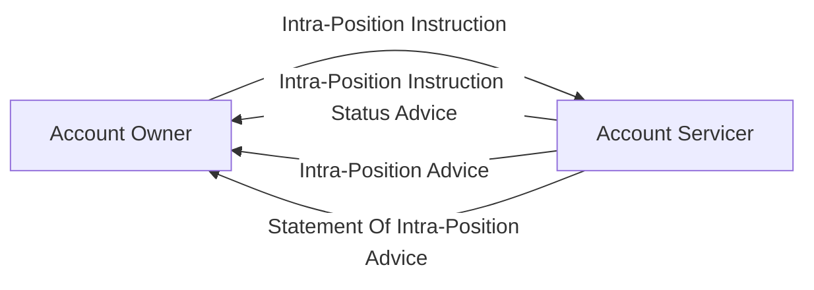

# Intra-position communication overview

[src-000196](../../../../../../../../evidence/omitted/590a0c85882f5e6c5c9ea627.md); direct-body paragraph P149; Scope and Functionality / Scope; `/w:document/w:body/w:p[149]`.

[Unchanged original asset](../../../../../../../../evidence/omitted/7b0023496b8653547e4cf09e.md) · [Readable original/complete vector preview](../../../../../../../../evidence/omitted/7b0023496b8653547e4cf09e.md)

## Mermaid source reconstruction

## Participants and flow context

- [account owner](../../../../../../../../shared/reference/participants/settlement-reconciliation-account-owner.md)
- [account servicer](../../../../../../../../shared/reference/participants/settlement-reconciliation-account-servicer.md)

- [intra position instruction](../../flows/intra-position-instruction.md)

## Semantics and limitations

- The source provides communication categories, not exact definition IDs or a required temporal sequence. All four original labels are preserved.

## Rendering and visual review

Parse/render passed using Mermaid 12.3.0 with Mermaid browser API + Chromium 156.0.8078.81. [Rendered SVG](../../../../../../../../evidence/omitted/a40f6b0d1bba0557829c3629.md) · [Rendered PNG](../../../../../../../../evidence/omitted/4c928e7fca6b901816c2dd7b.md).

On 2026-11-09 (Europe/Warsaw), the original/full vector preview and the final reconstruction were directly compared for labels, role boundaries, decisions, branches, feedback paths, arrowheads/plain connections, start/end symbols and source synchronization bars. Result: **visual relationship fidelity pass**. Native layout reflows the lanes; original assets remain authoritative for pictorial layout. The machine render date is UTC 2026-11-08.

[Hash-bound review evidence](../../../../../../../../evidence/archived/095d2b4ef93d117b23cff488.md)

<!-- RENDERED-SOURCE-START -->
## Rendered source page context

[Read-only Word-rendered source PDF](../../../../../../../../evidence/omitted/aae5b215a8f3b7a6b1062885.md); file page(s) 9. The page association is established by exact original-asset SHA-256 in the Word shape inventory, not by shape ordinal. Full-page/composite visual comparison is pending unless a separate dated review is recorded.
<!-- RENDERED-SOURCE-END -->
