# Financing instruction activity — two parties

[src-000196](../../../../../../../../evidence/omitted/590a0c85882f5e6c5c9ea627.md); direct-body paragraph P213; Description of BusinessActivities / Securities Financing Instruction / Securities Financing Instruction and Confirmation / Two Parties (Securities Financing Servicing Party and the Settlement Executing Party are the Same); `/w:document/w:body/w:p[213]`.

[Unchanged original asset](../../../../../../../../evidence/omitted/adac000c3cb39b8473a6493e.md) · [Readable original/complete vector preview](../../../../../../../../evidence/omitted/9575bbba64f35ca8b0faacb1.md)

## Mermaid source reconstruction

```mermaid
%%{init: {"themeVariables": {"edgeLabelBackground": "#ffffff"}, "themeCSS": ".edgeLabel rect { fill: #fff !important; opacity: 1 !important; }"}}%%
flowchart TB
  subgraph I["Settlement Instructing Party"]
    IS@{shape: f-circ, label: " "}
    IA("Instruct securities financing transaction")
    IS --> IA
    IM("Monitor securities financing transaction")
    IU("Update Status")
    IOD{"Opening Settled?"}
    ICD{"Closing settled?"}
    IOS(["Settle Opening"])
    ICS(["Settle Closing"])
    ISJ@{shape: fork, label: " "}
    IOJ@{shape: fork, label: " "}
    IEnd@{shape: framed-circle, label: " "}
    IM --> IOD
    IOD -->|No| ISJ
    IOD -->|Yes| IOS
    IOS --> ICD
    ICD -->|No| ISJ
    ICD -->|Yes| ICS
    ISJ --> IU
    IU --> IM
    IOS --> IOJ
    ICS --> IOJ
    ICS --> IEnd
    IOJ --> IU
  end
  subgraph B["Securities Financing Servicing Party/Settlement Executing Party"]
    BP("Process instruction")
    BD{"Processed?"}
    BR("Update Status")
    BP --> BD
    BD -->|No| BR
    BA("Create Securities Financing Transactions")
    BO("Process opening leg")
    BC("Process closing leg")
    BA --> BO
    BA --> BC
    BO --> BM
    BC --> BM
    BD -->|Yes| BA
    BM("Manage securities financing transaction")
    BU("Update Status")
    BOD{"Opening Settled?"}
    BCD{"Closing settled?"}
    BOS(["Settle Opening"])
    BCS(["Settle Closing"])
    BSJ@{shape: fork, label: " "}
    BOJ@{shape: fork, label: " "}
    BEnd@{shape: framed-circle, label: " "}
    BM --> BOD
    BOD -->|No| BSJ
    BOD -->|Yes| BOS
    BOS --> BCD
    BCD -->|No| BSJ
    BCD -->|Yes| BCS
    BSJ --> BU
    BU --> BM
    BOS --> BOJ
    BCS --> BOJ
    BCS --> BEnd
  end
  IA --> BP
  BR --> IA
  BU --> IM
  BOJ --> IM
  classDef main fill:#d1d8b8,stroke:#111,color:#111
  classDef context fill:#c0d1e5,stroke:#111,color:#111
  class IA,IM,IOD,ICD,IOS,ICS,BP,BD,BA,BM,BOD,BCD,BOS,BCS main
  class IU,BU,BR context
  class BO,BC context
  classDef fork fill:#111,stroke:#111
  class ISJ,IOJ,BSJ,BOJ fork
  classDef framedcircle fill:#fff,stroke:#111,stroke-width:3px
  class IEnd,BEnd framedcircle
  classDef fcirc fill:#4472c4,stroke:#4472c4
  class IS fcirc
```

## Participants and flow context

- [financing instructing party](../../../../../../../../shared/reference/participants/settlement-reconciliation-financing-instructing-party.md)
- [financing servicing settlement executing party](../../../../../../../../shared/reference/participants/settlement-reconciliation-financing-servicing-settlement-executing-party.md)

- [financing instruction two parties](../../flows/financing-instruction-two-parties.md)

[Activity table T32 — all steps, definitions and Initiator values](../../documents/src-000196/tables/tbl-0032.md). These source responsibilities are distinct from message sender/receiver assertions.

## Semantics and limitations

- The picture labels its left lane Settlement Instructing Party; the activity table uses Securities Financing Instruction Party, and the two-party sequence uses Securities Financing Instructing Party. The picture label is preserved. The linked financing participant is contextual, not a new unsupported global synonym.
- The combined servicing/executing participant creates and processes both opening and closing legs. Both participants separately monitor opening and closing settlement, with source bars and return paths retained.

Swimlane ownership is represented by native flowchart subgraphs. Decisions retain their source labels and branch labels; start/end symbols and explicit source bars use native Mermaid shapes. The layout is reflowed without changing endpoints. Green/blue fills preserve the source’s distinction between the foreground activities and surrounding status/context activities where visible.

## Rendering and visual review

Parse/render passed using Mermaid 12.3.0 with Mermaid browser API + Chromium 156.0.8078.81. [Rendered SVG](../../../../../../../../evidence/omitted/06fae62241eee3901f6ed9b8.md) · [Rendered PNG](../../../../../../../../evidence/omitted/babc5b356e0773ccfa7a4249.md).

On 2026-11-09 (Europe/Warsaw), the original/full vector preview and the final reconstruction were directly compared for labels, role boundaries, decisions, branches, feedback paths, arrowheads/plain connections, start/end symbols and source synchronization bars. Result: **visual relationship fidelity pass**. Native layout reflows the lanes; original assets remain authoritative for pictorial layout. The machine render date is UTC 2026-11-08.

[Hash-bound review evidence](../../../../../../../../evidence/archived/095d2b4ef93d117b23cff488.md)

<!-- RENDERED-SOURCE-START -->
## Rendered source page context

[Read-only Word-rendered source PDF](../../../../../../../../evidence/omitted/aae5b215a8f3b7a6b1062885.md); file page(s) 26. The page association is established by exact original-asset SHA-256 in the Word shape inventory, not by shape ordinal. Full-page/composite visual comparison is pending unless a separate dated review is recorded.
<!-- RENDERED-SOURCE-END -->
