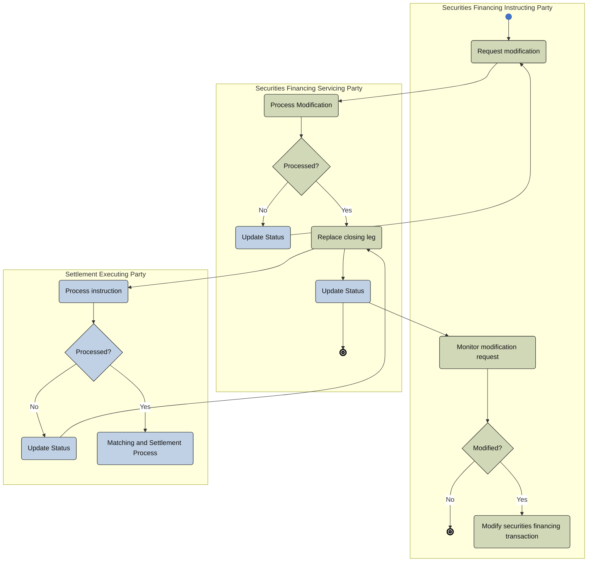

# Financing modification activity — three parties

[src-000196](../../../../../../../../evidence/omitted/590a0c85882f5e6c5c9ea627.md); direct-body paragraph P228; Description of BusinessActivities / Securities Financing Instruction / Modification Process  / Changes That Do Not Impact the Securities Position; `/w:document/w:body/w:p[228]`.

[Unchanged original asset](../../../../../../../../evidence/omitted/e0c5190d24446f84a17ac1b6.md) · [Readable original/complete vector preview](../../../../../../../../evidence/omitted/435e25eaafc0dcc8ca286b39.md)

## Mermaid source reconstruction

## Participants and flow context

- [financing instructing party](../../../../../../../../shared/reference/participants/settlement-reconciliation-financing-instructing-party.md)
- [financing servicing party](../../../../../../../../shared/reference/participants/settlement-reconciliation-financing-servicing-party.md)
- [settlement executing party](../../../../../../../../shared/reference/participants/settlement-reconciliation-settlement-executing-party.md)

- [financing modification three parties](../../flows/financing-modification-three-parties.md)

[Activity table T33 — all steps, definitions and Initiator values](../../documents/src-000196/tables/tbl-0033.md). These source responsibilities are distinct from message sender/receiver assertions.

## Semantics and limitations

- The modification picture concerns replacement of the closing leg. Modified? No reaches an endpoint; Yes reaches Modify securities financing transaction. No further outgoing edge from that activity is invented. The settlement executing party’s matching/settlement process remains a separate lane.

Swimlane ownership is represented by native flowchart subgraphs. Decisions retain their source labels and branch labels; start/end symbols and explicit source bars use native Mermaid shapes. The layout is reflowed without changing endpoints. Green/blue fills preserve the source’s distinction between the foreground activities and surrounding status/context activities where visible.

## Rendering and visual review

Parse/render passed using Mermaid 12.3.0 with Mermaid browser API + Chromium 156.0.8078.81. [Rendered SVG](../../../../../../../../evidence/omitted/9a11a498b462740886e1eb7a.md) · [Rendered PNG](../../../../../../../../evidence/omitted/f4504d067e3c9058f541579a.md).

On 2026-11-09 (Europe/Warsaw), the original/full vector preview and the final reconstruction were directly compared for labels, role boundaries, decisions, branches, feedback paths, arrowheads/plain connections, start/end symbols and source synchronization bars. Result: **visual relationship fidelity pass**. Native layout reflows the lanes; original assets remain authoritative for pictorial layout. The machine render date is UTC 2026-11-08.

[Hash-bound review evidence](../../../../../../../../evidence/archived/095d2b4ef93d117b23cff488.md)

<!-- RENDERED-SOURCE-START -->
## Rendered source page context

[Read-only Word-rendered source PDF](../../../../../../../../evidence/omitted/aae5b215a8f3b7a6b1062885.md); file page(s) 29. The page association is established by exact original-asset SHA-256 in the Word shape inventory, not by shape ordinal. Full-page/composite visual comparison is pending unless a separate dated review is recorded.
<!-- RENDERED-SOURCE-END -->
