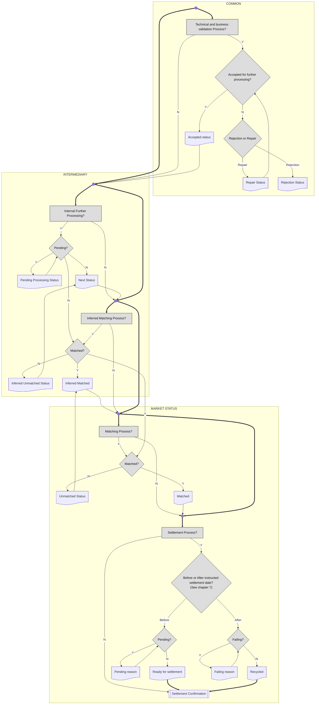

# Settlement instruction status processes

[src-000196](../../../../../../../../evidence/omitted/590a0c85882f5e6c5c9ea627.md); direct-body paragraph P247; Description of BusinessActivities / Status Reporting Process  / Instruction Status Advice; `/w:document/w:body/w:p[247]`.

[Unchanged original asset](../../../../../../../../evidence/omitted/b2da92bcce6d0e9ef17c3018.md) · [Readable original/complete vector preview](../../../../../../../../evidence/omitted/b2da92bcce6d0e9ef17c3018.md)

## Mermaid source reconstruction

## Participants and flow context

- [instructing party](../../../../../../../../shared/reference/participants/settlement-reconciliation-instructing-party.md)
- [executing servicing party](../../../../../../../../shared/reference/participants/settlement-reconciliation-executing-servicing-party.md)

- [instruction confirmation](../../flows/instruction-confirmation.md)

## Semantics and limitations

- The message function is INST. Common status is potentially provided by all parties. Intermediary statuses are provided on processes performed at a party other than the CSD; market statuses concern processes at the CSD. For a transaction settled at an intermediary (for example an internal transfer), market statuses are sent, according to the source note.
- Internal Further Processing and Inferred Matching may run in parallel. Inferred matching is not official; the account servicer may deduce it from allegement-report analysis. It is not a market matching status.
- A market matching status is an official matching status from the CSD. Matching and settlement may run in parallel; in that parallel process, an unmatched trade has only pending/failing status or reason pertaining to the account owner, not the counterparty.
- The source states that PENDING changes to FAILING at END of Settlement Date. A matched instruction that is pending/failing may become unmatched again, for example after cancellation from a counterparty.
- The source uses a heavy vertical process spine, document-shaped status outputs, feedback paths and COMMON / INTERMEDIARY / MARKET STATUS boundaries. Native layout reflows the spine, without turning the parallel-process notes into a mandatory serial algorithm. Small unlabeled junctions are routing points, not participants or added business activities.

## Rendering and visual review

Parse/render passed using Mermaid 12.3.0 with Mermaid browser API + Chromium 156.0.8078.81. [Rendered SVG](../../../../../../../../evidence/omitted/67c2763be66db7fdb160257f.md) · [Rendered PNG](../../../../../../../../evidence/omitted/4eba4d906826933f208ab42e.md).

On 2026-11-09 (Europe/Warsaw), the original/full vector preview and the final reconstruction were directly compared for labels, role boundaries, decisions, branches, feedback paths, arrowheads/plain connections, start/end symbols and source synchronization bars. Result: **visual relationship fidelity pass**. Native layout reflows the lanes; original assets remain authoritative for pictorial layout. The machine render date is UTC 2026-11-08.

[Hash-bound review evidence](../../../../../../../../evidence/archived/095d2b4ef93d117b23cff488.md)

<!-- RENDERED-SOURCE-START -->
## Rendered source page context

[Read-only Word-rendered source PDF](../../../../../../../../evidence/omitted/aae5b215a8f3b7a6b1062885.md); file page(s) 35. The page association is established by exact original-asset SHA-256 in the Word shape inventory, not by shape ordinal. Full-page/composite visual comparison is pending unless a separate dated review is recorded.
<!-- RENDERED-SOURCE-END -->
