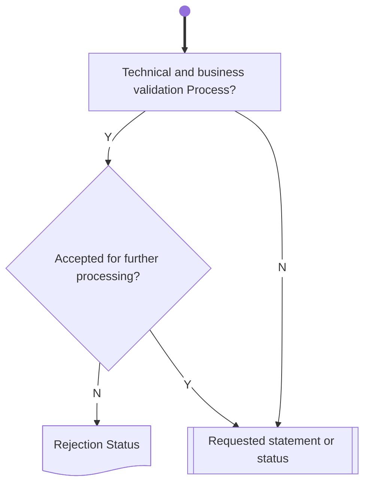

# Statement or status query validation

[src-000196](../../../../../../../../evidence/omitted/590a0c85882f5e6c5c9ea627.md); direct-body paragraph P256; Description of BusinessActivities / Status Reporting Process  / Request for Status or Statement Status Advice; `/w:document/w:body/w:p[256]`.

[Unchanged original asset](../../../../../../../../evidence/omitted/07e2cc4bd4b5dba5069dc842.md) · [Readable original/complete vector preview](../../../../../../../../evidence/omitted/07e2cc4bd4b5dba5069dc842.md)

## Mermaid source reconstruction

## Participants and flow context

- [instructing party](../../../../../../../../shared/reference/participants/settlement-reconciliation-instructing-party.md)
- [executing servicing party](../../../../../../../../shared/reference/participants/settlement-reconciliation-executing-servicing-party.md)

- [reporting pull](../../flows/reporting-pull.md)

## Semantics and limitations

- The source has no accepted-status output for this chart. Acceptance routes to Requested statement or status, while non-acceptance routes to Rejection Status.

## Rendering and visual review

Parse/render passed using Mermaid 12.3.0 with Mermaid browser API + Chromium 156.0.8078.81. [Rendered SVG](../../../../../../../../evidence/omitted/9aae5338c310b57ab58491a6.md) · [Rendered PNG](../../../../../../../../evidence/omitted/9680e8700de8c42ae8db3caa.md).

On 2026-11-09 (Europe/Warsaw), the original/full vector preview and the final reconstruction were directly compared for labels, role boundaries, decisions, branches, feedback paths, arrowheads/plain connections, start/end symbols and source synchronization bars. Result: **visual relationship fidelity pass**. Native layout reflows the lanes; original assets remain authoritative for pictorial layout. The machine render date is UTC 2026-11-08.

[Hash-bound review evidence](../../../../../../../../evidence/archived/095d2b4ef93d117b23cff488.md)

<!-- RENDERED-SOURCE-START -->
## Rendered source page context

[Read-only Word-rendered source PDF](../../../../../../../../evidence/omitted/aae5b215a8f3b7a6b1062885.md); file page(s) 37. The page association is established by exact original-asset SHA-256 in the Word shape inventory, not by shape ordinal. Full-page/composite visual comparison is pending unless a separate dated review is recorded.
<!-- RENDERED-SOURCE-END -->
