# Modification before settlement activity

[src-000196](../../../../../../../../evidence/omitted/590a0c85882f5e6c5c9ea627.md); direct-body paragraph P266; Description of BusinessActivities / Modification Process / Modification Request and Status Advice / Modification Process Prior To Settlement ; `/w:document/w:body/w:p[266]`.

[Unchanged original asset](../../../../../../../../evidence/omitted/ead56776f44a6c970591f51a.md) · [Readable original/complete vector preview](../../../../../../../../evidence/omitted/d4dad51ef392c02fbf66e0c1.md)

## Mermaid source reconstruction

```mermaid
%%{init: {"themeVariables": {"edgeLabelBackground": "#ffffff"}, "themeCSS": ".edgeLabel rect { fill: #fff !important; opacity: 1 !important; }"}}%%
flowchart TB
  subgraph I["Instructing Party"]
    S@{shape: f-circ, label: " "} --> Create("Create Instruction")
    Monitor("Monitor Matching and Settlement Process") --> Needed{"Modification needed?"}
    Needed -->|No| Monitor
    Needed -->|Yes| Request("Request Modification")
    IM("Monitor Modification Request") --> IV{"Validated?"}
    IV -->|Yes| IX("Update original transaction")
    IX --> Monitor
    IV -->|No| IP{"Pending?"}
    IP -->|Yes| IM
    IP -->|No| Monitor
  end
  subgraph E["Executing/Servicing Party"]
    Process("Processing, Matching and Settlement Process")
    Validate("Validation Modification request") --> VD{"Validated?"}
    VD -->|No| Reject(["Reject"])
    VD -->|Yes| Need{"Cpy response Needed"}
    Need -->|YES| Send("Send Status Advice")
    Need -->|No| EM("Monitor Modification Request")
    Send --> Status(["Provide Status on Modification"])
    EM --> Possible{"Update Possible"}
    Possible -->|No| Status
    Possible -->|YES| EX("Update original transaction")
    EX --> Status
    Reject --> Status
    Status --> Process
    Reject --> EndBar@{shape: fork, label: " "}
    EX --> EndBar
  end
  subgraph C["Counterparty"]
    Review("Review Status") --> Decision{"Response?"}
    Decision -->|YES| Response("Provide a response")
  end
  Create --> Process
  Request --> Validate
  Status --> IM
  Send --> Review
  Decision -->|No| EM
  Response --> EM
  classDef focus fill:#d1d8b8,stroke:#111,color:#111
  classDef context fill:#c0d1e5,stroke:#111,color:#111
  class Request,IM,IV,IX,IP,Validate,VD,Reject,Need,EM,Possible,EX,Status,Decision focus
  class Create,Monitor,Needed,Process,Send,Review,Response context
  classDef fork fill:#111,stroke:#111
  class EndBar fork
  classDef fcirc fill:#4472c4,stroke:#4472c4
  class S fcirc
```

## Participants and flow context

- [instructing party](../../../../../../../../shared/reference/participants/settlement-reconciliation-instructing-party.md)
- [executing servicing party](../../../../../../../../shared/reference/participants/settlement-reconciliation-executing-servicing-party.md)

- [modification before settlement](../../flows/modification-before-settlement.md)

[Activity table T39 — all steps, definitions and Initiator values](../../documents/src-000196/tables/tbl-0039.md). These source responsibilities are distinct from message sender/receiver assertions.

## Semantics and limitations

- The Counterparty lane is a separate participant instance. The matching sequence and P507–P514 identify the other instructing party; the generic role reference does not collapse both instances into one participant in this flow.
- The source’s terminal horizontal bar has two incoming routes and no visible outgoing route. It is retained as a bar rather than replaced with an invented end state. The picture has no direct arrow from Request Modification to Monitor Modification Request; monitoring is entered from the returned modification status.
- All validation, counterparty-response, pending and update-possible branches are retained. The enlarged connector inspection distinguishes line crossings with bridges from actual joins.

Swimlane ownership is represented by native flowchart subgraphs. Decisions retain their source labels and branch labels; start/end symbols and explicit source bars use native Mermaid shapes. The layout is reflowed without changing endpoints. Green/blue fills preserve the source’s distinction between the foreground activities and surrounding status/context activities where visible.

## Rendering and visual review

Parse/render passed using Mermaid 12.3.0 with Mermaid browser API + Chromium 156.0.8078.81. [Rendered SVG](../../../../../../../../evidence/omitted/75cccb8438745b8e86a59af7.md) · [Rendered PNG](../../../../../../../../evidence/omitted/e0726f447a5dd89639240268.md).

On 2026-11-09 (Europe/Warsaw), the original/full vector preview and the final reconstruction were directly compared for labels, role boundaries, decisions, branches, feedback paths, arrowheads/plain connections, start/end symbols and source synchronization bars. Result: **visual relationship fidelity pass**. Native layout reflows the lanes; original assets remain authoritative for pictorial layout. The machine render date is UTC 2026-11-08.

[Hash-bound review evidence](../../../../../../../../evidence/archived/095d2b4ef93d117b23cff488.md)

<!-- RENDERED-SOURCE-START -->
## Rendered source page context

[Read-only Word-rendered source PDF](../../../../../../../../evidence/omitted/aae5b215a8f3b7a6b1062885.md); file page(s) 41. The page association is established by exact original-asset SHA-256 in the Word shape inventory, not by shape ordinal. Full-page/composite visual comparison is pending unless a separate dated review is recorded.
<!-- RENDERED-SOURCE-END -->

<!-- NATIVE-EVIDENCE-START -->
## Native embedded source object

[Microsoft_Visio_2003-2010_Drawing1.vsd](../../../../../../../../evidence/omitted/7f3439c0222ece5942a44598.md)

[Native-object identity and occurrence inventory](../../documents/src-000196/native-embeddings.md). These original embedded bytes are retained unchanged. The visual reconstruction was compared with the supplied visible picture/complete vector preview. Hidden native layers or additional native pages have not been activated or checked; visual fidelity does not assert their equivalence.
<!-- NATIVE-EVIDENCE-END -->
