# Cancellation-request activity

[src-000196](../../../../../../../../evidence/omitted/590a0c85882f5e6c5c9ea627.md); direct-body paragraph P303; Description of BusinessActivities / Cancellation Request Process ; `/w:document/w:body/w:p[303]`.

[Unchanged original asset](../../../../../../../../evidence/omitted/3ba384cf7e3f59d5757f57ae.md) · [Readable original/complete vector preview](../../../../../../../../evidence/omitted/71745152698b8f1ad029f059.md)

## Mermaid source reconstruction

```mermaid
%%{init: {"themeVariables": {"edgeLabelBackground": "#ffffff"}, "themeCSS": ".edgeLabel rect { fill: #fff !important; opacity: 1 !important; }"}}%%
flowchart TB
  subgraph I["Instructing Party"]
    IS@{shape: f-circ, label: " "}
    IF@{shape: framed-circle, label: " "}
    IA("Request cancellation")
    IM("Monitor Cancellation request")
    ID{"Cancelled?"}
    IU("Update Status")
    IX(["Cancel instruction"])
    IS --> IA
    IM --> ID
    ID -->|No| IU
    IU --> IM
    ID -->|Yes| IX
    IJ@{shape: fork, label: " "}
    IJ --> IM
    IX --> IF
  end
  subgraph E["Executing/Servicing Party"]
    EP("Process cancellation request")
    ED{"Processed?"}
    EU("Update Status")
    EM("Cancellation process")
    ES{"Cancelled?"}
    UP("Update Status")
    EX(["Cancel instruction"])
    EF@{shape: framed-circle, label: " "}
    EP --> ED
    ED -->|No| EU
    ED -->|Yes| EM
    EM --> ES
    ES -->|No| UP
    UP --> EM
    ES -->|Yes| EX
    EX --> EF
  end
  IA --> EP
  EU --> IA
  UP --> IJ
  EX --> IJ
  classDef main fill:#d1d8b8,stroke:#111,color:#111
  classDef status fill:#c0d1e5,stroke:#111,color:#111
  class IA,IM,ID,IX,EP,ED,EM,ES,EX main
  class IU,EU,UP status
  classDef start fill:#4472c4,stroke:#4472c4
  classDef terminal fill:#fff,stroke:#111,stroke-width:3px
  classDef synchronization fill:#111,stroke:#111
  class IS start
  class IF,EF terminal
  class IJ synchronization
```

## Participants and flow context

- [instructing party](../../../../../../../../shared/reference/participants/settlement-reconciliation-instructing-party.md)
- [executing servicing party](../../../../../../../../shared/reference/participants/settlement-reconciliation-executing-servicing-party.md)

- [cancellation request](../../flows/cancellation-request.md)

[Activity table T45 — all steps, definitions and Initiator values](../../documents/src-000196/tables/tbl-0045.md). These source responsibilities are distinct from message sender/receiver assertions.

## Semantics and limitations

- The source includes a synchronization bar for status/outcome information returning to the instructing participant. A cancellation request does not itself establish completed cancellation.

Swimlane ownership is represented by native flowchart subgraphs. Decisions retain their source labels and branch labels; start/end symbols and explicit source bars use native Mermaid shapes. The layout is reflowed without changing endpoints. Green/blue fills preserve the source’s distinction between the foreground activities and surrounding status/context activities where visible.

## Rendering and visual review

Parse/render passed using Mermaid 12.3.0 with Mermaid browser API + Chromium 156.0.8078.81. [Rendered SVG](../../../../../../../../evidence/omitted/4e782a3b591cee16018654de.md) · [Rendered PNG](../../../../../../../../evidence/omitted/3c7aea6077eac335f62b79b9.md).

On 2026-11-09 (Europe/Warsaw), the original/full vector preview and the final reconstruction were directly compared for labels, role boundaries, decisions, branches, feedback paths, arrowheads/plain connections, start/end symbols and source synchronization bars. Result: **visual relationship fidelity pass**. Native layout reflows the lanes; original assets remain authoritative for pictorial layout. The machine render date is UTC 2026-11-08.

[Hash-bound review evidence](../../../../../../../../evidence/archived/095d2b4ef93d117b23cff488.md)

<!-- RENDERED-SOURCE-START -->
## Rendered source page context

[Read-only Word-rendered source PDF](../../../../../../../../evidence/omitted/aae5b215a8f3b7a6b1062885.md); file page(s) 51. The page association is established by exact original-asset SHA-256 in the Word shape inventory, not by shape ordinal. Full-page/composite visual comparison is pending unless a separate dated review is recorded.
<!-- RENDERED-SOURCE-END -->
