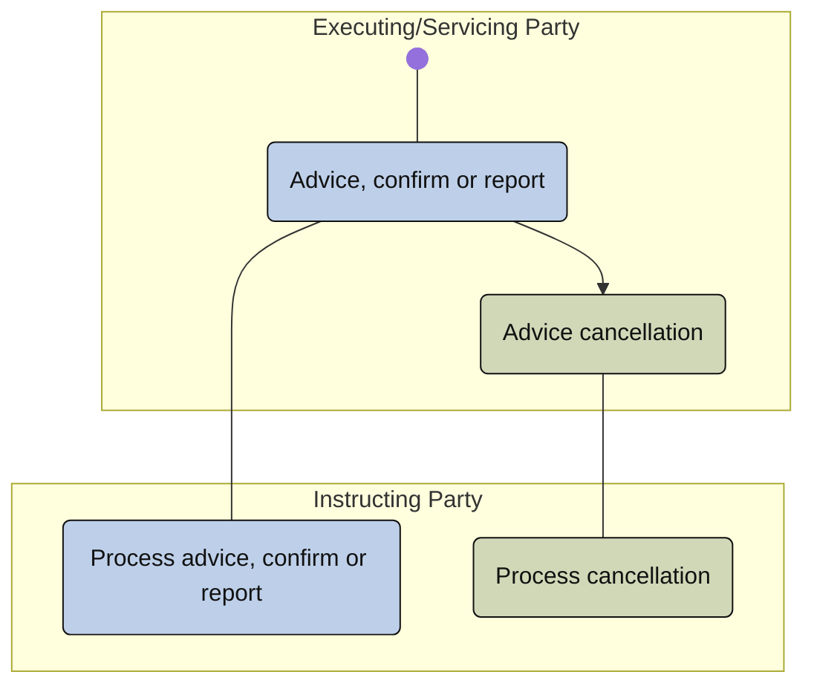

# Cancellation-advice activity

[src-000196](../../../../../../../../evidence/omitted/590a0c85882f5e6c5c9ea627.md); direct-body paragraph P305; Description of BusinessActivities / Cancellation Advise Process; `/w:document/w:body/w:p[305]`.

[Unchanged original asset](../../../../../../../../evidence/omitted/f5fc25556ad6fa46224e0fd1.md) · [Readable original/complete vector preview](../../../../../../../../evidence/omitted/f5fc25556ad6fa46224e0fd1.md)

## Mermaid source reconstruction

## Participants and flow context

- [instructing party](../../../../../../../../shared/reference/participants/settlement-reconciliation-instructing-party.md)
- [executing servicing party](../../../../../../../../shared/reference/participants/settlement-reconciliation-executing-servicing-party.md)

- [cancellation advice](../../flows/cancellation-advice.md)

[Activity table T46 — all steps, definitions and Initiator values](../../documents/src-000196/tables/tbl-0046.md). These source responsibilities are distinct from message sender/receiver assertions.

## Semantics and limitations

- The visible horizontal source connectors have no clear arrowheads; they remain plain connections. The source activity table and narrative establish the participants’ communication responsibilities.
- The source wording “Advice cancellation” is retained. Existing cancellation-advice/instruction-cancellation/status exclusions remain governed by the documented source conflicts, not resolved by this picture.

Swimlane ownership is represented by native flowchart subgraphs. Decisions retain their source labels and branch labels; start/end symbols and explicit source bars use native Mermaid shapes. The layout is reflowed without changing endpoints. Green/blue fills preserve the source’s distinction between the foreground activities and surrounding status/context activities where visible.

## Rendering and visual review

Parse/render passed using Mermaid 12.3.0 with Mermaid browser API + Chromium 156.0.8078.81. [Rendered SVG](../../../../../../../../evidence/omitted/d18d9db707381b0d10b9e796.md) · [Rendered PNG](../../../../../../../../evidence/omitted/77488b2adfe09fdf260b5246.md).

On 2026-11-09 (Europe/Warsaw), the original/full vector preview and the final reconstruction were directly compared for labels, role boundaries, decisions, branches, feedback paths, arrowheads/plain connections, start/end symbols and source synchronization bars. Result: **visual relationship fidelity pass**. Native layout reflows the lanes; original assets remain authoritative for pictorial layout. The machine render date is UTC 2026-11-08.

[Hash-bound review evidence](../../../../../../../../evidence/archived/095d2b4ef93d117b23cff488.md)

<!-- RENDERED-SOURCE-START -->
## Rendered source page context

[Read-only Word-rendered source PDF](../../../../../../../../evidence/omitted/aae5b215a8f3b7a6b1062885.md); file page(s) 52. The page association is established by exact original-asset SHA-256 in the Word shape inventory, not by shape ordinal. Full-page/composite visual comparison is pending unless a separate dated review is recorded.
<!-- RENDERED-SOURCE-END -->
