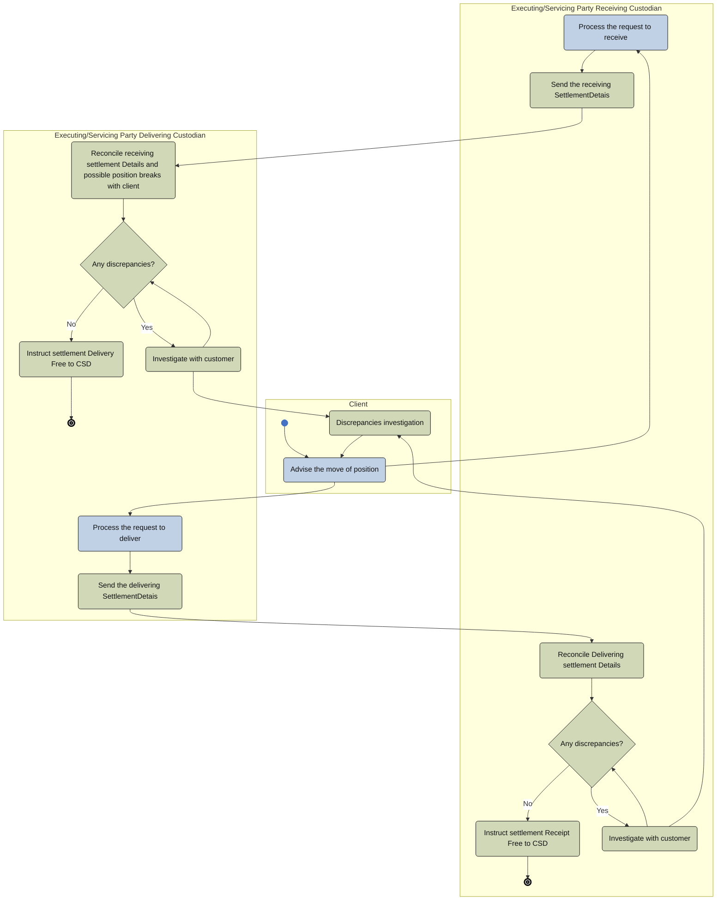

# Portfolio transfer activity

[src-000196](../../../../../../../../evidence/omitted/590a0c85882f5e6c5c9ea627.md); direct-body paragraph P312; Description of BusinessActivities / Portfolio Transfer Process; `/w:document/w:body/w:p[312]`.

[Unchanged original asset](../../../../../../../../evidence/omitted/1774d2c25d0f3df4fbb554dc.md) · [Readable original/complete vector preview](../../../../../../../../evidence/omitted/510bc3a0be86eb745246692e.md)

## Mermaid source reconstruction

## Participants and flow context

- [executing servicing party](../../../../../../../../shared/reference/participants/settlement-reconciliation-executing-servicing-party.md)
- [portfolio transfer client](../../../../../../../../shared/reference/participants/settlement-reconciliation-portfolio-transfer-client.md)
- [csd icsd](../../../../../../../../shared/reference/participants/settlement-reconciliation-csd-icsd.md)

- [portfolio transfer](../../flows/portfolio-transfer.md)

[Activity table T48 — all steps, definitions and Initiator values](../../documents/src-000196/tables/tbl-0048.md). These source responsibilities are distinct from message sender/receiver assertions.

## Semantics and limitations

- The receiving and delivering custodians are two instances of Executing/Servicing Party. The Client starts the move and participates in discrepancy investigation; it is not the unlabeled Third Party in the separate portfolio sequence.
- CSD is named in the settlement-instruction actions but is not drawn as a swimlane. Its participant reference remains linked. The original SettlementDetais spelling is retained in the two send-activity labels.

Swimlane ownership is represented by native flowchart subgraphs. Decisions retain their source labels and branch labels; start/end symbols and explicit source bars use native Mermaid shapes. The layout is reflowed without changing endpoints. Green/blue fills preserve the source’s distinction between the foreground activities and surrounding status/context activities where visible.

## Rendering and visual review

Parse/render passed using Mermaid 12.3.0 with Mermaid browser API + Chromium 156.0.8078.81. [Rendered SVG](../../../../../../../../evidence/omitted/44debec60d8591080d500fe3.md) · [Rendered PNG](../../../../../../../../evidence/omitted/0cbf1b826b7a902027580c68.md).

On 2026-11-09 (Europe/Warsaw), the original/full vector preview and the final reconstruction were directly compared for labels, role boundaries, decisions, branches, feedback paths, arrowheads/plain connections, start/end symbols and source synchronization bars. Result: **visual relationship fidelity pass**. Native layout reflows the lanes; original assets remain authoritative for pictorial layout. The machine render date is UTC 2026-11-08.

[Hash-bound review evidence](../../../../../../../../evidence/archived/095d2b4ef93d117b23cff488.md)

<!-- RENDERED-SOURCE-START -->
## Rendered source page context

[Read-only Word-rendered source PDF](../../../../../../../../evidence/omitted/aae5b215a8f3b7a6b1062885.md); file page(s) 54. The page association is established by exact original-asset SHA-256 in the Word shape inventory, not by shape ordinal. Full-page/composite visual comparison is pending unless a separate dated review is recorded.
<!-- RENDERED-SOURCE-END -->

<!-- NATIVE-EVIDENCE-START -->
## Native embedded source object

[Microsoft_Visio_2003-2010_Drawing3.vsd](../../../../../../../../evidence/omitted/1039d429c0632733f1f790b8.md)

[Native-object identity and occurrence inventory](../../documents/src-000196/native-embeddings.md). These original embedded bytes are retained unchanged. The visual reconstruction was compared with the supplied visible picture/complete vector preview. Hidden native layers or additional native pages have not been activated or checked; visual fidelity does not assert their equivalence.
<!-- NATIVE-EVIDENCE-END -->
